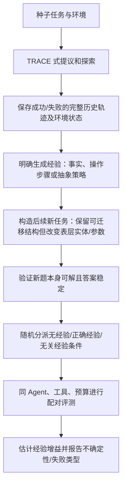

## 1. 研究目标与论文定位

本研究想用自动化 Pipeline 生成高质量、有挑战性的 Agent 任务，以测量历史经验能否帮助 Agent 完成新任务。TRACE 解决的是相邻但不同的问题：**从已有 Benchmark 种子题出发，自动演化更复杂的新任务，并为新题同时构造可审核的解题轨迹，减少题目不可解或答案错误的风险。**

### 1.1 论文版本与主要贡献

TRACE 发表于 ICLR 2026。会议论文题名为 *Towards Self-Evolving Agent Benchmarks: Validatable Agent Trajectory via Test-Time Exploration*；仓库目前为空仓库。

TRACE 的关键贡献不是“让 LLM 出难题”这么简单，而是把任务演化组织成三个角色：Evolution Proposer 提议如何改变种子任务，Exploration Executor 在工具环境中实现提议并探索出轨迹，Trajectory Validator 对轨迹进行重放和审核。最终产物是**新题 + 参考答案 + 对应轨迹**（§4、Figure 2）。

## 2. TRACE 的问题定义和总体流程

### 2.1 任务和轨迹如何表示

论文把 Agent 工作流看作 DAG：节点是决策状态，包含上下文、可用工具、动作和环境观察；边表示前一步产物被后一步使用（§3.1）。轨迹是沿 DAG 经过的状态序列，记录每步上下文、推理、动作和观察，而不仅是最终答案（§3.2）。

给定种子集合 `B0={(q, τ)}`，其中每个种子问题 `q` 与其参考轨迹 `τ` 配对，TRACE 的目标是构造演化集合 `B'`，同时满足：

1. 演化后的题目相对种子题有更高的内在难度；
2. 每个新题的对应轨迹通过可验证性检查（§3.3）。

难度不是程序直接算出的绝对量。论文用 trajectory-informed bottleneck assessment：给定种子题与新题的解题轨迹，让判断器估计在规划、推理和工具能力相近时，哪道题具有更强的内在瓶颈（例如需要更多尝试或非平凡洞见）（§3.3）。

### 2.2 端到端流程

```mermaid
flowchart TD
 A[已有 Benchmark 种子题 q 与可选参考答案/轨迹] --> B[Proposer 预探索、分析能力瓶颈]
 B --> C[提出多个语义相关的演化指令 Δ]
 C --> D[Executor 沿种子解题路径推进]
 D --> E[在中间步骤注入提议，形成探索分支]
 E --> F[Agent 使用浏览/代码等工具进行 ReAct 探索]
 F --> G[记录推理、工具动作、观察和证据 τ′]
 G --> H[根据 τ′ 逆向表述新题 q′ 和确定答案]
 H --> I[格式/安全/轨迹结构检查]
 I --> J[逐步重放工具调用]
 J --> K[全局逻辑审核、答案确定性和资源可访问性]
 K --> L[内在难度判断 + 不看轨迹的独立盲解]
 L -->|全部通过| M[接受 (q′, 答案, τ′)]
 L -->|不通过| N[在剩余重试预算内重新提议/探索；耗尽则不收录]
 N --> B
```

图中“重新提议/探索”表示 Algorithm 1 的有预算重试逻辑及论文文字所述拒收或返回再演化。论文未公开可确认代码，故无法核实各类失败对应的精细重试策略、阈值和状态恢复实现。

三阶段算法（§4、Algorithm 1）可概括为：从待处理种子中选择 `q`；最多重试 `R` 次；Proposer 产生演化提议 `Δ`；Executor 用工具执行并返回新轨迹 `τ′`；Executor 从 `τ′` 形成新问题 `q′`；Validator 判断 `(q′, τ′)`；通过才加入输出集，否则继续尝试。重试预算耗尽而未通过时，该种子不产生合格条目。

| 环节/角色 | 输入 | 主要动作 | 输出 | 由谁完成 |
|---|---|---|---|---|
| 种子准备 | 原 Benchmark 问题；可选原答案/轨迹 | 选题、提供基础任务 | 种子 `q`（及可选 `τ`） | 原 Benchmark 数据/人工或已有系统 |
| Evolution Proposer | 种子问题、可选解题路径 | 分析瓶颈，提出演化方向 | 指令集合 `Δ` | LLM Agent |
| Exploration Executor | `q`、`Δ`、工具集/环境 | 插入分支、调用工具、探索 | 执行轨迹 `τ′` 和证据 | LLM Agent + 外部工具/环境 |
| Question Formulation | `τ′` 中已验证证据与解题路径 | 反向定义问题和唯一答案 | `q′`、参考答案 | LLM Agent |
| Trajectory Validator | `q′`、`τ′`、工具环境 | 重放、逻辑审核、确定性/资源/难度检查 | accept/reject | LLM Agent + 工具重放 + 规则检查 |
| 辅助盲解器 | `q′`，不含生成轨迹 | 独立 ReAct 求解，受资源预算约束 | 是否轻易可解 | 独立 Agent |
| 评测模型 | 已冻结新题 | 独立回答新题 | Pass@1、token 等 | 被评测 Agent/LLM |

## 3. 阶段一：Evolutionary Proposal Mining

### 3.1 输入和瓶颈分析

Proposer 输入既有数据集里的原题；可以额外给潜在解题路径和答案，但论文措辞是 optional，并非每题必定带一条可靠金标准轨迹（§4.1）。它先做 bottleneck-aware pre-exploration，而非立刻对题目做同义改写：

1. 判断原题主要涉及什么能力，例如规划、推理或工具使用；
2. 分析解题轨迹中哪里最可能构成内在难点；
3. 探索原任务语义空间里可扩展的维度，如延长证据链、增加工具交互复杂度或推深推理要求；
4. 输出多条具体、祈使式的演化指令，供 Executor 后续选择实现（§4.1）。

### 3.2 演化提议的边界

论文给出的是方向性策略，不是固定模板或传统程序变异。Proposer 可以沿相关语义自由发散，甚至转向新的但仍有语义依据的情境；同时，每个提议都要以可解、答案确定、可验证为约束（§4.1）。指导方向包括更长证据链、更复杂工具交互、更专门的领域、更高推理要求。

这个区分很关键：提议只说明“要怎样尝试改变任务”，不是最终任务，也不保证改变后仍然可解。是否真正形成任务，留给 Executor 在执行中验证。

### 3.3 角色分离的意义

Proposer 的输出是抽象改造意图；Executor 才负责在具体解题进程中选择合适位置注入提议。这样可以让创意生成和可执行任务构造分开，避免直接让一个 LLM 凭空编题、编答案。不过两角色论文实验仍使用同一个后端模型，角色分离是提示/职责分离，不代表不同模型或独立机构审查（§5.1）。

## 4. 阶段二：探索、记录轨迹、由轨迹反向出题

### 4.1 Step-wise proposal injection

Executor 从种子题的解法路径出发，逐步推进。在适当的中间步骤，把一个提议具体化为新约束、替换工具，或跳到另一能力领域，从该点形成“fork in the road”。之后 Agent 可在完整工具权限下沿新分支探索，并记录 reasoning、action、observation（§4.2）。

这不是简单把原任务数值变大或重复执行更多步骤；理想的分支应该增加证据依赖、推理或工具组合难点。论文没有给出可执行的、通用的“何时注入哪个提议”算法细节，描述的是由 Agent 按步骤判断的探索流程。

### 4.2 为什么先探索再写问题

TRACE 的 Executor 不是先写一个复杂题目，再尝试求解。它先探索到一条包含具体证据和成功路径的轨迹，再根据轨迹来“定义”问题（inverse problem creation）。轨迹中的数据、约束、文献或网页信息为题面参数和参考答案提供依据；题目与其解法在构造时同步产生（§4.2、Figure 2）。

这一做法可以减少“题面看起来复杂，但答案是编的/不存在”的风险。它仍然可能发生题目文字与轨迹证据不完全匹配，所以后面还要验证题面、答案和轨迹逻辑。

### 4.3 论文中的真实示例：鱼袋问题演化

Table 4 用 GAIA 原题展示演化结果：原题问论文 *Can Hiccup Supply Enough Fish to Maintain a Dragon’s Diet?* 中计算出的鱼袋体积。TRACE 的 Round 2 示例要求：给定 5.0 m² 金属板，设计一组相同的开口圆柱容器；每个装满容器受 80 kg 搬运上限约束；所需鱼的质量/体积数据从同一论文取得；求一次最多能运的鱼总质量。这个新问题把论文证据查找与几何优化、约束计算结合起来。它是原文 Table 4 的真实例子，不是本报告自编案例。

示例也揭示了 TRACE 的挑战：新题更复杂的证据链和计算约束应能从探索轨迹找到依据。验证器需确认所引用鱼类数据、容器尺寸假设、公式和最终数值在轨迹中闭合，而不是只检查最终答案格式。

### 4.4 轨迹记录的结构作用

一条 TRACE 轨迹至少应支撑审计以下事项：

- 每一步 Agent 看到了哪些上下文/观察；
- 用了哪个工具、传入什么动作/参数；
- 环境返回了什么结果；
- 后续推理是否使用前一步产物；
- 哪些网页、数字、代码输出构成最终答案证据；
- 新题要求是否与真实执行路径一致。

论文将完整轨迹视为一等产物，而不是最终答案的附带日志（§3.2、§4）。但公开论文描述并未提供一套固定的轨迹 JSON schema，也没有开放代码供核对存储字段格式。

## 5. 阶段三：多层验证的具体机制

TRACE 不是单个“LLM judge 说题目没问题”的检查。§4.3 区分轨迹重放、全局逻辑审核、难度判断、答案确定性/资源可访问性，以及轨迹无关求解器。Figure 2 还提到 lightweight schema checks。

| 验证层 | 实际检查 | 执行方式 | 能说明什么 | 不能单独说明什么 |
|---|---|---|---|---|
| 格式/schema | 题面、答案、工具动作、轨迹记录是否结构完整 | 轻量规则检查；论文未公开具体 schema | 无明显缺字段/格式错误 | 推理正确、任务有意义 |
| 每步重放 | 逐步重跑轨迹工具调用，比较新 observation 与记录值 | Validator 调用相同/兼容工具和环境 | 所记执行路径可复现 | 所有推理判断正确；环境永久稳定 |
| 全局轨迹审核 | 审查整条轨迹的逻辑连贯性，检查证据如何推出结论 | Validator Agent | 路径内部没有明显逻辑断裂 | 逻辑审查零误差；题面完全无歧义 |
| 可解性/正确性 | 假设中间观察均可重现且推理链一致，则认为题可解且 well-posed | 依赖重放结果与逻辑审核 | 至少存在一条轨迹支持答案 | 唯一存在一条解法或不存在遗漏前提 |
| 答案确定性 | 检查最终答案是否为单一稳定值 | Validator/规则判断 | 减少开放题、模糊评分 | 开放网页之后不变 |
| 资源可访问性 | 检查引用 URL 等资源能否访问 | 工具访问检查 | 评测时证据资源当前可用 | 未来网页永远可用 |
| 内在难度判断 | 比较种子与演化题的能力瓶颈 | trajectory-informed judge | 评估新题预期难度更高 | 经验收益更可测、难度估计客观无偏 |
| 轨迹无关盲解 | 不向辅助 solver 提供生成轨迹，让它单独用 ReAct 和同等工具求解 | 独立验证 Agent，限次数/预算 | 若容易解出，题目有经验之外的简单路径 | solver 解不出就证明任务可靠/可解 |

### 5.1 逐步重放具体怎么做

Validator 对 `τ′` 中每个记录步骤重新执行工具调用，并检查实际结果是否与记录 observation 对齐。只要关键中间输出无法重现，任务所依赖的参考路径就不可靠，不应直接收录（§4.3）。外部网页或服务存在变化时，重放结果可能因时间/页面版本而变化；论文强调动态重放和资源访问性，但并未提供跨时间网页快照或版本锁定的通用实现细节。

### 5.2 全局逻辑审核和答案检查

逐步重放回答“动作有没有产生预期观察”，全局审核回答“这些观察是否真能推出题目要求的答案”。例如工具输出都复现了，但轨迹把某个单位从磅误当公斤，逐步重放可能通过，全局逻辑检查应发现单位换算错误。答案检查还要求结果唯一、可判分，避免因多个合理解释产生不同答案（§4.3）。这里逻辑审核仍是 Agent 判断，并非形式证明。

### 5.3 独立求解器如何评估是否过易

辅助 solver 不看生成轨迹，只看到新任务，可在相同工具权限下用 ReAct 独立解题。TRACE 在预算内多次尝试；若它能可靠解出，就把样本标为挑战性不足，拒绝或返工。这个设计试图避免生成器“沿自己的思路觉得难”而造成自我评估偏差（§4.3、Algorithm 1）。

但“独立”是相对于轨迹可见性与验证职责；论文实验中它仍是同一研究流水线中的 LLM Agent，且由指定辅助模型承担。solver 失败只能说明该 solver 在给定预算下没解出，并不能单独证明任务清楚、可解、答案正确。因此必须与正向轨迹重放和逻辑审核合用。

### 5.4 通过/失败与重试

Algorithm 1 为每个种子设置最大重试数 `R`。每次失败提议/探索/验证未通过后继续重试；只将通过 Validator 的 `(q′, τ′)` 加入演化集。论文正文另称对不可重现、逻辑不一致、格式不良的样本进行过滤，过易样本被拒收或送回再演化（§4.4、Algorithm 1）。未在论文中披露每类失败的阈值、重试优先级、错误原因分类、最大轮数数值及人工复核比例，不能把这些实现参数补写成确定事实。

## 6. TRACE 实验设置、结果与证据边界

### 6.1 实验设置

- **GAIA：** 比较原始 Round 0、TRACE 第一轮 Round 1、第二轮 Round 2；保留 GAIA 原有题型接口和 Level 1/2/3 标签（§5.1）。
- **AIME-2024：** 演化出更高轮次样本；报告 Round 2 和 Round 4，以检查方法是否能用于数学推理题（§5.2）。
- **演化后端：** Proposer、Executor、Multi-level Validator 统一使用 Qwen3-Coder-480B-A35B，并提供匹配工具权限；辅助 validator solver 使用 Qwen3-235B-A22B-Instruct（§5.1）。
- **评测模型：** Kimi-K2、DeepSeek-V3.1、Gemini-2.5-Flash、GPT-5-Mini；固定提示、解码、工具权限和预算，只更换被测后端（§5.1）。
- **独立评测 Agent：** GAIA 所有轮次通过 inspect_eval ReAct Agent 评测，每题最多 100 轮；它不读取生成轨迹和 Validator 结果，评测流程与生成验证分开（§5.1）。
- **指标：** GAIA 官方答案评估 Pass@1；同时测每题平均 token 数作为 test-time 计算量/推理努力的代理；AIME 表报告 10 次运行平均准确率和平均生成长度（§5.1–5.2）。

### 6.2 关键结果

GAIA Round 1/2 上，多个模型相对 Round 0 的 Pass@1 明显下降。例如 Table 1 的 Round 2 Gemini-2.5-Flash 在 Level 1 从 0.471 降至 0.040，下降 0.431；GPT-5-Mini 总体从 0.455 降至 0.218，下降 0.237。Table 2 显示演化后 GPT-5-Mini 平均答案长度从原始约 2,864.5 token 增至 Round 2 的 6,275.7；Kimi-K2 从约 3,389.6 增至 8,454.7 token。作者据此认为任务使模型更难求解且需要更多推理（§5.2.1，Tables 1–2）。

AIME-2024 Round 4 中，Qwen3-235B-A22B 平均准确率从原始 0.9400 降至 0.7167（下降 0.2233），平均生成 token 从 19,265.0 增至 27,283.2（增加 8,018.2）；Qwen3-32B 平均准确率从 0.7300 降至 0.5333（Table 3）。论文另以 Hiccup 鱼袋问题示范多步数学约束如何由种子演化（Table 4）。

### 6.3 实验能支持什么、不能支持什么

**支持的结论：** 在作者选用的模型、任务和配置上，TRACE 生成的 Round 1/2 GAIA、Round 2/4 AIME 使大部分评测模型准确率下降；部分模型生成更长答案。它支持“TRACE 能提高题目对当前测试模型的挑战性”，并展示轨迹为答案核验提供过程证据。

**尚不能推出的结论：**

1. 不能由 Pass@1 下降推出任务质量必然更高。若某些题太难、题面有偏差或模型底座过拟合演化模型，也会导致下降。
2. 没有报告有经验与无经验条件，不能说明新题更能测量历史经验的因果收益。
3. 难度 judge 的判断是否与人类专家或其他独立 solver 的一致度，论文没有给出全面的人类效度验证指标。
4. 生成与验证阶段共用 Qwen3-Coder-480B 后端，有助于控制生成配置，但也存在同模型偏差；辅助盲解模型不等于完全独立的人工金标准。
5. 对外部网页/开放环境，重放只能对应特定运行时状态；网页更新可能降低跨时间复现性。
6. 报告以准确率与 token 长度为主；并未系统报告每层验证的误杀率、漏检率、最终有效样本率、标注者一致度、生成成本等质量/效率指标。

## 7. 对“历史经验能否帮助新任务”的借鉴与改造

### 7.1 可直接借用的部分

- **从种子任务和真实执行过程出发：** 避免只凭题面想象新任务；让候选任务有可检查的成功轨迹。
- **保留完整轨迹：** 记录动作、工具返回、环境状态和证据，让后续可定位任务失败或经验使用错误。
- **逆向形成问题：** 先确定有依据的解题路径和结果，再写出恰当地要求这些证据的题目。
- **分层验证：** 将结构、可重放性、逻辑闭合、答案确定性、资源可用性、难度拆成独立关卡。
- **轨迹盲测：** 测试求解器不看生成轨迹，检测简单捷径和难度不足。

### 7.2 需要新增的经验评测逻辑

TRACE 的题目演化当前瞄准整体难度，没有“历史任务产生何种可迁移经验”这一层。若直接把轨迹提供给 Agent，至少有三种不同能力会混在一起：提炼经验、保存/检索经验、将经验应用到新情境。应先决定研究的是其中哪一项。

候选扩展流程：



每个测试任务应有经验来源 ID、前序任务成功/失败状态、预期支持步骤、经验适用条件，以及不依赖历史时可用的环境证据。正确经验不能直接泄漏最终答案，否则测到的是答案提示而非策略迁移。

### 7.3 建议的质量筛选和对照

| 条件 | Agent 得到什么 | 回答的问题 |
|---|---|---|
| 无经验 | 仅新任务和标准工具 | 当前底座能否独立解决 |
| 正确相关经验 | 过去轨迹中可迁移的事实/策略 | 历史经验是否带来增益 |
| 无关经验 | 长度/格式相近但与新任务无关的经验 | 增益是否只是更多上下文/提示效应 |
| 错误或过时经验（可选） | 故意失效的经验 | 经验冲突和过度信任带来的代价 |

要求除经验条件外固定 Agent 底座、任务、工具、预算、解码和评测顺序；同一新任务尽量在不同条件重复配对运行。主指标是正确经验与无经验的成功率差，并同时报告部分进度、答案/动作质量、成本、延迟及配对置信区间。若研究经验检索，还应单独记录证据是否被检索到；若研究策略迁移，则需要迁移任务在关键规则上相似、表层实体/环境变化，避免简单重复训练题。

### 7.4 难度不能只靠盲解器控制

TRACE 的盲解器用于排除太容易的题，但经验评测还需避免两种极端：

- **过易：** 无经验组和有经验组都成功，差异接近零，经验价值不可辨。
- **过难：** 无经验组、正确经验组、甚至 oracle 经验组都失败，无法看到经验是否足够。

因此建议开发集至少测三条曲线：无经验 baseline、正确经验条件、oracle（直接提供关键支持信息但不提供答案）条件。优先保留正确经验能带来可重复提升、且 oracle 能解决的中等难度题。阈值只在开发集上确定；最终测试任务和留出模型不参与生成器/筛选器调参。

## 8. 研究路线与待讨论问题

### 8.1 初步可行路线

1. 选一个答案可判定、环境能重放的 Agent 领域作为起点，先不同时混入开放网页、数学和代码多种环境。
2. 定义经验类型：从原始轨迹提取操作策略，还是提供已整理的经验文本；建议第一轮固定表示，避免同时研究“总结质量”和“使用能力”。
3. 准备带轨迹种子任务，用 Proposer 产生多种变化，以 Executor 形成候选新题和 gold trajectory。
4. 用程序检查结构/终态，用轨迹重放验证关键动作，用独立模型检查难度，再由人工抽查题意和参考答案。
5. 将前序轨迹或其经验表示绑定到后续任务，预先生成正确经验、无关经验和无经验条件。
6. 冻结测试集后，对多种记忆系统/Agent 做配对评测，报告经验增益、方差与失败归因。

### 8.2 尚待导师讨论

- 研究的是原始轨迹利用，还是整理策略的迁移？
- 经验是系统自主从前序任务中提炼，还是由研究者整理并提供？
- 测量在线检索、经验迁移、错误经验干扰，还是先单测其中一种？
- 第一阶段任务域选数学、代码、工具调用还是受控 Web 环境？
- 新任务演化时能否看到经验内容？若能，如何防止生成器为目标经验“量身出题”？
- 难度筛选是用目标模型表现，还是用独立留出模型？如何避免反复选题带来的选择偏差？
- 是否需要报告多轮重复、任务族聚类置信区间，以及人类对答案/题意的独立评审？

## 9. 总结

TRACE 的强项是提供一种有过程依据的 Benchmark 演化办法：先从种子任务识别瓶颈、提出改造方向，再通过工具探索形成轨迹，并基于轨迹反向定义题目；随后用重放、逻辑审核、确定性/资源检查和独立盲解筛掉有明显问题或过易的题。实验表明演化后 GAIA/AIME 题目对所测模型更难，但没有测历史经验的收益。

对本研究，建议把 TRACE 当作“候选新任务及可审计 gold 轨迹的生成/验证骨架”，额外加入经验来源和对照条件。研究价值应由正确经验相对无经验的稳定增益、无关经验控制、任务正确性和跨模型泛化共同支撑，而非 Pass@1 下降本身。TRACE 官方代码仓库当前为空，下一步若要复现，须依论文文字自行实现或联系作者核实实现状态；在提出研究结论前，还需先与导师确认经验的操作定义、环境范围和因果评测设计。

## 10. 参考文献

1. Guo, D. et al. *Towards Self-Evolving Agent Benchmarks: Validatable Agent Trajectory via Test-Time Exploration*. ICLR 2026. [ICLR Proceedings PDF](https://openreview.net/pdf?id=2H03gm4Rq6)；[arXiv v3 全文](https://arxiv.org/html/2510.00415)。问题形式化 §3；方法 §4.1–4.4、Figure 2、Algorithm 1；实验 §5、Tables 1–4。
2. 官方实现链接（论文 PDF 所列）：[titanwings/trace-benchmark-evolving](https://github.com/titanwings/trace-benchmark-evolving)。截至 2026-10-30，仓库页面显示为空。
