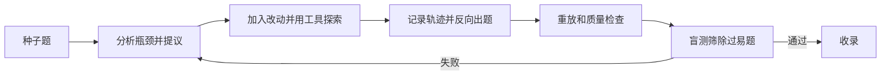
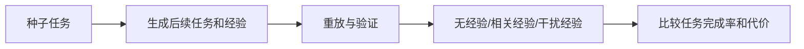

# Benchmark 自动生成与经验评测：TRACE 论文调研及研究思路

## 1. 研究目标与论文定位

本研究想用自动化 Pipeline 生成高质量、有挑战性的 Agent 任务，以测量历史经验能否帮助 Agent 完成新任务。

TRACE 研究的是如何从已有 Benchmark 的种子题出发，自动生成更复杂的新任务，并为每道新题保留可审核的解题轨迹，以便检查任务是否可解、答案是否有依据。

### 1.1 论文版本与主要贡献

TRACE 发表于 ICLR 2026。会议论文题名为 *Towards Self-Evolving Agent Benchmarks: Validatable Agent Trajectory via Test-Time Exploration*。论文所列官方仓库目前为空。

TRACE 把任务演化分为三个角色：Evolution Proposer（演化提议器） 提出种子任务的改造方向；Exploration Executor （探索执行器）在工具环境中落实提议、探索解法并记录轨迹；Trajectory Validator （轨迹验证器）重放和审核轨迹。最终产物包括**新题、参考答案和对应轨迹**。

## 2. TRACE 的问题定义和总体流程

### 2.1 任务和轨迹如何表示

作者将 Agent 工作流形式化为有向无环图（DAG）：节点表示决策状态，包括上下文、可用工具、动作和环境观察；边表示后续步骤使用了前一步的产物。轨迹是 Agent 沿图执行的状态序列，记录各步上下文、推理、动作和观察。

给定种子集合 `B0={(q, τ)}`，其中每个种子问题 `q` 与其参考轨迹 `τ` 配对，TRACE 的目标是构造演化集合 `B'`，同时满足：

1. 演化后的题目相对种子题有更高的内在难度；
2. 每个新题的对应轨迹通过可验证性检查。

论文没有用程序计算一个绝对难度分数，而是采用“基于解题轨迹的瓶颈评估”（trajectory-informed bottleneck assessment）：给判断器提供种子题和新题的解题轨迹，让它估计在规划、推理和工具能力相近的情况下，哪道题的内在瓶颈更强，例如是否需要更多尝试或非平凡的推理。

### 2.2 端到端流程

论文伪代码按种子逐题处理：每题最多尝试 `R` 次，Proposer 提议改造方向，Executor 探索并记录轨迹，再按轨迹写出新题。Validator 通过后才收录；预算用尽仍未通过的题目丢弃。官方仓库目前为空，失败分类和具体重试参数无法从代码核实。

## 3. 阶段一：Evolutionary Proposal Mining

### 3.1 输入和瓶颈分析

Proposer 以已有数据集中的原题为输入，也可以获得潜在解题路径和答案；论文说明这部分信息是可选的，并未要求每道种子题都附有可靠的标准轨迹。Proposer 会先进行“面向瓶颈的初步探索”（bottleneck-aware pre-exploration），分析题目考查的能力和解题难点：

1. 判断原题主要涉及什么能力，例如规划、推理或工具使用；
2. 分析解题轨迹中哪里最可能构成内在难点；
3. 探索原任务语义空间里可扩展的维度，如延长证据链、增加工具交互复杂度或推深推理要求；
4. 输出多条具体、祈使式的演化指令，供 Executor 后续选择实现。

### 3.2 演化提议的边界

Proposer 根据方向性策略生成方案，不采用固定改写模板或程序化参数变异。它可以沿种子题语义延展，也可以转向相关的新情境；提议必须仍然可解，并能得到确定、可核验的答案。论文列出的改造方向包括延长证据链、增加工具交互、引入专业领域和提高推理要求。

提议只描述改造方向，并不等于已生成的新题。Executor 需要实际执行，确认改动后仍有可行路径。

### 3.3 角色分离的意义

Proposer 负责提出改造方向，Executor 负责选择具体步骤并用工具完成探索。实验中两个角色使用同一个模型后端，这是提示和职责上的区分，实验没有使用两个独立模型交叉审查。

## 4. 阶段二：探索、记录轨迹、由轨迹反向出题

### 4.1 在解题过程中落实演化提议

Executor 沿种子题的解题路径逐步推进，并在合适的中间步骤落实一项提议，例如加入新约束、替换工具，或把问题引向另一个能力领域。这个改动形成新的探索分支；Agent 随后使用工具继续执行，并记录推理、动作和环境观察。

改造应增加证据依赖、推理要求或工具组合的复杂度。论文没有给出通用算法来决定注入位置和提议类型；Executor 根据当前解题路径选择具体步骤。

### 4.2 为什么先探索再写问题

Executor 先探索出一条成功轨迹，再根据轨迹反向写出新问题，这一过程称为逆向问题构造（inverse problem creation）。轨迹中收集的数据、约束、文献或网页内容为题面和参考答案提供依据。

这种顺序能让新题建立在实际观察到的证据和可行路径上，但题面仍可能误述证据或遗漏条件，因此还需检查题目、答案和轨迹是否一致。

### 4.3 论文中的真实示例：鱼袋问题演化

论文给出了一个真实演化案例。GAIA 原题询问论文 *Can Hiccup Supply Enough Fish to Maintain a Dragon’s Diet?* 中计算出的鱼袋体积。TRACE 的 Round 2 版本要求根据该论文中的鱼类质量和体积数据，利用 5.0 m² 金属板设计相同的开口圆柱容器；每个装满的容器不得超过 80 kg，再计算一次最多能运输的鱼总质量。新题把文献检索、几何优化和重量约束组合在一起。

这个例子中，鱼类数据、圆柱容器的几何关系、金属板面积和搬运重量限制都必须在轨迹中有依据，最终计算也要能从这些条件推出。验证不能只看答案格式，还要核对这些证据和计算是否连贯。

### 4.4 轨迹记录的结构作用

轨迹需保留上下文、工具调用及参数、环境观察和支撑答案的证据，便于重放并检查推理是否使用了正确结果。论文没有规定统一的轨迹 JSON 格式；官方仓库目前为空，无法核对具体字段。

## 5. 阶段三：多层验证的具体机制

验证器检查结构、轨迹、逻辑、答案和难度，并用盲测求解器排除过易任务。论文没有公开具体提示词或判定阈值，以下按正文说明归纳。

1. **结构检查：** 轻量检查题面、答案和轨迹记录格式是否完整。它能发现缺字段或格式错误，不能判断推理是否正确。
2. **逐步重放：** 重新执行轨迹里的工具调用，并将返回结果与记录的 observation 比较。通过表示该条路径在当前环境中可复现，不表示所有推理都正确，也不保证环境以后不变。
3. **全局逻辑审核：** 检查整条推理链是否连贯、观察结果是否支持最终结论。审核由 Agent 完成，并非形式化证明。
4. **答案与资源检查：** 检查答案是否确定、可稳定评分，并确认引用资源（如 URL）可访问。这能降低歧义和死链风险，不能保证网页内容长期不变。
5. **难度判断：** 根据种子题和新题的轨迹，估计新题是否引入更强的内在瓶颈。该判断由模型完成，不能视为绝对难度分数。
6. **轨迹盲测：** 另一个 solver 不看生成轨迹，只拿到新题和同等工具权限，通过 ReAct 独立求解。若它在限定预算内稳定解出，样本就被认为过易，拒收或返工。solver 未解出不等于题目必然正确、清楚或可解。

### 5.1 独立求解器如何评估是否过易

实验使用 Qwen3-235B-A22B-Instruct 作为辅助 validator。它与生成器使用不同后端，但仍是模型判断；求解器未能解出，不能单独证明题目正确或可解。

### 5.2 通过/失败与重试

论文说明，不可重现、逻辑不一致或格式有误的样本会被过滤；过易样本会被拒收或送回再演化。文中没有报告各类失败的具体阈值、重试优先级、`R` 的实验取值或人工复核比例。

## 6. TRACE 实验设置、结果与证据边界

### 6.1 实验设置

- **GAIA：** 比较原始 Round 0、TRACE 第一轮 Round 1、第二轮 Round 2；保留 GAIA 原有题型接口和 Level 1/2/3 标签。
- **AIME-2024：** 演化出更高轮次样本；报告 Round 2 和 Round 4，以检查方法是否能用于数学推理题。
- **演化后端：** Proposer、Executor、Multi-level Validator 统一使用 Qwen3-Coder-480B-A35B，并提供匹配工具权限；辅助 validator solver 使用 Qwen3-235B-A22B-Instruct。
- **评测模型：** Kimi-K2、DeepSeek-V3.1、Gemini-2.5-Flash、GPT-5-Mini；固定提示、解码、工具权限和预算，只更换被测后端。
- **独立评测 Agent：** GAIA 所有轮次通过 inspect_eval ReAct Agent 评测，每题最多 100 轮；它不读取生成轨迹和 Validator 结果，评测流程与生成验证分开。
- **指标：** GAIA 官方答案评估 Pass@1；同时测每题平均生成 token 数作为测试时计算量和推理长度的近似指标；AIME 表报告 10 次运行平均准确率和平均生成长度。

### 6.2 关键结果

GAIA Round 1/2 上，多个模型相对 Round 0 的 Pass@1 明显下降。例如，Round 2 的 Gemini-2.5-Flash 在 Level 1 从 0.471 降至 0.040，下降 0.431；GPT-5-Mini 总体从 0.455 降至 0.218，下降 0.237。演化后 GPT-5-Mini 平均答案长度从原始约 2,864.5 token 增至 Round 2 的 6,275.7；Kimi-K2 从约 3,389.6 增至 8,454.7 token。作者据此认为任务使模型更难求解且需要更多推理。

AIME-2024 Round 4 中，Qwen3-235B-A22B 平均准确率从原始 0.9400 降至 0.7167（下降 0.2233），平均生成 token 从 19,265.0 增至 27,283.2（增加 8,018.2）；Qwen3-32B 平均准确率从 0.7300 降至 0.5333。论文另以 Hiccup 鱼袋问题示范多步数学约束如何由种子演化。

### 6.3 结果的解释范围

在论文使用的模型和设置下，演化后的 GAIA 与 AIME 任务使多数被测模型准确率下降，部分模型的答案长度也增加。这支持 TRACE 能生成对这些模型更难的任务，并说明记录轨迹可为答案审核提供过程证据。

这些结果还不能证明：

1. Pass@1 下降不等于任务质量更高。若某些题太难、题面有偏差或模型底座过拟合演化模型，也会导致下降。
2. 没有报告有经验与无经验条件，不能说明新题更能测量历史经验的因果收益。
3. 论文没有报告难度判断与人类专家或独立 solver 的一致性评估。
4. 生成与验证阶段共用 Qwen3-Coder-480B 后端，有助于控制生成配置，但也存在同模型偏差；辅助盲解模型不等于完全独立的人工金标准。
5. 对外部网页/开放环境，重放只能对应特定运行时状态；网页更新可能降低跨时间复现性。
6. 报告以准确率与生成 token 数为主；并未系统报告每层验证的误杀率、漏检率、最终有效样本率、标注者一致度、生成成本等质量/效率指标。

## 7. 对“历史经验能否帮助新任务”的借鉴与改造

### 7.1 可借鉴的部分

TRACE 提供三项可借鉴做法：沿解题轨迹演化任务、根据可执行轨迹反向写题、用重放和盲测筛查正确性与难度。经验评测还需另行加入跨任务经验来源和有无经验的对照。

### 7.2 需要新增的经验评测逻辑

TRACE 的题目演化当前瞄准整体难度，没有“历史任务产生何种可迁移经验”这一层。若直接把轨迹提供给 Agent，至少有三种不同能力会混在一起：提炼经验、保存/检索经验、将经验应用到新情境。应先决定研究的是其中哪一项。

候选扩展流程：

为每个任务记录经验来源、前序任务状态和适用条件，并保留不依赖历史也能检查的环境证据。正确经验不能直接包含最终答案，否则测到的是答案提示，而不是经验迁移。

### 7.3 建议的质量筛选和对照

| 条件 | Agent 得到什么 | 回答的问题 |
|---|---|---|
| 无经验 | 仅新任务和标准工具 | 当前底座能否独立解决 |
| 正确相关经验 | 过去轨迹中可迁移的事实/策略 | 历史经验是否带来增益 |
| 无关经验 | 长度/格式相近但与新任务无关的经验 | 增益是否只是更多上下文/提示效应 |
| 错误或过时经验（可选） | 故意失效的经验 | 经验冲突和过度信任带来的代价 |

各条件固定 Agent、任务、工具和预算，对同一任务配对运行。主指标比较正确经验与无经验的成功率，同时报告部分进度、成本和置信区间。若研究检索或策略迁移，再分别记录证据命中率和跨任务泛化表现。

### 7.4 难度不能只靠盲解器控制

TRACE 的盲解器用于排除太容易的题，但经验评测还需避免两种极端：

- **过易：** 无经验组和有经验组都成功，差异接近零，经验价值不可辨。
- **过难：** 无经验组、正确经验组、甚至 oracle 经验组都失败，无法看到经验是否足够。

因此建议开发集至少测三条曲线：无经验 baseline、正确经验条件、oracle（直接提供关键支持信息但不提供答案）条件。优先保留正确经验能带来可重复提升、且 oracle 能解决的中等难度题。阈值只在开发集上确定；最终测试任务和留出模型不参与生成器/筛选器调参。

## 8. 研究路线与待讨论问题

### 8.1 初步路线

先选一个可重放、答案可判定的任务环境，并固定一种经验表示。使用 TRACE 思路生成新任务和参考轨迹，再设置无经验、相关经验和无关经验条件进行配对评测。最后冻结测试集，在未参与生成的 Agent 上复核增益。

### 8.2 尚待导师讨论

- 研究的是原始轨迹利用，还是整理策略的迁移？
- 经验是系统自主从前序任务中提炼，还是由研究者整理并提供？
- 测量在线检索、经验迁移、错误经验干扰，还是先单测其中一种？
- 第一阶段任务域选数学、代码、工具调用还是受控 Web 环境？
- 新任务演化时能否看到经验内容？若能，如何防止生成器为目标经验“量身出题”？
- 难度筛选是用目标模型表现，还是用独立留出模型？如何避免反复选题带来的选择偏差？
- 是否需要报告多轮重复、任务族聚类置信区间，以及人类对答案/题意的独立评审？

## 9. 总结

TRACE 从种子题提出演化方向，用工具探索得到轨迹，再根据轨迹写出新题，并通过重放、逻辑审核和盲测筛选。实验表明，演化题降低了多数被测模型在 GAIA/AIME 上的准确率；论文没有测试历史经验是否带来增益。

本研究可复用它的任务生成和验证流程，但需要另设经验来源与对照组。评测重点应是正确经验相对无经验的稳定增益，并检查无关经验是否只增加上下文负担。官方代码仓库目前为空，复现需按论文描述实现或向作者核实代码状态。

## 10. 参考文献

1. Guo, D. et al. *Towards Self-Evolving Agent Benchmarks: Validatable Agent Trajectory via Test-Time Exploration*. ICLR 2026. [ICLR Proceedings PDF](https://openreview.net/pdf?id=2H03gm4Rq6)；[arXiv v3 全文](https://arxiv.org/html/2510.00415)。
2. 官方实现链接（论文 PDF 所列）：[titanwings/trace-benchmark-evolving](https://github.com/titanwings/trace-benchmark-evolving)。截至 2026-10-30，仓库页面显示为空。
