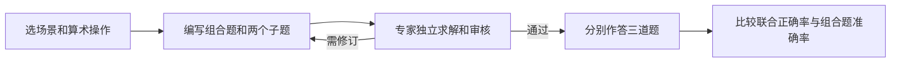

# Benchmark 自动生成与经验评测：AgentCoMa 论文调研及研究思路

## 1. 研究目标与论文定位

本研究想用自动化 Pipeline 生成 Agent 任务，测量历史经验能否帮助 Agent 完成新任务。AgentCoMa 关注其中一个问题：模型能分别完成两个推理步骤时，能否把它们接起来完成整题？

### 1.1 论文版本与主要贡献

AgentCoMa 发表于 ACL 2026。论文名为 *AgentCoMa: A Compositional Benchmark Mixing Commonsense and Mathematical Reasoning in Real-World Scenarios*。作者公开了代码，并提供数据获取入口。 [论文](https://aclanthology.org/2026.acl-long.380/) · [项目主页](https://agentcoma.github.io/)

AgentCoMa 把同一道任务拆成一道组合题和两道子题，用来区分单步能力不足与组合失败。题目以真实 Agent 场景为背景，评测采用文本问答。

## 2. AgentCoMa 的问题定义和总体流程

### 2.1 组合题如何表示

每题有两个相依步骤：先用常识从候选项中选出对象，再对选中对象的数量或属性做一次算术运算。数学步骤用到哪些数据，由常识步骤决定。

每个样本有三道题及对应金标。**组合题**给出完整情境，要求完成选择和计算。**常识子题**只问应选哪些对象。**数学子题**直接给出正确对象，只要求计算。

### 2.2 端到端流程

## 3. 阶段一：设定场景和出题约束

作者让专家手工出题，覆盖家务、网购、科学实验、智能助手和旅行规划。常识部分要确实需要日常知识，且有明确的选择标准。数学部分限定为一次加、减、乘或除，使复杂计算尽量少干扰对组合能力的测量。

论文初步试验发现，给 GPT-4o 提供示例后，仍难稳定写出符合约束的题。若借鉴其设计做自动生成，建议把约束写进收录检查，例如改动正确选项后，检查最终数值是否也随之变化。

## 4. 阶段二：派生子题与中间答案

### 4.1 论文中的真实示例：车库工具归类

组合题列出 1 把电钻、6 把锤子、3 根延长线、1 台吹叶机和 7 把螺丝刀，问共有多少件电气用品应放入防风雨柜。

常识子题只问应放入哪些工具，答案是电钻、延长线和吹叶机。数学子题直接给出这三类工具，要求计算 1 + 3 + 1，答案是 5。数学子题因此可以独立测量下游计算能力。 [原文图 2](https://aclanthology.org/2026.acl-long.380.pdf#page=4)

### 4.2 如何定位组合失败

若同一个模型能答对两道子题，却答错组合题，就可以回看它在完整题中是否选错对象、把无关数量带入计算，或算错最终结果。子题结果提供定位线索，完整题的具体失误仍要看模型输出。

## 5. 阶段三：人工验证与评分

其他专家检查任务是否有现实用途、常识判断是否必要、题目是否满足“先选择、再运算”，再独立求解并标记歧义。审核未通过或解答与金标不一致时，修改后重新验证。最终收录 260 个样本，开发集 80 个、测试集 180 个。各集合按场景和算术类型平衡。

数字题提取最终数字，与金标精确匹配。常识题由 GPT-4o 对照参考答案评分，论文对 200 条回答的人工核查显示，两种评分的一致准确率为 94%。

## 6. AgentCoMa 实验设置、结果与证据边界

### 6.1 实验设置

主实验评测 61 个开放权重模型，使用两个示例的 CoT 提示和贪心解码。正文展示其中 16 个代表模型，并用 45 名非专家做了人类对照。同一样本的三道题分给不同的人。

### 6.2 关键结果

组合差距按同一样本配对计算，即“两道子题都答对的比例 − 组合题准确率”。

| 对象 | 两子题均答对 | 组合题答对 |
| --- | ---: | ---: |
| 正文 16 个模型均值 | 约 80% | 约 51% |
| Llama 3.1 8B IT | 68.3% | 33.3% |
| Llama 3.3 70B IT | 90.0% | 73.3% |
| 非专家人类 | 78.9% | 82.8% |

代表模型的平均组合差距约 29 个百分点。组合题答错时，约 74% 的样本在两道子题上都能独立答对。作为参照，Bamboogle 的联合正确率与组合题准确率约为 53% 和 52%，MultiArith 的平均差距小于 1 个百分点。 [原文 §5，表 2、图 4–5](https://aclanthology.org/2026.acl-long.380.pdf#page=6)

### 6.3 结果的解释范围

给常识子题加上无关数字后，模型表现有所下降，幅度小于完整组合题的落差。作者还用训练分布相似度、注意力和神经元归因解释这一差距，这些分析提供的是机制线索。主实验采用固定的两步顺序，向长轨迹或真实工具任务推广需要额外实验。

## 7. 对“历史经验能否帮助新任务”的借鉴与改造

### 7.1 可借鉴的部分

从 [[TRACE]] 的验证轨迹中挑一个会影响后续执行的中间节点，例如选出符合条件的对象。围绕它派生完整任务、独立决策子题和给定正确决策的后续任务。这三道题共同记录决策金标和最终状态。

### 7.2 需要新增的经验评测逻辑

在同一批完整任务上比较无经验、相关经验和长度相近的无关经验。另加一组直接给出正确中间产物的 oracle 条件，检查后续步骤是否仍然卡住。固定底座、工具与预算，同时报告中间决策正确率和最终成功率。

若相关经验提高了中间决策正确率，但整题成功率没有变化，就检查 Agent 是否把正确结果用于后续动作。若 oracle 也经常失败，应先排查下游任务难度。筛选阈值在开发集确定，最终测试用留出的任务族。

## 8. 总结

AgentCoMa 用同题的组合题和子题测量组合差距。对经验评测而言，这种设计可以追踪经验是否改善了关键决策，以及改善能否传到最终任务结果。
