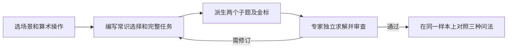

# Benchmark 自动生成与经验评测：AgentCoMa 论文调研及研究思路

## 1. 研究目标与论文定位

本研究想通过自动生成可验证的 Agent 任务，测量历史经验能否帮助 Agent 完成新任务。[[TRACE]] 给出从种子题演化并验证轨迹的方法。AgentCoMa 提供了一个可放进这条流程的诊断思路：在同一道任务上，分别测各个环节能否单独完成，以及 Agent 能否把前一步产物用到后一步。

论文名为 *AgentCoMa: A Compositional Benchmark Mixing Commonsense and Mathematical Reasoning in Real-World Scenarios*，由 Lisa Alazraki 等人撰写。AgentCoMa 是 Agentic Commonsense and Math 的缩写。题目以真实 Agent 应用为背景，实验测的是文本问答中的混合推理能力。论文的数据由专家手工编写。数据、代码和榜单入口见项目主页。 [项目主页](https://agentcoma.github.io/)

**发表信息** · ACL 2026（第 64 届计算语言学协会年会），主会长论文，第 8383–8410 页。 [ACL Anthology](https://aclanthology.org/2026.acl-long.380/)

## 2. 问题定义与样本结构

### 2.1 常识选择如何连接到数学

每题先根据题面外的日常知识从若干选项中挑出合适对象，再用这些对象的数量或属性做一次基本算术运算。两个环节存在依赖：选择结果决定数学步骤应使用哪些输入。题目覆盖家务、网购、科学实验、智能助手、旅行规划五个场景，四种运算是加、减、乘、除。 [原文 §3.1、§3.4，图 1](https://aclanthology.org/2026.acl-long.380.pdf#page=3)

| 同一样本的三个问题 | 给模型什么 | 要求输出什么 |
| --- | --- | --- |
| 组合题（Composition） | 完整情境、候选项、约束和数值 | 执行常识选择后算出最终答案 |
| 常识子题（Commonsense） | 同一情境与候选项，通常省去计算所需数字 | 给出正确对象 |
| 数学子题（Math） | 同一计算情境，并在题面明确给出正确对象 | 根据这些对象计算 |

数学子题提供金标中间结果，相当于把选择环节设为正确。常识子题和数学子题分别作答，模型答错常识子题也不会影响数学子题的输入。这样可以独立测两项能力，再用组合题观察它们是否能接起来。 [原文 §3.2，图 2](https://aclanthology.org/2026.acl-long.380.pdf#page=4)

### 2.2 论文示例：车库里的电气用品

图 2 给出的候选项是 1 把电钻、6 把锤子、3 根延长线、1 台吹叶机、7 把螺丝刀。组合题询问有多少件电气用品应放入防风雨柜。常识子题只问哪些东西应该放进去，答案是电钻、延长线、吹叶机。数学子题直接给出这三类对象，答案为 1 + 3 + 1 = 5 件。

如果模型能正确列出这三类对象，也能在给定它们时算出 5，但完整任务答错，就得到一条很具体的诊断信号：这道题的两个子能力在独立测试中都可用，完整题里的错误还要结合输出检查是选错、用了无关数值，还是计算或提取出错。 [原文图 2、附录 L.2](https://aclanthology.org/2026.acl-long.380.pdf#page=4)

## 3. 数据构造与审核

### 3.1 如何约束出题

专家按场景和运算类型编写三联题及标准答案。常识步骤要求确实存在选择，并需要日常知识。数学步骤只做一次运算，减少计算难度掩盖组合问题的可能。作者还尝试用 GPT-4o 出题，初步结果显示，即使给示例也难以稳定满足任务设计要求。 [原文 §3.1，附录 B、H](https://aclanthology.org/2026.acl-long.380.pdf#page=3)

### 3.2 审核和数据划分

审核检查真实场景用途、常识是否必要、是否遵循先选择再运算。其他专家独立求解并标记歧义，答案不符或审核项未通过就修订、重写并重新验证。五名专家分工参与审核。最终有 260 个三联样本，开发集 80、测试集 180。两个集合都平衡五个场景，每个场景内又平衡四种算术运算。论文没有提供训练集。 [原文 §3.3–3.4，表 1](https://aclanthology.org/2026.acl-long.380.pdf#page=4)

## 4. 评测协议与组合差距

### 4.1 模型、提示和评分

主实验覆盖 61 个开放权重模型，包括指令模型、经 SFT 优化的推理模型和经 RL 优化的推理模型。正文展示 16 个代表模型，完整测试结果见附录 A。模型使用两个示例的 few-shot CoT 提示与贪心解码。数字题提取最终数字后与金标精确匹配，常识题由 GPT-4o 对照参考答案判等。作者抽查 200 条常识题回答，模型评分与专家标签的一致准确率为 94%。另有 45 名非专家完成测试集的人类实验，同一样本的三个问题分给不同的人。 [原文 §4，表 2，附录 A、G、I](https://aclanthology.org/2026.acl-long.380.pdf#page=5)

### 4.2 如何计算组合差距

先按样本 ID 对齐两道子题，计算同一个模型在两道子题上都答对的比例 `Both correct`。组合差距等于该比例减去完整题准确率 `Comp.`，单位是百分点。联合正确率直接从配对结果计数，两道子题的正确率相乘会隐含错误相互独立的假设。

另一个诊断是只看组合答错的样本，统计其中多少题的两个子题都答对。该比例的分母是组合失败题，适合回答“完整题的错误有多少发生在子步骤都能独立完成的情况下”。 [原文 §5，表 2，图 4–5](https://aclanthology.org/2026.acl-long.380.pdf#page=6)

## 5. 关键结果与证据边界

| 对象 | 两子题均正确 | 组合题正确 | 组合差距 |
| --- | ---: | ---: | ---: |
| 正文 16 个模型均值（约） | 80% | 51% | 29 个百分点 |
| Llama 3.1 8B IT | 68.3% | 33.3% | 35.0 个百分点 |
| Llama 3.3 70B IT | 90.0% | 73.3% | 16.7 个百分点 |
| SimpleRL 32B | 93.9% | 66.7% | 27.2 个百分点 |
| 非专家人类 | 78.9% | 82.8% | −3.9 个百分点 |

论文另报告 61 个模型的中位数：单项均超过 85%，两项独立均正确接近 75%，完整题约 42%。正文图 5 对代表模型的组合失败做分解，约 74% 的失败发生在两个子题都独立答对的情况下。Bamboogle 的同类比较约为 53% 对 52%，MultiArith 的平均差距小于 1 个百分点。跨数据集题面和任务形式也存在差异，因此这些对比给出诊断基线，混合推理类型的效应仍需要进一步用严格配对题目验证。人类结果的联合正确率来自不同答题者的组合，不能作为个人级的组合增益。 [原文 §1、§5–5.1，表 2，图 4–5](https://aclanthology.org/2026.acl-long.380.pdf#page=6)

### 5.1 作者如何探查失败来源

- **上下文长度。** 给常识子题加上计算会用到的数字，使长度接近完整题。额外数字让部分模型的表现下降，但下降幅度小于组合题的总体落差。 [原文 §6.1，图 6](https://aclanthology.org/2026.acl-long.380.pdf#page=7)
- **训练分布。** 组合题的 Min-K%++ 得分更低，表明文本模式对模型更不熟悉。这个分数反映可预测性，训练集中实际出现了哪些样本无法由此确定。 [原文 §6.2，图 7](https://aclanthology.org/2026.acl-long.380.pdf#page=8)
- **注意力与神经元。** 作者在 Llama 3.1 8B Instruct 上发现组合题回看输入的注意力比例略低。QRNCA 在该模型和 GeneralReasoner 4B 上估计出组合题与数学子题的神经元重叠率为 39%、54%，与常识子题为 3%、10%。这是有限模型上的归因证据，尚不足以确定失误由某组神经元造成。 [原文 §6.3–6.4，表 3，图 8–9](https://aclanthology.org/2026.acl-long.380.pdf#page=8)

### 5.2 结果能用到哪里

主设置固定为常识在前、数学在后，只有两步且算术简单。论文附录 N 对反向顺序做了小规模探索。把结论扩展到更长轨迹、开放环境、工具调用或跨任务经验，需要对应的任务和实验。 [原文 Limitations、附录 N](https://aclanthology.org/2026.acl-long.380.pdf#page=10)

## 6. 对“历史经验能否帮助新任务”的借鉴与改造

### 6.1 为生成轨迹标出可评测的中间产物

对每条 [[TRACE]] 式新任务，沿验证通过的轨迹挑一个会影响后续执行的中间节点，例如根据先验条件挑出适用对象、识别工具调用的前置状态。围绕这个节点派生三道题：完整任务、只考查该决策的子题、给定正确决策后继续执行的子题。三者共享实体和评分逻辑，记录中间决策的金标与下游最终状态。

可以用静态库存的例子先验证生成器。历史任务产出“冷藏商品排除在常温库存外”的规则，目标任务换一批商品和数量。完整题要求选商品再算总数，选择子题只判入库对象，后续子题直接提供正确对象再计数。再把同一结构扩到真实工具任务，例如用选出的对象执行操作并检查最终状态。

### 6.2 将经验效果和组合能力放到同一组配对实验

| 完整任务条件 | 输入差异 | 可解释的观测 |
| --- | --- | --- |
| 无经验 | 题面和标准工具 | 完整任务基线 |
| 相关经验 | 增加历史任务提炼的判断规则 | 经验是否改善对象选择或最终成功率 |
| 无关经验 | 增加长度和格式相近的无关规则 | 控制额外上下文的影响 |
| 中间产物 oracle | 提供当前题正确选择，保留下游步骤 | 判断环节解决后，下游是否仍构成瓶颈 |

四组对同一批任务配对，固定底座、工具和执行预算。主要比较“相关经验 − 无经验”的完整任务成功率，同时看中间决策正确率及“两个环节均能独立完成、完整任务却失败”的比例。相关经验若只提高选择准确率而未改善完成率，就检查 Agent 是否实际把选出的对象传给了下游。筛选任务时还应检查把关键对象换掉后最终答案是否随之改变，防止表面上有两步、实际跳过选择也能答对。先在开发集定筛选规则，再用分开的任务族验证。

## 7. 总结

AgentCoMa 最适合为新 Benchmark 提供逐样本的能力诊断。完整题和子题共享同一个推理依赖，因此能看到独立步骤的可解性与端到端表现之间的落差。加入历史经验对照后，还可以追踪提升来自关键决策变准，还是来自 Agent 更会把决策结果用于后续动作。
