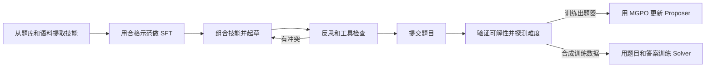

# Benchmark 自动生成与经验评测：Agentic Proposing 论文调研及研究思路

## 1. 研究目标与论文定位

本研究想自动生成可验证、有挑战性的 Agent 任务。Agentic Proposing 研究如何把出题方法做成可组合的技能，由出题器反复起草、检查和修订，再用下游模型的训练效果验证数据质量。

### 1.1 论文版本与主要贡献

Agentic Proposing 发表于 ICML 2026。论文名为 *Agentic Proposing: Enhancing Large Language Model Reasoning via Compositional Skill Synthesis*。官方仓库已发布初版代码。 [正式论文](https://proceedings.mlr.press/v306/jiao26f.html) · [官方仓库](https://github.com/Frostlinx/Agentic-Proposing)

论文的主要贡献包括构建出题技能库、训练可使用工具的 Proposer，以及用多粒度策略优化（MGPO）同时利用终局质量与过程反馈。

## 2. Agentic Proposing 的问题定义和总体流程

### 2.1 题目与技能如何表示

作者把出题建模为部分可观测的决策过程。题目是否一致、难度如何，需要通过检查和求解估计。Proposer 根据当前技能、交互历史和出题阶段采取行动，可以反思、在沙箱运行代码、移除不合适的技能，或提交题目。

一个出题技能包含推理意图、构造方法、难度效应和工具提示。例如，在题目中加入一个可用符号计算核验的数学约束。

### 2.2 端到端流程

## 3. 阶段一：技能获取与出题器冷启动

教师模型从已有题库和文本语料提取技能，打分后筛选入库。技能模块保留构造骨架、操作步骤、预期结果与验证工具。多个模块在起草时组合，若一个模块会引入逻辑矛盾，出题器可以把它从当前技能集合移除。

教师还生成包含反思、工具调用和技能裁剪的出题示范。只有最终题目验证通过的示范进入监督微调（SFT）。这个阶段得到的模型作为后续强化学习的参考策略。

## 4. 阶段二：组合、检查和修订题目

### 4.1 从起草到提交

Proposer 按“起草 → 检查 → 修订 → 提交”推进，发现矛盾时可以回到前面的阶段。工具用来检验可形式化的局部约束，整道题仍需验证题意和解法是否成立。

### 4.2 论文中的真实示例：数列极限题修订

一份草稿想让相邻项差的极限为正，但给函数加上了初值为零及 `|f'(t)| ≤ |f(t)|` 的约束，由此可推出函数恒为零。Proposer 发现冲突后，把题目改成证明极限为零，再用符号计算检查其中的根理想条件。

这展示了反思和工具如何帮助修订。对 Benchmark 设计还要多查一步：该例仅凭函数恒为零已能推出极限，根理想部分可以独立求解。若要考组合推理，需检查每项声称必需的技能是否真正影响解法。 [附件预印本图 5](https://arxiv.org/pdf/2602.03279v1#page=20)

## 5. 阶段三：有效性验证、难度探测与策略优化

### 5.1 Verifier 和 Prober 如何分工

Verifier 由三个模型组成，读取题面和出题轨迹，分别求解、投票并说明理由，再选一位复审。接受样本需核对题目是否明确、是否有完整解法以及答案是否一致。Prober 只看题面，在固定设置下独立尝试 16 次，用求解结果估计难度。

有效题有基础奖励。按论文公式，探测至少有成功信号时才给难度奖励，成功率越低，难度奖励越高。论文另外对成功的工具执行和连贯反思给过程奖励。技能课程根据各类别的验证通过率提高薄弱类别的采样频率。

### 5.2 MGPO 如何使用过程反馈

MGPO 在轨迹组里比较最终题目的奖励，在同一认知阶段内比较局部过程奖励，再融合两种信号更新 Proposer。这样，是否完成了有效出题和某一步检查做得如何，都能影响训练。下游 Solver 则采用 GRPO，只用最终的题目和答案训练。

## 6. Agentic Proposing 实验设置、结果与证据边界

### 6.1 实验设置

下游对照使用相同训练配方，数据量固定为 10,000 或 11,000 个样本。数学基准使用 Mean@64，即每题采样 64 个解答后平均计分。LiveCodeBench 使用 Best-of-5，五个候选有一个通过官方测试即算成功。

### 6.2 关键结果

| 下游设置 | 基础模型 | 合成数据训练后 |
| --- | ---: | ---: |
| 4B，10,000 道数学题，四个数学基准平均 | 34.2% | 38.3% |
| 30B-A3B，11,000 道数学和编程混合题，AIME 2025 | 85.0% | 91.6% |
| 同一 30B-A3B 设置，LiveCodeBench v6 | 66.0% | 71.2% |

论文消融中，加入技能库和迭代出题流程，均改善了下游成绩。完整 MGPO 在表内的对照结果也优于只使用轨迹级奖励的配置。 [附件预印本表 1–2、表 4–6](https://arxiv.org/pdf/2602.03279v1#page=8)

### 6.3 结果的解释范围

实验支持这些合成问答在给定训练配置下能提高 Solver 的基准成绩。出题器用到的反思和工具轨迹主要用于出题与验证。若要衡量测试时给 Agent 提供历史经验的效果，需要另做有无经验对照。固定训练样本量也只控制了下游数据预算，教师模型、工具和验证采样的生成成本应单独统计。

## 7. 对“历史经验能否帮助新任务”的借鉴与改造

### 7.1 可借鉴的部分

可将 [[TRACE]] 中的演化提议组织成可复用的构造模块。每个模块记录适用条件、需要的证据和可检查结果。生成器选取模块并记录实际执行轨迹，验证器再检查答案、可解性和模块依赖。对于多个模块组成的新题，可借鉴 [[AgentCoMa]] 派生子题，检查中间结果能否影响后续步骤。

### 7.2 需要新增的经验评测逻辑

出题侧固定种子和生成预算，比较使用技能库前后的可验证题比例和单题生成成本。测试侧固定新题、Agent 和工具预算，比较无经验、相关经验和无关经验，报告最终成功率与关键中间决策。开发集可加 oracle 经验组排查题目过难，测试集则保留独立任务族。

## 8. 总结

Agentic Proposing 提供了用技能模块组织出题、用反思和工具修正草稿、用验证和盲解控制质量的流程。将它用于经验评测时，出题阶段检验生成质量，测试阶段再测历史经验对新任务的增益。
