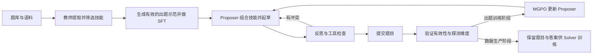

# Benchmark 自动生成与经验评测：Agentic Proposing 论文调研及研究思路

## 1. 研究目标与论文定位

本研究想自动生成可验证、有挑战性的 Agent 任务，再测历史经验对新任务的帮助。Agentic Proposing 研究其中的生成问题：给出可组合的出题技能，让专门的 Proposer 多步构造、检查和修订题目，再用这些题训练 Solver，观察数据是否能提高独立评测成绩。

论文名为 *Agentic Proposing: Enhancing Large Language Model Reasoning via Compositional Skill Synthesis*，由 Zhengbo Jiao 等人撰写。方法细节和页码以附件的 arXiv:2602.03279v1 为准。核心模块是结构化技能库、带工具的出题过程、Verifier Ensemble 和估计难度的 Prober，以及训练 Proposer 的多粒度策略优化（Multi-Granularity Policy Optimization，MGPO）。 [arXiv v1](https://arxiv.org/abs/2602.03279v1) · [论文所列项目仓库](https://github.com/Frostlinx/Agentic-Proposing)

**发表信息** · ICML 2026（第 43 届国际机器学习大会），收录于 PMLR 第 306 卷，第 53778–53799 页。 [PMLR 正式会议版](https://proceedings.mlr.press/v306/jiao26f.html)

## 2. 问题定义与总体流程

### 2.1 出题为什么需要多步决策

作者将问题合成建模为部分可观测马尔可夫决策过程（POMDP）。题目的逻辑有效性和难度是潜在状态。Proposer 可见当前启用的技能、含工具输出的历史记录和认知阶段，例如起草、检查、修订。动作包括自然语言反思、在沙箱执行代码、删减当前启用的技能，以及提交最终题目。阶段给模型提供上下文，发现冲突后仍可返回修订。

每个技能被表示为四元组 `(意图, 构造方法, 难度效应, 工具提示)`。论文示例还把技能写成可读模块，保留形式骨架、关键操作、预期结果和外部工具。这里的技能是出题器手里的构造模块，例如为一道题加入可符号验证的数学约束。下游 Solver 的训练输入见 §6.1。 [原文 §3.1，图 3，附录 D](https://arxiv.org/pdf/2602.03279v1#page=4)

## 3. 阶段一和二：技能获取与出题器冷启动

### 3.1 技能提取与动态裁剪

教师模型从题库、文本语料等多源材料提取构造技能，对候选打分并按阈值筛选。论文将 Proposer 学习这些技能写成对保留技能的最大似然训练。进入出题时，模型用当前技能子集规划草稿，可以反思某个技能是否会制造矛盾，发现不合适时通过编辑动作将其移出当前子集。附录 C.2 报告约 14.5% 的合成轨迹发生主动裁剪，裁剪消融中验证器通过率从 68.7% 上升到 82.3%。这是该消融设置下的验证器通过率。 [原文 §3.3，附录 C.2、D](https://arxiv.org/pdf/2602.03279v1#page=6)

### 3.2 Agentic SFT 学到哪些行为

教师先生成示范轨迹。轨迹包含观察、反思、工具调用与技能裁剪等决策，最终题目经验证器判为有效后才纳入 SFT。Proposer 用行为克隆学习这些动作，形成下一阶段 RL 的参考策略。论文附录 A 列出 Agentic-Proposer-4B 的底座为 Qwen3-4B-Instruct-2507，技能获取教师为 Qwen3-235B-Instruct-2507。 [原文 §3.4，附录 A](https://arxiv.org/pdf/2602.03279v1#page=6)

## 4. 阶段三：如何同时优化有效性和难度

### 4.1 Verifier 与 Prober 分别看什么

| 角色 | 输入和操作 | 输出 |
| --- | --- | --- |
| Verifier Ensemble | 三个模型看题面和出题轨迹，各自求解并判断有效性，再随机选一个进行二次审核 | 题目是否有效。至少两票有效，须有完整解法、无未解决的歧义，并核对答案一致性 |
| Prober | 只看最终题面，按固定配置独立采样 16 次，规则评分。探测池含不同规模的 Qwen3 与 gpt-oss-20b | 基于求解成功的难度信号 |
| 下游 Solver | 消费已通过筛选的题目和参考答案，用 GRPO 训练 | 在外部数学、编程和科学基准上测出的成绩 |

验证器组合包括 gpt-oss-120b、DeepSeek-V3.2-Speciale、Qwen3-235B-Thinking-2507。附录的细化接受规则允许二审解释并解决答案差异。由于 Verifier 能看出题轨迹，而 Prober 只看题面，后者更接近盲解。附录还报告按批更新 Prober 正确率的指数移动平均，稳定准确率低于 30% 时切换到更强的 Prober。 [原文附录 A.2、C.3](https://arxiv.org/pdf/2602.03279v1#page=14)

### 4.2 奖励和课程如何工作

- **终局有效性。** 按式（7），未通过 Verifier 的题终局奖励为 0。通过的题获得有效性基础分。
- **终局难度。** 作者将难度信号写为 `ρ(q)`，称为基于 16 次探测的 Pass@k。仅在 `ρ(q) > 0` 时增加难度奖励，且该奖励随 `ρ(q)` 升高而下降。探测零成功的有效题仍有有效性基础分。复现时应明确 `ρ` 的具体聚合方式，区分单次成功比例和 16 次中至少一次成功的指标。
- **过程反馈。** 成功执行工具或逻辑一致的反思可获非负的过程奖励。正文同时说无效题总奖励为零，式（7）直接定义的是终局奖励，过程奖励如何对无效轨迹统一门控需以具体实现为准。
- **技能课程。** 各技能类别按验证通过率更新熟练度的指数移动平均，熟练度低的类别采样概率更高。这个课程调整训练时选什么技能，与 Prober 换强模型的难度探测课程是两个机制。 [原文 §3.5.1–3.5.2，式（6）–（7），附录 A.2](https://arxiv.org/pdf/2602.03279v1#page=6)

### 4.3 MGPO 如何分配信用

MGPO 同时计算两类优势：终局奖励在轨迹组内标准化，过程奖励在同一认知阶段内标准化。两者按权重融合，再结合相对 SFT 参考策略的隐式奖励构造更新权重。非对称门控会对偏离旧策略的更新衰减，负权重侧衰减更强。最后以 token 归一化的加权似然更新出题策略。附录在所测设置中使用阶段优势权重 `ω = 0.5`。Proposer 的 MGPO 和下游 Solver 的 GRPO 是两个训练环节。 [原文 §3.5.3，式（8）–（10），附录 C.1、C.3](https://arxiv.org/pdf/2602.03279v1#page=7)

## 5. 论文示例：组合技能时如何发现矛盾

论文图 5 的案例尝试组合微分不等式、数列差分与多项式根理想。草稿希望相邻项差的极限为正，但函数满足 `f(0)=0` 和 `|f'(t)|≤|f(t)|`，由此可推出函数恒为零，原草稿的正极限条件与约束冲突。Proposer 发现冲突后，将题目改成证明极限为零。沙箱里的符号检查验证了 `x−1` 的三次方属于理想 `⟨(x−1)³⟩`，从而验证对应的根理想条件。

这个案例展示了草稿能依据检查被修改，也暴露了 Benchmark 出题时需要额外验证的问题：函数恒为零已经足以确定极限，根理想部分可以单独求解。若目标是考查技能组合，就应测试去掉某个模块后题目是否仍能用同一条捷径求解。 [原文图 5，附录 F](https://arxiv.org/pdf/2602.03279v1#page=20)

## 6. 实验设置、结果与证据边界

### 6.1 数据预算与评分口径

作者将各方法的下游训练数据预算固定为 10,000 或 11,000，采用同一套 GRPO 配方。正文称这些数据为合成 trajectories，附录 A.3 明确下游 Solver 训练只使用最终的 `{question, answer}`，中间反思、工具调用和验证输出都排除。数学的 Mean@64 是每题采样 64 个解答后平均计分；LiveCodeBench 的 Best-of-5 是五个候选中有一个通过官方测试即记成功；科学和通用推理用 Mean@1。 [原文表 1–3，附录 A.1、A.3](https://arxiv.org/pdf/2602.03279v1#page=14)

| 下游设置 | 指标 | 基础模型 | 用合成题训练后 |
| --- | --- | ---: | ---: |
| 4B，10,000 道数学训练样本 | 四项数学基准平均 | 34.2% | 38.3%（+4.1 个百分点） |
| 4B，同一数学训练设置 | AIME 2025 | 46.7% | 51.2%（+4.5 个百分点） |
| 30B-A3B，11,000 道数学与编程混合样本 | AIME 2025 | 85.0% | 91.6%（+6.6 个百分点） |
| 30B-A3B，同一混合训练设置 | LiveCodeBench v5 / v6 | 68.1% / 66.0% | 73.4% / 71.2% |
| 4B，另用针对编程和科学的样本训练 | 表 3 五项基准平均 | 56.1% | 61.4%（+5.3 个百分点） |

91.6% 对应 30B-A3B 下游 Solver 的 AIME 2025 Mean@64。表 2 中 PromptCoT 2.0 在 LiveCodeBench v5 为 74.2%，略高于本文方法的 73.4%。表 3 的成绩来自面向其他领域合成的数据，能说明合成流程可用于不同领域。要测试仅用数学数据训练后的跨领域迁移，还需专门的训练对照。 [原文 §4.2–4.3，表 1–3](https://arxiv.org/pdf/2602.03279v1#page=8)

### 6.2 消融结果如何解读

表 4 中，GPT-5.2-High 直接出题、加技能库、再加出题工作流的下游成绩依次为 32.8、34.6、36.4，专门训练的 4B Proposer 为 38.3。表 5 中，一次性出题为 31.5，加入工具为 33.8，加入反思为 33.4，完整流程为 38.3。表 6 中，仅用轨迹级 GRPO 为 31.8，去掉阶段优势的 MGPO 为 35.1，完整 MGPO 为 38.3。论文将这些消融列标作 “AIME Avg.”，但部分数字与表 1 的四项数学总体值相同，例如 38.3，与表 1 两项 AIME 的简单均值不一致。宜保留表内对照，避免把这些数字当作明确的两项 AIME 平均成绩。

这些实验比较的是固定样本预算和下游训练配方下的结果。出题所需教师、验证器、工具和模型采样仍有成本，且相同样本量无法直接推出相同的生成成本。 [原文 §5，表 4–6](https://arxiv.org/pdf/2602.03279v1#page=10)

## 7. 对“历史经验能否帮助新任务”的借鉴与改造

### 7.1 用技能约束生成，再用轨迹验证新题

[[TRACE]] 从种子任务和解题轨迹提出改造，Agentic Proposing 提供了组织改造规则的方法。可从历史成功任务抽取构造模块，给每个模块明确触发条件、需要的证据、对新题的约束和可自动检查的结果。生成器按模块构造候选任务，保留操作与证据轨迹。验证时同时检查轨迹可重放、最终答案可靠、每个声称必需的模块确实影响解法。模块之间的依赖可以借鉴 [[AgentCoMa]]，通过给定中间结果的子题检验。

### 7.2 把“出题时用技能”和“测试时给经验”拆成两项实验

| 实验问题 | 固定项 | 对照与观测 |
| --- | --- | --- |
| 技能库能否提高出题质量 | 种子分布、生成预算、验证器 | 无模块与有模块对照，比较有效题比例、每道收录题的成本及任务覆盖 |
| 历史经验能否提高新任务表现 | 同一批新题、Agent、工具及预算 | 无经验、相关经验、无关经验配对，比较最终成功和关键中间决策 |
| 经验有帮助但 Agent 用不起来时怎么办 | 新题和经验内容 | 增加只给关键中间产物的 oracle 条件，检查经验使用和后续执行的瓶颈 |

在开发集上同时看可验证性和三组成功率。盲解很难、oracle 也失败的题，应先检查任务本身。无经验即可稳定解决的题对经验增益的区分力较弱。选题和阈值可在开发集调好后冻结，再用留出任务族和 Solver 报告最终结果，避免用目标组的表现反复挑题。

## 8. 总结

Agentic Proposing 可借鉴的是把出题方法做成可组合的模块，以反思和工具检查迭代修正，并让验证器与盲解探测器承担不同职责。论文用合成问答训练下游 Solver 获得提升。若研究目标是推理时复用历史经验，应在冻结的任务集上通过配对对照单独测量该增益。
