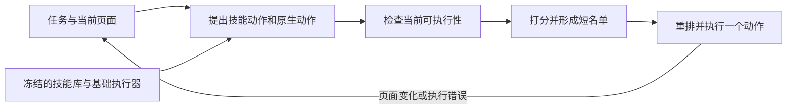

# Benchmark 自动生成与经验评测：SkillShift-Bench 论文调研及研究思路

## 1. 研究目标与论文定位

本研究想测量历史任务产生的经验能否迁移到新任务。SkillShift-Bench 将问题进一步限定为：Agent 在同一个网站的源环境中学到的技能，到了界面或运行条件变化的目标环境，还能否选对时机、找对对象并顺利执行？

论文名为 *SkillShift-Bench: Benchmarking Skill Learning under Environment Evolution for Web Agents*，由 Bo-Yu Chen、Zhi Zhou、Yu-Feng Li 撰写。论文有三个产物：用于诊断技能迁移的 Benchmark、用于分析执行条件变化的 SWOP，以及使用同一个技能库进行测试时动作重排的 MPCR。 [项目主页](https://skillshift-bench.github.io/)

**发表信息** · EMNLP 2026（2026 年自然语言处理实证方法会议），主会论文，第 44392–44461 页。 [ACL Anthology](https://aclanthology.org/2026.emnlp-main.1952/)

## 2. 任务族与环境演化如何定义

### 2.1 保持任务语义不变

每个对齐任务族有源环境和演化后的目标环境。作者在两侧保持四项一致：目标意图、任务关键实体、完成任务所需功能、自动评分判据。这样可以在同一目标上比较历史技能在原界面和新界面是否仍可执行。

实验使用三个可自托管系统。GitLab 从 v12.0.0 到 v16.0.6，覆盖项目、议题、合并请求等协作操作；Magento 从 v1.9.3 到 v2.4.6，覆盖订单、商品等管理操作；WordPress 在相同部署和数据上从 News Portal 换到 Twenty Twenty-Four 主题，形成展示层的变化。 [原文 §3.1、§3.3，附录 B.1](https://aclanthology.org/2026.emnlp-main.1952.pdf#page=3)

### 2.2 三种偏移分别改变什么

| 偏移 | 实际改变 | 主要诊断对象 |
| --- | --- | --- |
| Contextual Shift（情境偏移） | 更换同站版本或主题，改变路由、导航、流程布局或控件位置 | 技能是否在合适页面和上下文被调用 |
| Perceptual Shift（感知偏移） | 改变布局、DOM 结构、元素属性或定位线索 | 动作能否绑定到当前界面上的正确目标 |
| Execution Shift（执行偏移） | 注入可复现的模态遮罩，阻断与底层页面的交互 | 原操作受阻时，Agent 能否恢复并继续任务 |

三者对应调用、定位、执行三个环节，具体错误可能相互影响。例如新版本既可能移动入口，也可能改变控件结构。分类依据是实验操纵了哪类条件，日志分析再检查失败发生在哪一步。正文使用每轮只注入一次的执行遮罩，附录还测每次导航重注入、以固定概率随机延时注入。 [原文 §3.2、图 1，附录 B.2、E.6](https://aclanthology.org/2026.emnlp-main.1952.pdf#page=4)

### 2.3 任务生成与验证

作者先对齐种子数据与状态，再写自然语言指令和最终状态评分器。人工验证覆盖指令有效、评分器能拒绝近似错误状态、源和目标仍有必要功能、六个条件各自至少存在一条可执行解法。若偏移消除了最后一条解法，则修订或弃用该任务。基准包含 355 道自然语言任务。这里的人工参与用于验证可解性，论文没有报告人类任务成功率。 [原文 §3.3，附录 B.3](https://aclanthology.org/2026.emnlp-main.1952.pdf#page=5)

| 界面证据或运行条件 | 源环境 | 目标环境 |
| --- | --- | --- |
| 干净条件 | Src | Tgt |
| 感知偏移 | Src-Perc | Tgt-Perc |
| 执行偏移 | Src-Exec | Tgt-Exec |

`Src → Tgt` 看干净条件下的同站迁移；`Src → Src-Perc` 或 `Tgt → Tgt-Perc` 看同一环境内的定位变化，执行偏移也按同样方式做配对。作者还把两侧的干净条件合为 Base，感知条件合为 Perceptual，执行条件合为 Execution。 [原文 §3.3、§5.1](https://aclanthology.org/2026.emnlp-main.1952.pdf#page=5)

## 3. 从真实轨迹看技能怎样失效

附录 B.4 用 Magento 和 GPT-5 mini 的轨迹解释三种失效。案例是从干净条件成功、偏移条件失败的样本中挑出，适合解释失败形态。

- **调用失配。** 统计最近五笔已完成订单的总付款额。源环境能导航到订单列表并在五步完成，目标环境的 Agent 提前调用报表步骤并返回过时数值，没到迁移后的订单页面。
- **定位失配。** 查询最新待处理订单编号。干净环境中能调用订单导航和状态筛选两个技能；感知偏移改变了筛选控件的呈现，原选择动作遇到类型错误，Agent 反复尝试直至耗尽步数。
- **执行失配。** 查找包含 “decent” 的评论。评论链接目标仍在，运行时遮罩拦截操作，点击连续超时。诊断重点是检查当前页面为何无法交互、能否先恢复可执行状态。 [原文附录 B.4，表 5](https://aclanthology.org/2026.emnlp-main.1952.pdf#page=19)

## 4. SWOP 与 MPCR 如何适应变化

### 4.1 SWOP：用近期证据修正先验

SWOP（Sliding-Window Optimistic Prior-Guided Planning）把环境写成一系列有限时域 MDP。每个 episode 的奖励和转移可以变，固定技能库和基础执行器诱导出参考策略。算法在近期滑动窗口估计奖励与转移，用乐观估计处理不确定性，并以 KL 正则约束策略偏离参考先验的幅度。

动态遗憾将实际策略与每个 episode 上最优的 KL 正则化策略比较。变化预算统计相邻 episode 奖励和转移的变动。在有限状态、固定动作域、参考先验全支持等假设下，论文给出随变化预算增大的动态遗憾界；当变化预算相对 episode 数次线性增长时，该界也次线性。窗口宽度按已知变化预算选取。 [原文 §4.1，定理 4.1，附录 C](https://aclanthology.org/2026.emnlp-main.1952.pdf#page=6)

### 4.2 MPCR：当前页面决定下一步

MPCR（Masked Prior-Guided Candidate Reranking）在测试时读取当前页面、任务进度、既有技能和原生动作。它先提出少量候选，检查元素存在性、可见性、是否启用、是否被遮挡等证据，再按相关性、进度、就绪度、能否暴露后续所需信息、稳定性和风险给候选打分。被标为阻塞或待滚动的动作会降权，观测不完整时仍可能保留。模型在短名单内比较并选出一个动作，执行反馈进入下一步。正文的候选上限和短名单长度均为 2。

SWOP 提供理论抽象，MPCR 的效果由浏览器实验验证。MPCR 依赖候选覆盖，若恢复动作未进入候选集，重排无法选到它。 [原文 §4.2–4.3，图 2，附录 D.1–D.7](https://aclanthology.org/2026.emnlp-main.1952.pdf#page=6)

## 5. 实验设置、结果与证据边界

### 5.1 观测指标与方法

- **SR（Success Rate）。** 达到自动评分判据的任务比例。
- **AS（Average Steps）。** 每个任务在成功、失败或超时前执行的平均动作数。
- **ASC（Average Skill Calls）。** 每个任务平均技能调用数。调用多可能意味着有效复用，也可能意味着重复尝试。
- **SFR（Skill Failure Rate）。** 已调用技能中的失败比例，运行错误计为失败。调用很少时需结合 ASC 和调用总数解读。AWM 用文本工作流，论文未给它计算 ASC 和 SFR。

基准对比 AWM、ASI、SkillWeaver、WALT，各方法按原协议在源环境学习，基准级分析使用 DeepSeek-V3.2、GPT-5 mini 和 Claude Haiku 4.5。固定库实验用 GPT-5 mini，ASI 先在源环境学库并冻结，再由原版 ASI 与 MPCR 共用。 [原文 §3.4、§5.1，表 1](https://aclanthology.org/2026.emnlp-main.1952.pdf#page=7)

### 5.2 偏移压低成功率，也增加恢复代价

| 汇总条件 | SR | AS | SFR |
| --- | ---: | ---: | ---: |
| Base | 40.97% | 8.49 | 9.83% |
| Perceptual | 35.23% | 9.38 | 16.70% |
| Execution | 18.69% | 11.99 | 27.60% |

单看 ASI，表 1 中 Src 为 53.65%，Tgt 为 41.84%，Tgt-Exec 为 15.79%。在这三个自托管系统和本文所用偏移实现中，运行阻断伴随最大的成功率下降、平均步数增加与技能失败率上升。 [原文 §5.2，图 3，表 1](https://aclanthology.org/2026.emnlp-main.1952.pdf#page=7)

### 5.3 固定库条件下的重排增益

| 条件 | ASI | MPCR | 绝对增益 |
| --- | ---: | ---: | ---: |
| Tgt | 42.83% | 43.32% | +0.49 个百分点 |
| Src-Exec | 26.68% | 33.23% | +6.55 个百分点 |
| Tgt-Exec | 17.75% | 19.99% | +2.24 个百分点 |
| 六条件平均 | 37.90% | 41.26% | +3.36 个百分点 |

表 2 报告平均相对增益 8.87%。ASC 从 0.06 上升到 0.15，浏览器动作数处于相近范围。模型重排调用仍应另行计入成本。作者用两种执行器之间的累计任务失败差作为理论机制的实证代理，Base、Perceptual、Execution 的累计差分别为 11、20、32；该代理直接反映任务结果，不能据此读出理论动态遗憾。论文还在 Magento 上报告三随机种子、重复及随机遮罩和目标环境重学库的补充实验，跨站点与其他运行故障仍有待验证。 [原文 §5.3–5.4，图 4–5，表 2，附录 E.4–E.7](https://aclanthology.org/2026.emnlp-main.1952.pdf#page=8)

## 6. 对“历史经验能否帮助新任务”的借鉴与改造

### 6.1 把任务难度变化和经验可用性变化分别测量

[[TRACE]] 可沿种子轨迹改出更复杂的任务。借鉴 SkillShift-Bench，可以在每道新任务内部再构造对齐版本，保留任务目标、关键实体和评分器，逐次改变经验调用的前置状态、环境证据或工具运行条件。这样，同一道题在不同版本间的差异能反映经验依赖的条件。跨任务泛化另用留出的任务族测，按族分开历史经验来源与目标题，避免看到同题的解法。

### 6.2 同时测经验价值与执行器恢复能力

对同一批任务做“环境条件 × 经验条件”的配对实验。经验侧至少有无经验、历史相关经验、长度相近的无关经验；环境侧可先用干净和单一偏移，观察相关经验相对无经验的成功率增益随偏移如何变化。如果还想测执行器修复，把原执行器和适配执行器都放到同一个冻结经验库下，再测相同题目。

轨迹至少保留被检索的经验、调用发生的状态、绑定对象、调用结果、是否恢复和最终评分。相关经验被命中但没有调用，先查适用条件或选择机制；命中且调用却失败，继续查对象绑定和执行前置条件。报告成功率、动作数、调用分母和恢复成功率；使用额外模型的条件再报告模型调用数与 token 成本。

## 7. 总结

SkillShift-Bench 最适合借鉴的是同任务配对环境和逐环节的执行诊断。固定库实验表明，在本文的同站偏移条件下，使用当前页面证据重排动作能恢复一部分成功率。要估计历史经验本身的增益，需在同一个环境条件下另加有无经验对照。
