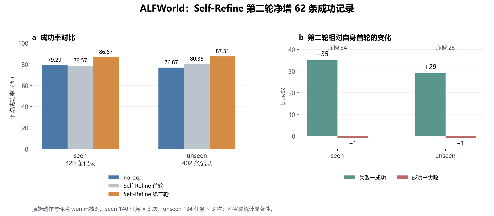
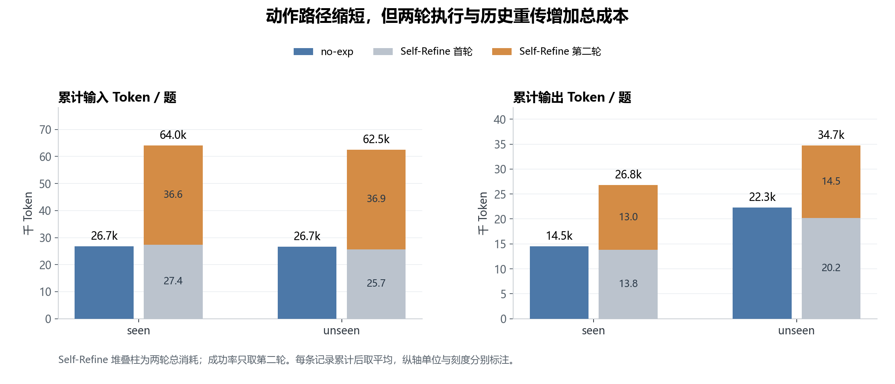

# Long-bench：ALFWorld / WebShop 结果统计与案例分析

## 1. 结果统计汇总

### 1.1 成功率与相对 no-exp 的变化

| 模型  | 任务              | no-exp 成功率 | Self-Refine 成功率 | Self − no-exp | TRAD 成功率 | TRAD − no-exp |
| --- | --------------- | ---------- | --------------- | ------------- | -------- | ------------- |
| 27B | ALFWorld seen   | 79.29%     | 86.67%          | +7.38         | 88.10%   | +8.81         |
| 27B | ALFWorld unseen | 76.87%     | 87.31%          | +10.45        | 83.58%   | +6.72         |
| 27B | WebShop         | 27.87%     | 31.60%          | +3.73         | 27.67%   | −0.20         |
| 9B  | ALFWorld seen   | 55.24%     | 64.29%          | +9.05         | 61.90%   | +6.67         |
| 9B  | ALFWorld unseen | 52.74%     | 65.67%          | +12.94        | 54.73%   | +1.99         |
| 9B  | WebShop         | 14.33%     | 16.80%          | +2.47         | 15.80%   | +1.47         |
### 1.2 WebShop：Score 与完全成功率分别看

Score 为官方 reward×100 的平均值；成功要求 reward＝1。部分满足购物要求可以有非零分，却不算成功。

| 模型 | 方法 | 平均 Score | 成功率 | 零分条数 | 部分得分条数 | 完全成功条数 |
| --- | --- | --- | --- | --- | --- | --- |
| 27B | no_exp | 55.48 | 27.87% | 282 | 800 | 418 |
| 27B | self_refine | 60.20 | 31.60% | 204 | 822 | 474 |
| 27B | trad | 60.12 | 27.67% | 199 | 886 | 415 |
| 9B | no_exp | 32.41 | 14.33% | 787 | 498 | 215 |
| 9B | self_refine | 38.67 | 16.80% | 623 | 625 | 252 |
| 9B | trad | 41.13 | 15.80% | 585 | 678 | 237 |
27B TRAD 相对 no-exp 的 Score 从 55.48 提高到 60.12，但完全成功由 418 降到 415：零分减少 83 条、部分得分增加 86 条、满分反而减少 3 条。这支持“更多任务取得部分进展”，不支持“完全满足需求的能力已经提高”。9B TRAD 则同时减少零分并提高满分，但完全成功率仍低于 Self-Refine。

按现有结果选择方法时，27B TRAD 在 seen 上成功率最高，Self-Refine 在 unseen 与 WebShop 完全成功率上更好；9B 的 Self-Refine 在三个任务的成功率均高于 TRAD，但 TRAD 的 WebShop Score 更高。目标指标不同，方法排序可以不同。

## 2. no-exp：错误主要落在哪些执行环节？

### 2.1 终止状态的完整分布

以下是官方执行结果的类别，不把人工推断的错误原因当成已经标注的频数。

| 模型 | 任务 | 成功 | 步数耗尽 | 已购买但未完全成功 | 每任务平均动作数 |
| --- | --- | --- | --- | --- | --- |
| 27B | ALFWorld seen | 333/420 | 87 | 0 | 22.62 |
| 27B | ALFWorld unseen | 309/402 | 93 | 0 | 23.33 |
| 27B | WebShop | 418/1500 | 260 | 822 | 6.69 |
| 9B | ALFWorld seen | 232/420 | 188 | 0 | 31.53 |
| 9B | ALFWorld unseen | 212/402 | 190 | 0 | 32.28 |
| 9B | WebShop | 215/1500 | 774 | 511 | 10.14 |
ALFWorld 的 no-exp 失败在现有终止记录中均表现为达到 50 步上限。它不能自动说明“只差一步”：需要查看目标对象、位置、持有状态及状态改变是否推进。WebShop 的 27B 更常完成购买但未满足全部条件，9B 则有更多任务在 15 步内未能完成购买；两者的主要失败形态并不相同。

### 2.2 ALFWorld 按任务类型汇总

为了看执行子技能，下面在同一任务类型内合并 seen / unseen，按对应作答数加权；每模型各方法分母相同。该表用于描述任务类型瓶颈，不替代第一节的分划分结果。

| 模型 | 任务类型 | 作答数 | no-exp | Self-Refine | TRAD |
| --- | --- | --- | --- | --- | --- |
| 27B | 灯下查看 | 93 | 78/93（83.87%） | 87/93（93.55%） | 78/93（83.87%） |
| 27B | 简单搬放 | 177 | 174/177（98.31%） | 177/177（100.00%） | 172/177（97.18%） |
| 27B | 清洗后放置 | 174 | 134/174（77.01%） | 146/174（83.91%） | 150/174（86.21%） |
| 27B | 冷却后放置 | 138 | 96/138（69.57%） | 120/138（86.96%） | 119/138（86.23%） |
| 27B | 加热后放置 | 117 | 37/117（31.62%） | 63/117（53.85%） | 94/117（80.34%） |
| 27B | 双物体放置 | 123 | 123/123（100.00%） | 122/123（99.19%） | 93/123（75.61%） |
| 9B | 灯下查看 | 93 | 77/93（82.80%） | 85/93（91.40%） | 72/93（77.42%） |
| 9B | 简单搬放 | 177 | 174/177（98.31%） | 174/177（98.31%） | 143/177（80.79%） |
| 9B | 清洗后放置 | 174 | 57/174（32.76%） | 75/174（43.10%） | 106/174（60.92%） |
| 9B | 冷却后放置 | 138 | 8/138（5.80%） | 35/138（25.36%） | 47/138（34.06%） |
| 9B | 加热后放置 | 117 | 19/117（16.24%） | 47/117（40.17%） | 45/117（38.46%） |
| 9B | 双物体放置 | 123 | 109/123（88.62%） | 118/123（95.93%） | 67/123（54.47%） |
两个模型的简单搬放都接近满分，9B no-exp 的冷却后放置仅 8/138（5.80%），加热后放置为 19/117（16.24%），清洗后放置也明显偏低。难点集中于**取对对象、到达正确工具、触发清洗/加热/冷却、再移动到目标容器**这一组依赖当前状态的操作链，而不只是辨认任务文本。27B 也在加热链上明显弱于简单搬放，说明增大模型并未消除这类执行瓶颈。

### 2.3 结合轨迹的原因分析

| 可观察机制 | 模型与案例任务 | 主要过程及解释 |
| --- | --- | --- |
| 不维持目标与物体状态 | 9B / no-exp / seen，灯下查看碗（bowl） | 已发现 bowl 和 desklamp，仍在桌、抽屉、架子间往返；后段尝试拿走 desklamp，并出现 `Nothing happens.`。任务所需的是拿 bowl 到灯旁使用灯，不是反复搬动灯具，最终 50 步未成功 |
| 搜索改写没有及时转化为有效购买 | 27B / no-exp / WebShop | 为“无麸质、素食、烟熏胡椒培根、4 oz×2、低于40美元”反复改写搜索、翻页和返回，15 步仍停在结果页，得分 0。说明搜索活动本身不等于完成多约束匹配 |
| 找到近似商品但属性不全 | 9B / no-exp / WebShop | 买入 3 oz×4 的 vegan jerky，得到 50 分，但任务要求 4 oz×2；有部分语义匹配而未满足所有条件 |
| 对象/需求匹配不可靠 | 27B 与 9B / no-exp / WebShop | 60 capsules 瓶装无硫酸盐、无防腐剂护发需求中，两者购买后仅 2.5 分；标签与购买状态能确认未满足目标，但不能单凭分数指定所有缺失属性 |
| 输出不成动作与环境前提不满足会叠加 | 上述 ALFWorld 轨迹中有被回退成回复尾部文本的动作；多步任务中也有未到目标位置就放置物品 | 需区分模型格式失败、动作字符串匹配失败与真实任务规划失败；并非每个 `Nothing happens.` 都来自同一种原因 |

这些是经过原始轨迹核查的例子，不是全体失败的人工原因分类。动作格式错误、无效动作与步数耗尽可能同时出现在同一任务，不能将它们直接相加作为互斥失败比例。

## 3. Self-Refine：两轮结果与反思的实际作用

### 3.1 首轮与第二轮的结果

本实验的 Self-Refine 会在新环境中重新执行第二轮，给它首轮任务和已执行动作/观察轨迹；第二轮即使首轮成功也照常运行。最终只按第二轮计分，Token 则包含两轮。第二轮没有直接接收首轮官方 reward 或目标评分字段。

这里**没有单独的 CORRECT / INCORRECT 自评标签**，因此不能从日志生成“自评准确率”或混淆矩阵。能直接核查的是：是否保留首轮成功、救回多少失败、第二轮是否退化，以及它有没有利用首轮发现的环境信息。

| 模型 | 任务 | 独立 no-exp | 自身首轮 | 首轮 − no-exp | 第二轮/最终 | 第二轮 − 首轮 | 最终 − no-exp |
| --- | --- | --- | --- | --- | --- | --- | --- |
| 27B | ALFWorld seen | 79.29% | 78.57% | −0.71 | 86.67% | +8.10 | +7.38 |
| 27B | ALFWorld unseen | 76.87% | 80.35% | +3.48 | 87.31% | +6.97 | +10.45 |
| 27B | WebShop | 27.87% | 28.40% | +0.53 | 31.60% | +3.20 | +3.73 |
| 9B | ALFWorld seen | 55.24% | 57.86% | +2.62 | 64.29% | +6.43 | +9.05 |
| 9B | ALFWorld unseen | 52.74% | 52.99% | +0.25 | 65.67% | +12.69 | +12.94 |
| 9B | WebShop | 14.33% | 14.47% | +0.13 | 16.80% | +2.33 | +2.47 |
27B unseen 最终比 no-exp 多 42 次成功，其中 14 次来自首轮本身比独立 no-exp 更高，后续第二轮净增 28 次。9B seen 最终多 38 次成功，其中首轮差异贡献 11 次、第二轮净增 27 次。只有相对自身首轮的变化，才能直接对应到这批任务的第二轮执行。

### 3.2 成功迁移：救回多少，丢失多少？

*图 1：已有图中的数据仅对应 **27B**，seen/unseen 第二轮分别净增 34、28 条成功，合计 62；9B 的对应结果见下表，不能用本图替代。*

| 模型 | 任务 | 成功→成功 | 失败→成功 | 成功→失败 | 失败→失败 | 失败救回率 | 原成功丢失率 |
| --- | --- | --- | --- | --- | --- | --- | --- |
| 27B | ALFWorld seen | 329 | 35 | 1 | 55 | 38.89% | 0.30% |
| 27B | ALFWorld unseen | 322 | 29 | 1 | 50 | 36.71% | 0.31% |
| 27B | WebShop | 419 | 55 | 7 | 1019 | 5.12% | 1.64% |
| 9B | ALFWorld seen | 241 | 29 | 2 | 148 | 16.38% | 0.82% |
| 9B | ALFWorld unseen | 212 | 52 | 1 | 137 | 27.51% | 0.47% |
| 9B | WebShop | 204 | 48 | 13 | 1235 | 3.74% | 5.99% |
ALFWorld 的成功丢失较少：27B seen/unseen 各丢失 1 条，9B 分别丢失 2、1 条；但它们不是零。9B unseen 的救回率为 52/189＝27.51%，明显高于其 seen 的 29/177＝16.38%。这说明第二轮能利用某些首轮暴露的位置和前提信息，但仍有相当多失败不能靠再执行一轮解决。

WebShop 的成功保留更脆弱：27B 丢失 7/426（1.64%）的首轮成功，9B 丢失 13/217（5.99%）。第一轮已成功也强制再购一次，使属性遗漏、不同商品选择和操作字符串变化有机会把满分变成部分分。

### 3.3 WebShop 分数是怎样变化的？

| 模型 | 独立 no-exp Score | 自身首轮 Score | 最终 Score | 最终 − 首轮 | 分数上升条数 | 持平条数 | 下降条数 |
| --- | --- | --- | --- | --- | --- | --- | --- |
| 27B | 55.48 | 54.97 | 60.20 | +5.23 | 167 | 1299 | 34 |
| 9B | 32.41 | 32.32 | 38.67 | +6.35 | 199 | 1248 | 53 |
27B 的分数变化集中在 201/1,500 条，9B 集中在 252/1,500 条；其余分数持平。分数持平不一定表示行为或商品完全相同，也不等于每条都有正确的显式自我评估，只表示最终官方分值相同。

### 3.4 反思成功与退化的真实案例

**案例一：利用首轮发现的位置，大幅缩短第二轮。** 9B / seen / 要求把光盘拿到台灯旁查看的任务。首轮在 book、pen 等对象上分散注意力，最后已看到 shelf 3 上的 cd 1，却耗尽 50 步。第二轮直接执行 `go to shelf 3 → take cd 1 from shelf 3 → go to sidetable 2 → use desklamp 1`，4 步成功。有效收益在于复用已发现的环境事实，并重新对准 CD 这个目标，而不只是生成更长的反思文字。

**案例二：修复目标对象与动作前提。** 9B / unseen / 要求清洗盘子（plate）并放到台面的任务。首轮先拿错 bowl，清洗后还没到 countertop 就尝试放置；后段虽找到 plate，最终放置仍得到 `Nothing happens.`。第二轮拿 cabinet 3 的 plate，去 sinkbasin 清洗，先走到 countertop 1 再放置，6 步成功。

**案例三：省略选项选择，把满分改成部分分。** 9B / WebShop，要求灰色、记忆棉、露趾拖鞋。首轮对商品 `B09JFDGWC8` 选择 `b-gray` 后购买，100 分；第二轮复用搜索与商品，但直接 `click[buy now]`，没有选颜色，降为 75 分，成功变失败。它减少了步骤（9→3），同时省掉了必要条件。

**案例四：动作字符串变化也能使成功退化。** 27B / WebShop，0.17 fl oz 香水。首轮选择页面选项 `0.17 fl oz  |  5ml` 后满分；第二轮把点击文本写成 `0.17 fl oz | 5ml`，最终只得到 66.67 分。日志支持其没有保持同样的选项操作；该类接口操作问题不能被笼统归为缺乏商品知识。

### 3.5 第二轮更省动作，不代表总成本更低

| 模型 | 任务 | 首轮动作均值 | 第二轮动作均值 | 两轮总动作均值 | 首轮输入均值 | 第二轮输入均值 |
| --- | --- | --- | --- | --- | --- | --- |
| 27B | ALFWorld seen | 22.89 | 12.72 | 35.60 | 27,415.19 | 36,590.49 |
| 27B | ALFWorld unseen | 22.62 | 13.33 | 35.95 | 25,661.77 | 36,888.19 |
| 27B | WebShop | 6.74 | 5.48 | 12.22 | 16,469.38 | 33,600.22 |
| 9B | ALFWorld seen | 31.46 | 23.60 | 55.06 | 43,571.25 | 86,859.73 |
| 9B | ALFWorld unseen | 32.62 | 24.31 | 56.92 | 45,187.27 | 87,379.68 |
| 9B | WebShop | 10.04 | 8.94 | 18.98 | 18,250.78 | 43,680.76 |
例如 27B seen 第二轮平均只需 12.72 步，少于首轮的 22.89 步，但两轮合计为 35.60 步；第二轮还需要携带首轮轨迹，因此输入 Token 反而更多。反思提升成功率的同时增加总执行成本，二者不能混为同一个效率指标。

## 4. TRAD：何时帮忙，何时仍然失败？

### 4.1 收益依赖任务与目标指标

27B TRAD seen 相对 no-exp 提高 8.81 pp，unseen 提高 6.72 pp；9B 分别提高 6.67、1.99 pp。9B 在 unseen 的增益明显小于 Self-Refine 的 12.94 pp。任务类型表还表明，即使有经验检索，清洗/冷却/加热等操作链仍未被稳定解决。

WebShop 上，27B TRAD 主要提高部分得分，而非满分；9B TRAD 虽比 no-exp 提高 1.47 pp 的成功率，但仍低于 Self-Refine 的 16.80%。这说明“能找到更相近的商品”和“能完成所有选项与限制”是两层能力。

### 4.2 正例：把操作经验落回当前观察

9B / seen，正是 no-exp 失败的 bowl 灯下查看任务。TRAD 的日志虽然也有两次无效开抽屉，但随后发现 dresser 1 的灯，回 desk 1 拿 bowl，再到 dresser 1 使用 desklamp，11 步成功。其成功动作与当时环境中的 bowl、灯和位置一致，显示经验能够帮助组织“持物到灯旁使用灯”的链条。

这是同一测试任务的描述性对照；不同方法是独立生成过程，不能据此断定唯一改变的因素或把单条轨迹当成总体因果证明。

### 4.3 反例：知道工具和目标，仍卡在状态循环

9B / TRAD / unseen，要求加热杯子（cup），再放进橱柜（cabinet）。轨迹拿到 cup 2 后去 microwave，却把杯子放进微波炉、反复开关门，期间调用 `heat cup 2 with microwave 1`，随后再次陷入开关门循环；50 步结束时杯子仍在微波炉里，没有完成到 cabinet 的最终转移。同一测试任务下 no-exp 的该次运行用了 43 步并成功。

这条记录支持“动作前提、当前持物状态与完成条件没有被持续跟踪”这一解释；并不能证明所有加热失败都是相同原因，也不能仅因为检索存在就断言失败全部由检索造成。

### 4.4 经验覆盖量与使用能力应分开看

| 模型 | 经验库 | 采集训练任务 | 成功入库轨迹 | 入库率 |
| --- | --- | --- | --- | --- |
| 27B | ALFWorld | 2000 | 1568 | 78.40% |
| 9B | ALFWorld | 2000 | 1202 | 60.10% |
| 27B | WebShop | 2000 | 478 | 23.90% |
| 9B | WebShop | 2000 | 249 | 12.45% |
较大的模型在相同训练任务上留下更多成功经验，但当前结果同时混合了经验覆盖、标注质量、检索命中与在线执行能力。没有固定经验库的对照，无法把跨模型差距全部归因于其中某一项。seen 的高收益也不自动等于能在 unseen 上同等迁移。

## 5. Token 消耗：长历史、双阶段请求与重复执行

### 5.1 每条任务的执行 Token

数值均先累计该任务内所有成功返回请求，再对全部测试作答平均。Self-Refine 包含两轮，TRAD 包含 Thought 与 Action；本表不含一次性建库或嵌入用量。

| 模型 | 任务 | no-exp 输入 / 输出 | Self-Refine 输入 / 输出 | TRAD 输入 / 输出 | Self 输入倍数 | TRAD 输入倍数 |
| --- | --- | --- | --- | --- | --- | --- |
| 27B | ALFWorld seen | 26,708.61 / 14,517.06 | 64,005.68 / 26,797.10 | 292,027.03 / 11,399.30 | 2.40× | 10.93× |
| 27B | ALFWorld unseen | 26,701.14 / 22,307.31 | 62,549.96 / 34,703.28 | 310,899.40 / 14,933.26 | 2.34× | 11.64× |
| 27B | WebShop | 16,242.44 / 4,922.84 | 50,069.60 / 9,758.67 | 85,516.93 / 4,585.89 | 3.08× | 5.27× |
| 9B | ALFWorld seen | 43,481.82 / 10,107.86 | 130,430.98 / 29,325.16 | 417,535.04 / 14,764.24 | 3.00× | 9.60× |
| 9B | ALFWorld unseen | 44,837.32 / 13,341.35 | 132,566.95 / 35,368.77 | 484,661.28 / 17,723.54 | 2.96× | 10.81× |
| 9B | WebShop | 18,245.91 / 3,994.04 | 61,931.54 / 9,711.81 | 109,363.85 / 5,328.72 | 3.39× | 5.99× |
27B TRAD 在 seen 的输出比 no-exp 更少（11,399 对 14,517），输入却约为 10.93 倍；9B unseen 输入约为 10.81 倍。不能把这种输入增长解释成输出推理变长，主要要看提示上下文和重复请求。

*图 2：已有图仅对应 **27B ALFWorld**。灰色与橙色堆叠分别为 Self-Refine 首轮和第二轮，柱高是两轮总消耗；成功率只统计第二轮。输入/输出纵轴刻度不同，不能直接比较柱高。*

### 5.2 TRAD 的输入主要花在哪个阶段？

| 模型 | 任务 | 平均环境动作 | 平均模型请求 | Thought 输入 | Action 输入 | Thought 占输入 |
| --- | --- | --- | --- | --- | --- | --- |
| 27B | ALFWorld seen | 19.90 | 39.80 | 239,303.85 | 52,723.18 | 81.95% |
| 27B | ALFWorld unseen | 21.20 | 42.40 | 255,344.69 | 55,554.71 | 82.13% |
| 27B | WebShop | 6.22 | 12.43 | 49,896.41 | 35,620.52 | 58.35% |
| 9B | ALFWorld seen | 30.77 | 61.54 | 345,371.97 | 72,163.07 | 82.72% |
| 9B | ALFWorld unseen | 33.61 | 67.22 | 407,398.13 | 77,263.15 | 84.06% |
| 9B | WebShop | 8.86 | 17.73 | 66,506.82 | 42,857.03 | 60.81% |
ALFWorld TRAD 每个环境动作都先 Thought、再 Action，因此请求数约为动作数的两倍。Thought 包含执行历史和经验上下文，Action 也包含相关经验及近期步骤；即使动作次数没有明显增加，每次请求也更贵。9B unseen 的 Thought 输入占比约 84.06%，持续重传较长历史是主要来源。其动作均值 33.61 还略高于 no-exp 的 32.28，所以该任务既没有缩短执行链，又承担了更重的提示成本。

WebShop TRAD 的 Thought 占比低于 ALFWorld，但商品结果页本身较长，Thought 与 Action 均需要有效页面信息和经验上下文。27B 输入增加约 5.27 倍，却没有提高完全成功率，是当前需要重点检查的成本收益组合。

### 5.3 格式与截断：存在，但不能等同全部任务失败

| 模型 | 方法 | ALFWorld 截断请求 | ALFWorld 格式失败请求 | WebShop 截断请求 | WebShop 格式失败请求 |
| --- | --- | --- | --- | --- | --- |
| 27B | no_exp | 1056 | 1054 | 146 | 146 |
| 27B | self_refine | 1498 | 1501 | 349 | 358 |
| 27B | trad | 422 | 449 | 61 | 136 |
| 9B | no_exp | 193 | 420 | 26 | 46 |
| 9B | self_refine | 773 | 1006 | 138 | 197 |
| 9B | trad | 487 | 524 | 124 | 215 |
这里是请求次数，不是失败任务数；同一个任务可出现多次格式问题，也可能在回退动作后最终成功。反过来，格式完全正常的购物轨迹也可能选错商品或漏选属性。因此应把“格式可靠性”“环境动作有效性”“目标完成率”分别评估。

### 5.4 一次性建库 Token

| 模型 | 经验库 | 建库输入 | 建库输出 |
| --- | --- | --- | --- |
| 27B | ALFWorld | 272,234,075 | 32,720,747 |
| 9B | ALFWorld | 258,167,195 | 24,973,695 |
| 27B | WebShop | 50,248,866 | 9,942,189 |
| 9B | WebShop | 43,994,494 | 8,072,637 |
建库统计采集与标注中成功返回请求的用量，失败调用不计，不含嵌入。ALFWorld seen/unseen 共享同一经验库，不能重复记两次建库。评估成本时应同时报告在线每任务消耗与一次性建库，再按实际复用任务数摊销，而不是直接把总建库与每任务执行相加。

## 6. 结论与后续值得验证的方向

1. **no-exp 的主要瓶颈具有任务结构。** ALFWorld 主要卡在带前提的多步骤状态操作，WebShop 还要区分搜索未结束与购买条件不全；总分不能替代失败轨迹分析。
2. **Self-Refine 的第二轮有明确净收益，但不是可靠的成功保护器。** 环境探索事实可复用，成功操作也可能被重做时省略或写错。WebShop 尤其应检查必要选项是否保持，而非单纯追求更短路径。
3. **TRAD 的作用与指标有关。** seen 成功率、unseen 迁移、WebShop 部分得分与满分表现不一致。当前数据不支持把“平均 Score 提升”直接写成“成功率提升”。
4. **高输入成本主要来自上下文与请求组织。** 对 TRAD 可验证缩短或筛选经验、压缩已确认状态、减少不必要的全历史重传；对 Self-Refine 可验证成功轨迹保留与重执行前的选项/状态检查。本文没有把这些尚未执行的方案写成已获得的收益。
5. 三次运行使用相同任务，存在任务内相关性；本文为描述性统计及可追溯案例分析，不据小幅差值宣称统计显著，不对未标注的错误原因编造比例。

## 附录：Self-Refine 每次完整运行首轮 → 第二轮成功数

seen 每次分母 140，unseen 每次分母 134，WebShop 每次分母 500。

| 模型 | 任务 | run_01 | run_02 | run_03 |
| --- | --- | --- | --- | --- |
| 27B | ALFWorld seen | 111 → 125 | 111 → 119 | 108 → 120 |
| 27B | ALFWorld unseen | 109 → 121 | 109 → 116 | 105 → 114 |
| 27B | WebShop | 143 → 158 | 142 → 163 | 141 → 153 |
| 9B | ALFWorld seen | 80 → 90 | 81 → 90 | 82 → 90 |
| 9B | ALFWorld unseen | 71 → 89 | 71 → 87 | 71 → 88 |
| 9B | WebShop | 75 → 90 | 70 → 79 | 72 → 83 |

## 统计口径

- 任务状态、成功率、分数、两轮迁移及 Token 均由原始运行记录复算；案例正文直接描述任务要求、关键动作与结果。
- Self-Refine 按同一任务的首轮、第二轮配对统计；最终表现按第二轮计分，成本为两轮累计。
- 百分比从原始计数计算后四舍五入。案例中的失败是执行结果，不等同于 API 请求失败。
- Token 只统计成功返回请求，在线执行与一次性建库分别列示。
