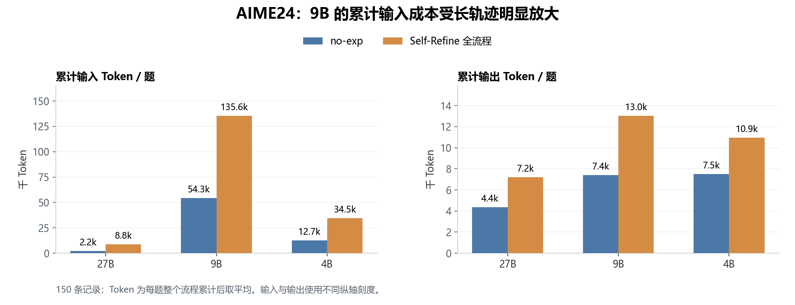

# Short-bench：AIME / GPQA 结果统计与案例分析

> 更新：2026-11-25。Qwen3.5-27B / 9B / 4B，关闭 thinking。本文只分析 `results` 中已有的 no-exp、Self-Refine、TRAD 原始运行结果；不混入其他方法的截图数据。统计覆盖 9,396 条测试作答。

## 1. 结果统计汇总

### 1.1 平均准确率及相对 no-exp 的变化

AIME 每年 30 题 × 5 次＝150 条作答；GPQA-Diamond 为 198 题 × 3 次＝594 条。差值单位均为**百分点（pp）**，不是相对百分比。所有方法对同一数据集使用相同测试题目。

| 模型 | 任务 | no-exp | Self-Refine | Self − no-exp | TRAD | TRAD − no-exp |
| --- | --- | --- | --- | --- | --- | --- |
| 27B | AIME24 | 77.33% | 80.00% | +2.67 | 78.00% | +0.67 |
| 27B | AIME25 | 71.33% | 75.33% | +4.00 | 70.00% | −1.33 |
| 27B | AIME26 | 78.00% | 79.33% | +1.33 | 76.00% | −2.00 |
| 27B | GPQA-Diamond | 81.31% | 82.15% | +0.84 | 80.47% | −0.84 |
| 9B | AIME24 | 61.33% | 56.00% | −5.33 | 53.33% | −8.00 |
| 9B | AIME25 | 39.33% | 41.33% | +2.00 | 48.67% | +9.33 |
| 9B | AIME26 | 48.67% | 46.00% | −2.67 | 50.67% | +2.00 |
| 9B | GPQA-Diamond | 72.73% | 74.07% | +1.35 | 68.35% | −4.38 |
| 4B | AIME24 | 50.67% | 59.33% | +8.67 | 20.67% | −30.00 |
| 4B | AIME25 | 38.00% | 42.00% | +4.00 | 16.67% | −21.33 |
| 4B | AIME26 | 47.33% | 52.67% | +5.33 | 14.00% | −33.33 |
| 4B | GPQA-Diamond | 68.35% | 68.18% | −0.17 | 57.07% | −11.28 |
按三个年份合并 AIME（每模型、每方法 450 条作答）后：

| 模型 | no-exp | Self-Refine | TRAD |
| --- | --- | --- | --- |
| 27B | 340/450（75.56%） | 352/450（78.22%） | 336/450（74.67%） |
| 9B | 224/450（49.78%） | 215/450（47.78%） | 229/450（50.89%） |
| 4B | 204/450（45.33%） | 231/450（51.33%） | 77/450（17.11%） |
**需要纠正一个总体印象：TRAD 并非在所有短程任务上都下降。** 9B 的 AIME25、AIME26 分别提高 9.33、2.00 pp，三年合并也提高 1.11 pp；27B 三年合并下降 0.89 pp，4B 则下降 28.22 pp。GPQA 上三个模型的 TRAD 均低于 no-exp。Self-Refine 对 27B 和 4B 的 AIME 更稳定，9B 的 AIME 合并准确率反而下降 2.00 pp。

### 1.2 AIME 的 pass@5 与 best@5

`pass@5` 是同一题五次运行中至少一次答对的题目比例；当前结果文件中的 `best@5` 是五次整轮运行中最高的一轮准确率，**不是多数投票准确率**。下表各单元格为 `pass@5 / best@5`。

| 模型 | 任务 | no-exp | Self-Refine | TRAD |
| --- | --- | --- | --- | --- |
| 27B | AIME24 | 86.67% / 80.00% | 90.00% / 86.67% | 90.00% / 83.33% |
| 27B | AIME25 | 86.67% / 73.33% | 86.67% / 80.00% | 80.00% / 73.33% |
| 27B | AIME26 | 90.00% / 86.67% | 86.67% / 83.33% | 93.33% / 86.67% |
| 9B | AIME24 | 83.33% / 66.67% | 76.67% / 63.33% | 76.67% / 60.00% |
| 9B | AIME25 | 70.00% / 43.33% | 76.67% / 53.33% | 63.33% / 53.33% |
| 9B | AIME26 | 76.67% / 56.67% | 76.67% / 53.33% | 73.33% / 56.67% |
| 4B | AIME24 | 73.33% / 53.33% | 83.33% / 63.33% | 63.33% / 26.67% |
| 4B | AIME25 | 63.33% / 46.67% | 70.00% / 53.33% | 40.00% / 23.33% |
| 4B | AIME26 | 80.00% / 53.33% | 80.00% / 60.00% | 40.00% / 23.33% |
4B TRAD 的 AIME24 虽有 63.33% 的 pass@5，平均准确率只有 20.67%，说明“某次能完成”与“稳定完成”之间差距很大；AIME25/26 的 pass@5 也降到 40.00%，并非单纯由五次取平均造成低分。

### 1.3 GPQA 分学科结果

三次运行累计 Physics 258 条、Chemistry 279 条、Biology 57 条；对应独立题目分别为 86、93、19 题。All 按题目数加权，不能直接平均三科百分比。

| 模型 | 方法 | Physics | Chemistry | Biology | All |
| --- | --- | --- | --- | --- | --- |
| 27B | no_exp | 91.86% | 72.76% | 75.44% | 81.31% |
| 27B | self_refine | 92.25% | 73.84% | 77.19% | 82.15% |
| 27B | trad | 94.96% | 69.53% | 68.42% | 80.47% |
| 9B | no_exp | 89.92% | 59.50% | 59.65% | 72.73% |
| 9B | self_refine | 92.64% | 59.86% | 59.65% | 74.07% |
| 9B | trad | 86.43% | 52.33% | 64.91% | 68.35% |
| 4B | no_exp | 86.82% | 52.69% | 61.40% | 68.35% |
| 4B | self_refine | 84.88% | 54.48% | 59.65% | 68.18% |
| 4B | trad | 76.74% | 37.99% | 61.40% | 57.07% |
4B TRAD 的 Physics 仍为 76.74%，Chemistry 下降到 37.99%，Biology 为 61.40%；其退化并不是各学科均匀下降。Biology 只有 19 道独立题，百分比跳动较大，不应据此声称模型能力在该科稳定超过更大模型。

## 2. no-exp：基本能力错误与完成失败要分开

### 2.1 可复核的错误分布

“标准答案”按答案值定义：AIME 为 0–999 整数，GPQA 为 A/B/C/D。未提取到答案、分式/根式、越界值或占位符等归入“无标准答案”。这与日志中的 `completed` 或 `token_budget_exhausted` 不是同一分类：程序完成不保证答案属于任务要求的形式。

| 模型 | 任务 | 正确 | 标准答案但错误 | 无标准答案 | 合计 |
| --- | --- | --- | --- | --- | --- |
| 27B | AIME | 340 | 68 | 42 | 450 |
| 27B | GPQA | 483 | 91 | 20 | 594 |
| 9B | AIME | 224 | 116 | 110 | 450 |
| 9B | GPQA | 432 | 148 | 14 | 594 |
| 4B | AIME | 204 | 150 | 96 | 450 |
| 4B | GPQA | 406 | 150 | 38 | 594 |
27B 的 AIME 错误仍包含实质性的计数、几何建模和边界判断问题；9B 与 4B 还明显受到完成格式和重复续写影响。因此，低分既不全是“不会算”，也不能把未规范结束的回答直接算作正确。

### 2.2 错误机制与原始案例

| 机制 | 案例位置 | 日志证据 | 可以支持的解释 |
| --- | --- | --- | --- |
| 未验证的组合计数假设 | 27B / no-exp / AIME24 / run_01 / ID 62 | 正八边形染色题把蓝点为 4 时的有效集合数算为 46，得到 139/256、答案 395；标准答案为 371。枚举 256 种染色可得有效集合 115 个，其中 4 蓝点仅 22 个 | “Known result”式断言没有被实际分类或枚举验证，重复确认算术不能修复组合结构错误 |
| 分段交点计数的充分性没有验证 | 27B / no-exp / AIME24 / run_01 / ID 63 | 用 16×24＝384 作为交点总数，并以各段覆盖值域推断每段组合恰有一交点；数据集答案为 385 | 错在分段计数论证及特殊情况处理，不能只检查乘法是否正确；本例不据此断言缺失交点的精确位置 |
| 已算出答案但不结束 | 9B / no-exp / AIME24 / run_05 / ID 69 | 彩票条件概率已反复得到 1/115 与 116，却始终没有最终 boxed；73 次调用、输入 646,927、输出 16,384，最终无答案 | 数学结果与可提交结果脱节，重复续写放大成本 |
| 与数据集答案不符的论证被坚持 | 9B / no-exp / GPQA / run_01 / ID 16 | 分子对接准备题选 D，数据集标签为 C；回答持续论证 D 的合理性 | 该样本说明答案层面的错误与立场固化，不凭这一条对有争议的领域论断作外部裁决 |

原始样本：[27B 数学案例](<file:///D:/%E7%BB%8F%E9%AA%8C%EF%BC%88%E5%88%A9%E7%94%A8%EF%BC%89/%E7%AC%AC%E4%B8%80%E6%AC%A1%E5%A4%8D%E7%8E%B0/ysc_experience_learning/results/ysc_step_experience_learning/ysc_step_experience_learning/qwen3.5-27b/no_exp/aime/outputs/aime24/run_01/samples.jsonl>)；[9B 结束失败](<file:///D:/%E7%BB%8F%E9%AA%8C%EF%BC%88%E5%88%A9%E7%94%A8%EF%BC%89/%E7%AC%AC%E4%B8%80%E6%AC%A1%E5%A4%8D%E7%8E%B0/ysc_experience_learning/results/ysc_step_experience_learning/ysc_step_experience_learning/qwen3.5-9b/no_exp/aime/outputs/aime24/run_05/samples.jsonl>)；[9B GPQA 案例](<file:///D:/%E7%BB%8F%E9%AA%8C%EF%BC%88%E5%88%A9%E7%94%A8%EF%BC%89/%E7%AC%AC%E4%B8%80%E6%AC%A1%E5%A4%8D%E7%8E%B0/ysc_experience_learning/results/ysc_step_experience_learning/ysc_step_experience_learning/qwen3.5-9b/no_exp/gpqa/outputs/diamond/run_01/samples.jsonl>)。

上述是人工核查过的机制案例，并不是对全部错误进行互斥人工标注后的原因占比。日志也没有统一“第一处错误步骤”标签，不能据此编造首错步统计。

## 3. Self-Refine：每轮结果、救回与损失

### 3.1 必须区分独立 no-exp 与 Self-Refine 自身首轮

*图 1：保留原有准确率图，数值已与本次统计核对。该图只比较 no-exp 与 Self-Refine，不包含 TRAD；独立 no-exp 与 Self-Refine 首轮不能视为同一份初答。*

流程是“初答 → 盲审反馈 → 按 Verdict 保留或修正”。反馈不接收标准答案。`CORRECT` 保留初答，`INCORRECT` 才启动修正；反馈无效或修正未完成时，当前结果可能丢失初答。下表最后一列才是对同一批初答的净自纠收益，不能把最终相对独立 no-exp 的全部变化都归给自纠。

| 模型 | 任务 | no-exp | 自身首轮 | 首轮 − no-exp | 最终 | 最终 − 首轮 |
| --- | --- | --- | --- | --- | --- | --- |
| 27B | AIME24 | 77.33% | 77.33% | 0.00 | 80.00% | +2.67 |
| 27B | AIME25 | 71.33% | 66.67% | −4.67 | 75.33% | +8.67 |
| 27B | AIME26 | 78.00% | 77.33% | −0.67 | 79.33% | +2.00 |
| 27B | GPQA-Diamond | 81.31% | 80.30% | −1.01 | 82.15% | +1.85 |
| 9B | AIME24 | 61.33% | 58.00% | −3.33 | 56.00% | −2.00 |
| 9B | AIME25 | 39.33% | 39.33% | 0.00 | 41.33% | +2.00 |
| 9B | AIME26 | 48.67% | 47.33% | −1.33 | 46.00% | −1.33 |
| 9B | GPQA-Diamond | 72.73% | 72.73% | 0.00 | 74.07% | +1.35 |
| 4B | AIME24 | 50.67% | 54.67% | +4.00 | 59.33% | +4.67 |
| 4B | AIME25 | 38.00% | 40.00% | +2.00 | 42.00% | +2.00 |
| 4B | AIME26 | 47.33% | 42.00% | −5.33 | 52.67% | +10.67 |
| 4B | GPQA-Diamond | 68.35% | 65.99% | −2.36 | 68.18% | +2.19 |
### 3.2 初答到最终的四格迁移

“错”包括答案错误和无可用答案。“对→错”也包含反馈/修正失败后无最终答案，不全是改成另一个错误数值。下表按作答记录配对，满足 `最终正确＝首轮正确＋错→对−对→错`。

| 模型 | 任务 | 对→对 | 错→对（救回） | 对→错（丢失） | 错→错 | 净增正确数 | 错误救回率 |
| --- | --- | --- | --- | --- | --- | --- | --- |
| 27B | AIME24 | 116 | 4 | 0 | 30 | +4 | 11.76% |
| 27B | AIME25 | 100 | 13 | 0 | 37 | +13 | 26.00% |
| 27B | AIME26 | 116 | 3 | 0 | 31 | +3 | 8.82% |
| 27B | GPQA-Diamond | 476 | 12 | 1 | 105 | +11 | 10.26% |
| 9B | AIME24 | 84 | 0 | 3 | 63 | −3 | 0.00% |
| 9B | AIME25 | 55 | 7 | 4 | 84 | +3 | 7.69% |
| 9B | AIME26 | 67 | 2 | 4 | 77 | −2 | 2.53% |
| 9B | GPQA-Diamond | 429 | 11 | 3 | 151 | +8 | 6.79% |
| 4B | AIME24 | 81 | 8 | 1 | 60 | +7 | 11.76% |
| 4B | AIME25 | 60 | 3 | 0 | 87 | +3 | 3.33% |
| 4B | AIME26 | 63 | 16 | 0 | 71 | +16 | 18.39% |
| 4B | GPQA-Diamond | 386 | 19 | 6 | 183 | +13 | 9.41% |
27B 的 AIME 共救回 20 条、没有丢失正确初答；9B 的 AIME 救回 9 条、丢失 11 条，后处理净损 2 条；4B 的 AIME 救回 27 条、丢失 1 条，净增 26 条。4B 在 GPQA 则救回 19 条、丢失 6 条；最终比自身首轮提高 13 条，仍比独立 no-exp 少 1 条，原因是自身首轮已少答对 14 条。

### 3.3 自评到底准不准？

以**初答答案是否匹配数据集标签**作为核查标准，而不是声称能判定每一步推理是否正确。以下六列把初答正确性与 Verdict 完整交叉；无 Verdict 单独列出。

| 模型 | 任务 | 初对→CORRECT | 初对→INCORRECT | 初对→无判定 | 初错→INCORRECT | 初错→CORRECT | 初错→无判定 |
| --- | --- | --- | --- | --- | --- | --- | --- |
| 27B | AIME | 330 | 2 | 0 | 56 | 43 | 19 |
| 27B | GPQA | 476 | 0 | 1 | 19 | 91 | 7 |
| 9B | AIME | 188 | 28 | 1 | 94 | 124 | 15 |
| 9B | GPQA | 405 | 27 | 0 | 31 | 126 | 5 |
| 4B | AIME | 181 | 23 | 1 | 99 | 123 | 23 |
| 4B | GPQA | 374 | 18 | 0 | 43 | 136 | 23 |
有效判定准确率只在有 CORRECT/INCORRECT 的记录中计算；错误检出率以全部初错记录为分母，含无标准答案；误报率以全部初对记录为分母。

| 模型 | 任务 | 有效 Verdict / 总数 | 有效判定准确率 | 初错检出率 | 初对误报率 |
| --- | --- | --- | --- | --- | --- |
| 27B | AIME | 431/450 | 89.56% | 47.46% | 0.60% |
| 27B | GPQA | 586/594 | 84.47% | 16.24% | 0.00% |
| 9B | AIME | 434/450 | 64.98% | 40.34% | 12.90% |
| 9B | GPQA | 589/594 | 74.02% | 19.14% | 6.25% |
| 4B | AIME | 426/450 | 65.73% | 40.41% | 11.22% |
| 4B | GPQA | 571/594 | 73.03% | 21.29% | 4.59% |
**自评的主要限制是漏检，而不只是误报。** 27B GPQA 初错 117 条中，91 条被说成 CORRECT，仅 19 条被检出；9B、4B GPQA 的错误检出率也只有约 19%–21%。因此，看起来较高的判定准确率部分来自初答本来正确的比例较高。9B AIME 还把 28 条正确初答判为 INCORRECT，误报率 12.90%；但其中并非全部最终丢失，应继续看实际修正结果。

### 3.4 丢失正确初答的具体原因

| 模型 | 任务 | 初对最终丢失 | 日志分类 |
| --- | --- | --- | --- |
| 27B | AIME 三年 | 0 | — |
| 27B | GPQA | 1 | 反馈无有效 Verdict 1 |
| 9B | AIME 三年 | 11 | 反馈无效 1；修正预算耗尽 9；修正完成但答案改错 1 |
| 9B | GPQA | 3 | 修正完成但答案改错 3 |
| 4B | AIME 三年 | 1 | 反馈无有效 Verdict 1 |
| 4B | GPQA | 6 | 修正完成但答案改错 5；修正预算耗尽 1 |
这区分了两个改进目标：一是提高审查内容的可靠性；二是让审查或修正的完成失败不自动抹掉一个已有正确答案。这里仅讨论结果所揭示的机制，没有修改实验结果或回填答案。

### 3.5 可追溯的修正与误改案例

| 情况 | 位置 | 初答、反馈与最终结果 |
| --- | --- | --- |
| 换建模方式后救回 | 27B / AIME25 / run_01 / ID 2 | 初答用错误面积拼接得到 432；反馈指出七边形区域分解不成立；修正改用按顶点顺序的向量叉积求面积，得到正确的 588 |
| 补回遗漏情况 | 9B / AIME26 / run_01 / ID 2 | 数位和为 13 的无零回文数题，初答把 7 位情况误套成偶数长度结构，得到 42；反馈补回该类 20 个，最终 62 |
| 修复边界漏计 | 4B / AIME26 / run_01 / ID 4 | 初答在 n+1≤101 的区间漏掉质数 101，得到 71；反馈补计后得到正确的 70 |
| 检查指出推理问题，但改坏答案 | 9B / AIME25 / run_02 / ID 15 | 初答 735 与标签一致；反馈确实指出立方剩余计数中有问题，但重算又发生错误，最终改为 245。答案匹配与推理无缺陷不是同一件事 |
| 反馈结束失败 | 9B / AIME24 / run_01 / ID 73 | 初答 197 正确；反馈耗尽 16,384 输出 Token，未形成有效 Verdict，最终没有答案 |
| 自评重复初始立场 | 9B / GPQA / run_01 / ID 16 | 初答 D、标签 C；反馈给出 CORRECT，因而直接保留 D，未触发修正 |

案例原始样本：[面积修正](<file:///D:/%E7%BB%8F%E9%AA%8C%EF%BC%88%E5%88%A9%E7%94%A8%EF%BC%89/%E7%AC%AC%E4%B8%80%E6%AC%A1%E5%A4%8D%E7%8E%B0/ysc_experience_learning/results/ysc_step_experience_learning/ysc_step_experience_learning/qwen3.5-27b/self_refine/aime/outputs/aime25/run_01/samples.jsonl>)；[回文数修正](<file:///D:/%E7%BB%8F%E9%AA%8C%EF%BC%88%E5%88%A9%E7%94%A8%EF%BC%89/%E7%AC%AC%E4%B8%80%E6%AC%A1%E5%A4%8D%E7%8E%B0/ysc_experience_learning/results/ysc_step_experience_learning/ysc_step_experience_learning/qwen3.5-9b/self_refine/aime/outputs/aime26/run_01/samples.jsonl>)；[边界修正](<file:///D:/%E7%BB%8F%E9%AA%8C%EF%BC%88%E5%88%A9%E7%94%A8%EF%BC%89/%E7%AC%AC%E4%B8%80%E6%AC%A1%E5%A4%8D%E7%8E%B0/ysc_experience_learning/results/ysc_step_experience_learning/ysc_step_experience_learning/qwen3.5-4b/self_refine/aime/outputs/aime26/run_01/samples.jsonl>)；[误改735](<file:///D:/%E7%BB%8F%E9%AA%8C%EF%BC%88%E5%88%A9%E7%94%A8%EF%BC%89/%E7%AC%AC%E4%B8%80%E6%AC%A1%E5%A4%8D%E7%8E%B0/ysc_experience_learning/results/ysc_step_experience_learning/ysc_step_experience_learning/qwen3.5-9b/self_refine/aime/outputs/aime25/run_02/samples.jsonl>)；[反馈失败](<file:///D:/%E7%BB%8F%E9%AA%8C%EF%BC%88%E5%88%A9%E7%94%A8%EF%BC%89/%E7%AC%AC%E4%B8%80%E6%AC%A1%E5%A4%8D%E7%8E%B0/ysc_experience_learning/results/ysc_step_experience_learning/ysc_step_experience_learning/qwen3.5-9b/self_refine/aime/outputs/aime24/run_01/samples.jsonl>)；[错误保留](<file:///D:/%E7%BB%8F%E9%AA%8C%EF%BC%88%E5%88%A9%E7%94%A8%EF%BC%89/%E7%AC%AC%E4%B8%80%E6%AC%A1%E5%A4%8D%E7%8E%B0/ysc_experience_learning/results/ysc_step_experience_learning/ysc_step_experience_learning/qwen3.5-9b/self_refine/gpqa/outputs/diamond/run_01/samples.jsonl>)。

## 4. TRAD：为什么短程收益不稳定，4B 尤其低？

### 4.1 先区分“推理答案错误”与“没有交出答案”

| 模型 | 任务 | no-exp：正确 / 错答 / 无标准答案 | TRAD：正确 / 错答 / 无标准答案 | TRAD 预算耗尽 |
| --- | --- | --- | --- | --- |
| 27B | AIME | 340 / 68 / 42 | 336 / 70 / 44 | 37 / 450 |
| 27B | GPQA | 483 / 91 / 20 | 478 / 97 / 19 | 19 / 594 |
| 9B | AIME | 224 / 116 / 110 | 229 / 169 / 52 | 34 / 450 |
| 9B | GPQA | 432 / 148 / 14 | 406 / 163 / 25 | 25 / 594 |
| 4B | AIME | 204 / 150 / 96 | 77 / 83 / 290 | 279 / 450 |
| 4B | GPQA | 406 / 150 / 38 | 339 / 185 / 70 | 69 / 594 |
4B AIME 的无标准答案从 96/450 增至 290/450，其中 279/450（62.00%）耗尽输出预算。它的标准错答反而从 150 降至 83，不能据此说推理更准，因为大量记录转移到了无答案类别。GPQA 的退化同时包含错答增加（150→185）与无标准答案增加（38→70）。

9B AIME24 的情况不同：无标准答案从 38 减至 17，但标准错答从 20 增至 53，说明消除原来的结束失败并不保证生成正确解法。9B AIME25/26 则获得实际提升。因此，不能用单一的“检索导致变差”解释所有任务。

### 4.2 案例 A：把检索案例的中间状态当成当前状态

**4B / TRAD / AIME24 / run_01 / ID 72。** 当前题要求在 |z|＝4 时最大化 `(75+117i)z+(96+144i)/z` 的实部，标准答案为 540。但检索命中了训练题 `2014-I-14`：求某有理方程最大实根，并写成 `a+√(b+√c)` 后求 a+b+c。首次 Thought 直接声称“已令 y=x−11，剩余根满足 y⁴−104y²+2504＝0”，接着 Action 求出 263；这些状态来自另一道训练题，并非当前题推导所得。

更关键的是，第一次步骤检索对这段偏离当前题的 Thought 给出了与 `2014-I-14` 的近乎 1.0 相似度。日志展示了一个可观察的链条：**初始状态被示例带偏 → 步骤检索继续匹配错误状态 → 后续 Action 围绕错误任务重复**。最终 151 次调用、累计输入 4,260,839、输出 16,384，没有最终答案。

这不是仅凭分数猜测“模型被干扰”，而是当前题、检索命中、Thought 与 Action 的内容都能相互核对。不过，单例只能证明该机制确实出现，不能给出其在全部错误中的占比。

[检索日志](<file:///D:/%E7%BB%8F%E9%AA%8C%EF%BC%88%E5%88%A9%E7%94%A8%EF%BC%89/%E7%AC%AC%E4%B8%80%E6%AC%A1%E5%A4%8D%E7%8E%B0/ysc_experience_learning/results/ysc_step_experience_learning/ysc_step_experience_learning/qwen3.5-4b/trad/aime/outputs/aime24/run_01/retrievals.jsonl>)；[Thought / Action 日志](<file:///D:/%E7%BB%8F%E9%AA%8C%EF%BC%88%E5%88%A9%E7%94%A8%EF%BC%89/%E7%AC%AC%E4%B8%80%E6%AC%A1%E5%A4%8D%E7%8E%B0/ysc_experience_learning/results/ysc_step_experience_learning/ysc_step_experience_learning/qwen3.5-4b/trad/aime/outputs/aime24/run_01/stages.jsonl>)。

### 4.3 案例 B：算对之后继续重复，没有形成提交答案

**4B / TRAD / AIME25 / run_01 / ID 17。** 题目要求 n+2 整除 `3(n+3)(n²+9)`。首次 Action 已推出 n+2 整除 39，n 为 1、11、37，和为 **49（正确）**；但之后反复重新描述“下一步求和”，没有输出最终 boxed。最终 188 次调用、累计输入 3,027,514、输出 16,384，仍无答案。

**4B / TRAD / GPQA / run_01 / ID 122** 也反复写出滴定题选项 A 对应的 pH 为 4.26、8.52，却没有规范提交选项；151 次调用、输入 1,985,491、输出 16,384 后失败。该回答的中间物质的量还存在不一致，因此这里仅确认“后期结论与标签一致却未提交”，不把整条推理视为完全正确。

[AIME25 ID 17](<file:///D:/%E7%BB%8F%E9%AA%8C%EF%BC%88%E5%88%A9%E7%94%A8%EF%BC%89/%E7%AC%AC%E4%B8%80%E6%AC%A1%E5%A4%8D%E7%8E%B0/ysc_experience_learning/results/ysc_step_experience_learning/ysc_step_experience_learning/qwen3.5-4b/trad/aime/outputs/aime25/run_01/samples.jsonl>)；[GPQA ID 122](<file:///D:/%E7%BB%8F%E9%AA%8C%EF%BC%88%E5%88%A9%E7%94%A8%EF%BC%89/%E7%AC%AC%E4%B8%80%E6%AC%A1%E5%A4%8D%E7%8E%B0/ysc_experience_learning/results/ysc_step_experience_learning/ysc_step_experience_learning/qwen3.5-4b/trad/gpqa/outputs/diamond/run_01/samples.jsonl>)。

### 4.4 检索量相同，不等于能正确利用经验

TRAD 每步先形成 Thought，再检索步骤并生成 Action；检索的是示例问题、状态与执行片段，而不是经过证明可直接用于当前题的定理。对这些运行，4B 的主要症状是**来源边界没有保持、反复生成下一步意图、答案终止不稳定**。这解释了为什么相同的机制在 27B 上可正常结束、在 4B 上却可能形成很长的循环，但不能据此把因果完全归结为模型规模。

经验库本身也是各模型自行采集和标注后的产物：AIME 轨迹数为 171 / 114 / 118（27B / 9B / 4B），GPQA 为 144 / 128 / 116。结果体现了经验构建与利用的整体效果。4B 采集时答对但导出未保留的轨迹为 AIME 2 条、GPQA 1 条（缺少 execution 标签）；这会改变库内容，但没有证据说明这 3 条能解释大幅掉分。

## 5. Token：为什么有些模型或方法特别高？

### 5.1 平均执行成本

每个单元格为**平均输入 / 平均输出 Token**，先累计单条作答的所有成功请求，再按全部测试作答取均值；Self-Refine 包含初答、反馈、修正三个阶段，TRAD 包含 Thought 与 Action。失败请求不计 Token。下表不包含一次性建库消耗或嵌入调用。

| 模型 | 任务 | no-exp 输入 / 输出 | Self-Refine 输入 / 输出 | TRAD 输入 / 输出 | TRAD 输入 / no-exp |
| --- | --- | --- | --- | --- | --- |
| 27B | AIME24 | 2,220.07 / 4,363.89 | 8,777.53 / 7,216.48 | 14,905.98 / 4,862.75 | 6.71× |
| 27B | AIME25 | 2,498.23 / 5,548.41 | 11,569.21 / 8,397.53 | 16,323.70 / 5,283.05 | 6.53× |
| 27B | AIME26 | 2,425.40 / 4,688.91 | 9,294.22 / 7,318.88 | 16,093.89 / 5,370.51 | 6.64× |
| 27B | GPQA-Diamond | 1,091.26 / 2,368.66 | 4,434.47 / 3,916.36 | 9,286.89 / 3,285.24 | 8.51× |
| 9B | AIME24 | 54,264.34 / 7,411.87 | 135,567.39 / 13,049.62 | 25,735.59 / 5,293.51 | 0.47× |
| 9B | AIME25 | 68,365.26 / 9,294.69 | 179,825.61 / 15,111.13 | 23,428.47 / 6,242.31 | 0.34× |
| 9B | AIME26 | 63,002.53 / 7,961.25 | 146,832.15 / 13,436.48 | 34,509.91 / 6,499.86 | 0.55× |
| 9B | GPQA-Diamond | 1,193.87 / 3,135.23 | 8,480.50 / 4,491.62 | 15,760.79 / 3,170.68 | 13.20× |
| 4B | AIME24 | 12,725.37 / 7,511.55 | 34,516.16 / 10,947.58 | 462,117.00 / 12,593.46 | 36.31× |
| 4B | AIME25 | 16,794.03 / 8,079.23 | 45,887.13 / 12,103.00 | 388,256.15 / 12,792.06 | 23.12× |
| 4B | AIME26 | 12,194.08 / 7,521.36 | 39,161.67 / 11,223.87 | 342,463.91 / 11,697.03 | 28.08× |
| 4B | GPQA-Diamond | 1,743.43 / 3,198.71 | 8,886.38 / 5,111.22 | 64,979.03 / 4,216.57 | 37.27× |
### 5.2 历史重传让少量长尾轨迹支配平均输入

*图 2：保留原有 AIME24 Token 图，橙色为 Self-Refine 全流程。输入与输出使用不同纵轴刻度；图中没有 TRAD，TRAD 的消耗见上表。*

输入 Token 不是每题只算一次题面，而是每个请求重新发送的完整提示、示例和所需历史的总和。若持续增加历史、又不断重复请求，累计输入可近似随步数呈二次增长；这只是增长机制，不表示每条轨迹都严格满足二次函数。

| 模型 / 方法 / 任务 | 平均调用 | 调用中位数 | 最多调用 | 调用 >10 的条数 | 这些长轨迹占输入比例 |
| --- | --- | --- | --- | --- | --- |
| 27B / no_exp / AIME24 | 2.23 | 2 | 3 | 0/150 | 0.00% |
| 9B / no_exp / AIME24 | 7.45 | 2 | 73 | 21/150 | 93.68% |
| 4B / no_exp / AIME24 | 3.14 | 2 | 49 | 8/150 | 78.15% |
| 4B / trad / AIME24 | 31.17 | 10 | 156 | 74/150 | 95.93% |
| 4B / trad / AIME25 | 27.31 | 9 | 188 | 71/150 | 95.51% |
| 4B / trad / AIME26 | 27.53 | 6 | 131 | 61/150 | 94.40% |
9B no-exp AIME24 仅 14% 的轨迹超过 10 次调用，却使用 93.68% 输入；4B TRAD 三个年份的对应输入占比均超过 94%。所以平均 Token 很高主要不是每道题都进行了高质量长推理，而是少量或大量重复轨迹反复携带长历史。

4B TRAD AIME24 平均输入 462,117，其中 Thought 为 301,658、Action 为 160,459；约 65.28% 的输入来自 Thought 阶段。每步同时发生两次模型请求、示例进入提示、Thought 保留推理历史，再叠加 31.17 次平均调用，构成主要成本来源。27B TRAD AIME24 只有 2.15 次平均调用，输入仍比 no-exp 高 6.71 倍，说明即使没有循环，经验上下文与双阶段请求本身也有成本。

### 5.3 Self-Refine 的分阶段成本

以下把三个 AIME 年份合并；GPQA 单独统计。各阶段均为每条作答的平均输入 / 输出 Token。

| 模型 | 任务 | 初答 | 反馈 | 修正 |
| --- | --- | --- | --- | --- |
| 27B | AIME | 2,369.08 / 4,992.56 | 5,223.48 / 2,171.41 | 2,287.76 / 480.33 |
| 27B | GPQA | 1,114.31 / 2,325.62 | 2,640.43 / 1,474.97 | 679.74 / 115.77 |
| 9B | AIME | 73,117.50 / 8,634.18 | 8,865.25 / 2,559.19 | 72,092.30 / 2,672.37 |
| 9B | GPQA | 1,154.06 / 3,158.98 | 3,473.95 / 1,129.35 | 3,852.49 / 203.30 |
| 4B | AIME | 15,863.50 / 7,741.42 | 7,972.33 / 2,442.57 | 16,019.16 / 1,240.83 |
| 4B | GPQA | 1,529.38 / 3,087.85 | 3,402.64 / 1,819.40 | 3,954.36 / 203.97 |
反馈本身可以长篇生成，修正又需要带入初答和反馈；因此“只多一次审查”不等于只多一次短请求。尤其 9B AIME 的修正阶段存在长尾和预算耗尽，成本上升与准确率下降可以同时发生。

### 5.4 一次性建库消耗

| 模型 | 任务 | 训练题数 | 成功入库轨迹 | 建库输入 | 建库输出 |
| --- | --- | --- | --- | --- | --- |
| 27B | AIME | 200 | 171 | 5,457,488 | 717,346 |
| 9B | AIME | 200 | 114 | 30,490,672 | 1,645,465 |
| 4B | AIME | 200 | 118 | 13,019,699 | 1,475,253 |
| 27B | GPQA | 200 | 144 | 2,045,835 | 475,255 |
| 9B | GPQA | 200 | 128 | 1,886,016 | 628,641 |
| 4B | GPQA | 200 | 116 | 1,901,937 | 706,694 |
4B 的采集记录中，AIME 有 120 条答对、118 条成功导出入库，GPQA 为 117 条答对、116 条入库；这 3 条回答缺少可导出的 execution 结构。它们确实改变了经验库，但不能据此解释 279 条 AIME 预算耗尽，更不能把全部退化归给这少量导出损失。

建库包括轨迹采集与意图标注中成功返回请求的累计用量，不含嵌入。AIME24/25/26 共享同一 AIME 库，不能为三个年份重复计算三次建库；若要摊销，应明确实际复用的总作答数。

## 6. 可用于后续判断的结论与边界

1. **27B：** no-exp 已较强；Self-Refine 的净自纠为正，AIME 没有丢失正确初答；TRAD 增加较多输入成本，三年合并准确率没有超过 no-exp。
2. **9B：** AIME 的主要风险是结束与审查/修正完成失败；TRAD 在 AIME25/26 确有提升，不能以 AIME24 的下降代替整体判断。GPQA 的审查仍存在大量漏检。
3. **4B：** Self-Refine 对 AIME 的救回明显；TRAD 则出现更严重的任务状态混淆、重复续写和提交失败。需分别评价“是否得出正确结论”“是否形成有效最终答案”“每题花了多少请求”。
4. 如果后续做消融，最有针对性的项目是：保留初答的失败回退、显式最终答案终止、检索示例与当前状态的边界提示、重复状态检测，以及固定经验库下的利用能力比较。它们是待验证方案，本文没有把可能收益写成已实现的提升。
5. AIME 每年只有 30 道独立题，五次作答相关；GPQA 也存在重复题目。本文提供描述性统计和人工核查案例，不把重复作答当成独立样本做显著性结论，也不声称发现了全部错误的唯一因果。

## 附录：Self-Refine 每次完整运行的首轮 → 最终正确数

AIME 每次分母 30；GPQA 每次分母 198。下面的 run 是独立完整运行，不是反馈/修正阶段。

| 模型 | 任务 | run_01 | run_02 | run_03 | run_04 | run_05 |
| --- | --- | --- | --- | --- | --- | --- |
| 27B | AIME24 | 25 → 26 | 23 → 24 | 23 → 23 | 23 → 23 | 22 → 24 |
| 27B | AIME25 | 17 → 22 | 19 → 21 | 21 → 23 | 22 → 24 | 21 → 23 |
| 27B | AIME26 | 23 → 24 | 25 → 25 | 21 → 22 | 24 → 24 | 23 → 24 |
| 27B | GPQA-Diamond | 159 → 160 | 159 → 164 | 159 → 164 | — | — |
| 9B | AIME24 | 20 → 19 | 18 → 17 | 14 → 13 | 17 → 17 | 18 → 18 |
| 9B | AIME25 | 10 → 11 | 13 → 13 | 10 → 11 | 10 → 11 | 16 → 16 |
| 9B | AIME26 | 14 → 16 | 14 → 13 | 13 → 12 | 17 → 15 | 13 → 13 |
| 9B | GPQA-Diamond | 144 → 146 | 143 → 146 | 145 → 148 | — | — |
| 4B | AIME24 | 17 → 18 | 16 → 18 | 16 → 19 | 17 → 18 | 16 → 16 |
| 4B | AIME25 | 10 → 11 | 16 → 16 | 14 → 14 | 10 → 11 | 10 → 11 |
| 4B | AIME26 | 14 → 18 | 13 → 17 | 11 → 15 | 12 → 14 | 13 → 15 |
| 4B | GPQA-Diamond | 130 → 134 | 129 → 132 | 133 → 139 | — | — |

## 数据来源与核对规则

- 结果根目录：`D:\经验（利用）\第一次复现\ysc_experience_learning\results\ysc_step_experience_learning\ysc_step_experience_learning`。
- 汇总值来源：`qwen3.5-{27b,9b,4b}/{no_exp,self_refine,trad}/{aime,gpqa}/outputs/.../summary_*runs.json`；准确率、各阶段 Token、状态和迁移数从 `run_*/samples.jsonl` 复算。
- 自评核查字段：`initial_is_correct`、`feedback_judgment`、`is_correct`、`pipeline_status`、`refinement_status`；TRAD 案例另核对 `retrievals.jsonl`、`stages.jsonl` 与经验库原题。
- 所有百分比由未四舍五入的计数计算后显示两位小数；例如 4B TRAD AIME25 是 16.67%，其 best@5 为 23.33%。表间直接相减已显示值可能有 0.01 pp 差异。
- 原文中可核实的首轮表、长尾解释和案例已保留并更新；两张原图经核对后保留，引用修正为 `assets/short_bench/` 下的实际路径。本次没有新增或删除图片文件。
