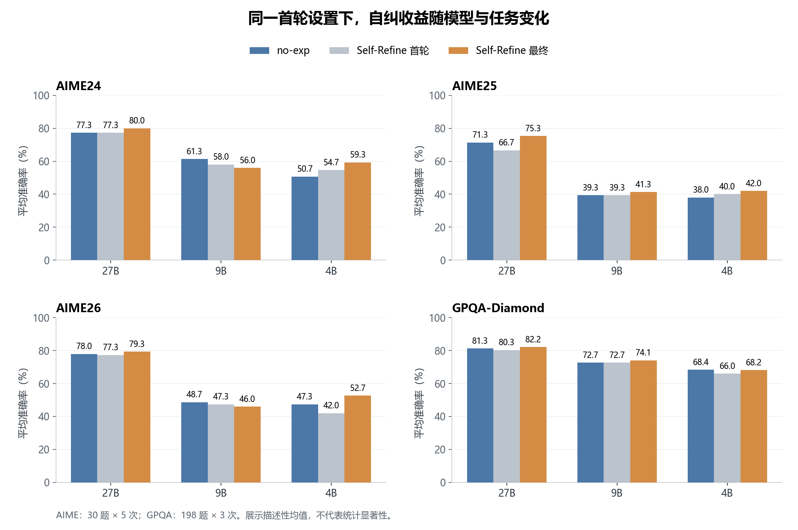

# Short-bench：AIME / GPQA 结果统计与案例分析

**统计口径。** 文中“占失败”均以同一模型、同一方法的失败作答为分母。每条失败作答按最终主要机制归入一类；结果类别和机制比例在同一模型、同一方法内合计为100%。

## 1. AIME：结果与方法比较

### 1.1 总体结果

差值单位为百分点（pp）。

| 模型  | 任务     | no-exp | Self-Refine | Self − no-exp | TRAD   | TRAD − no-exp |
| --- | ------ | ------ | ----------- | ------------- | ------ | ------------- |
| 27B | AIME24 | 77.33% | 80.00%      | +2.67         | 78.00% | +0.67         |
| 27B | AIME25 | 71.33% | 75.33%      | +4.00         | 70.00% | −1.33         |
| 27B | AIME26 | 78.00% | 79.33%      | +1.33         | 76.00% | −2.00         |
| 9B  | AIME24 | 61.33% | 56.00%      | −5.33         | 53.33% | −8.00         |
| 9B  | AIME25 | 39.33% | 41.33%      | +2.00         | 48.67% | +9.33         |
| 9B  | AIME26 | 48.67% | 46.00%      | −2.67         | 50.67% | +2.00         |
| 4B  | AIME24 | 50.67% | 59.33%      | +8.67         | 20.67% | −30.00        |
| 4B  | AIME25 | 38.00% | 42.00%      | +4.00         | 16.67% | −21.33        |
| 4B  | AIME26 | 47.33% | 52.67%      | +5.33         | 14.00% | −33.33        |

#### pass@5 与 best@5

`pass@5` 是同一题五次运行中至少一次答对的题目比例；当前结果文件中的 `best@5` 是五次整轮运行中最高的一轮准确率。下表各单元格为 `pass@5 / best@5`。

| 模型  | 任务     | no-exp          | Self-Refine     | TRAD            |
| --- | ------ | --------------- | --------------- | --------------- |
| 27B | AIME24 | 86.67% / 80.00% | 90.00% / 86.67% | 90.00% / 83.33% |
| 27B | AIME25 | 86.67% / 73.33% | 86.67% / 80.00% | 80.00% / 73.33% |
| 27B | AIME26 | 90.00% / 86.67% | 86.67% / 83.33% | 93.33% / 86.67% |
| 9B  | AIME24 | 83.33% / 66.67% | 76.67% / 63.33% | 76.67% / 60.00% |
| 9B  | AIME25 | 70.00% / 43.33% | 76.67% / 53.33% | 63.33% / 53.33% |
| 9B  | AIME26 | 76.67% / 56.67% | 76.67% / 53.33% | 73.33% / 56.67% |
| 4B  | AIME24 | 73.33% / 53.33% | 83.33% / 63.33% | 63.33% / 26.67% |
| 4B  | AIME25 | 63.33% / 46.67% | 70.00% / 53.33% | 40.00% / 23.33% |
| 4B  | AIME26 | 80.00% / 53.33% | 80.00% / 60.00% | 40.00% / 23.33% |

4B TRAD 的 AIME24 虽有 63.33% 的 pass@5，平均准确率只有 20.67%，说明“某次能完成”与“稳定完成”之间差距很大；AIME25/26 的 pass@5 也降到 40.00%，并非单纯由五次取平均造成低分。

### 1.2 no-exp：数学推理与答案完成错误

no-exp 直接要求模型从题面建立数学模型、推导并提交答案，不提供历史经验，也不安排额外审查。它最能暴露模型在分类计数、几何/代数建模、边界条件和答案格式上的原始弱点；“正常结束”只表示流程结束，不表示推导或答案正确。

答案提取器读取作答中最后一个完整的 `\boxed{...}`。它不要求 AIME 答案一定是0–999整数，也不计算 boxed 内的表达式；只要存在完整 boxed，就视为已经提交答案。提取值与标签一致记为正确，不一致记为“有 boxed 但错误”；没有完整 boxed 才记为“无 boxed 输出”。

| 模型  | 任务   |  正确 | 失败总数 | 有 boxed 但错误 |    占失败 | 无 boxed 输出 |    占失败 |  合计 |
| --- | ---- | --: | ---: | ----------: | -----: | ---------: | -----: | --: |
| 27B | AIME | 340 |  110 |          78 | 70.91% |         32 | 29.09% | 450 |
| 9B  | AIME | 224 |  226 |         129 | 57.08% |         97 | 42.92% | 450 |
| 4B  | AIME | 204 |  246 |         177 | 71.95% |         69 | 28.05% | 450 |

27B 的 AIME 错误仍包含实质性的计数、几何建模和边界判断问题；9B 与 4B 还明显受到完成格式和重复续写影响。因此，低分既不全是“不会算”，也不能把未规范结束的回答直接算作正确。

#### 代表性失败机制与案例

上表已经按失败主因分成“有 boxed 但错误”和“无 boxed 输出”，下表在此基础上给出具体案例。

| 模型  | 案例机制                                    | 任务内容          | 题目主要内容与实际回答                                                                        | 错误所在                                                          |
| --- | --------------------------------------- | ------------- | ---------------------------------------------------------------------------------- | ------------------------------------------------------------- |
| 27B | 计数模型或分类范围错误（有 boxed 但错误：78/110，70.91%）  | 正八边形染色与旋转计数   | 正八边形顶点独立染红或蓝，问是否能旋转使蓝点全部落到原红点处；模型把4个蓝点的有效集合数算成46，最终395，正确答案371                     | 256种染色中有效集合应为115个，其中4蓝点为22个。引用“已知结论”代替实际分类，重复检查加法不能修复计数模型     |
| 27B | 计数模型或分类范围错误（有 boxed 但错误：78/110，70.91%）  | 复合三角函数曲线交点计数  | 两条由绝对值、正弦和余弦复合而成的曲线求交点数，模型直接用16×24得到384，标签为385                                     | 没有证明每组分段的交点数量和特殊情形；该记录能确认计数论证有缺口，但不能单凭末尾回答确定遗漏交点的位置           |
| 27B | 公式建模或系数核对错误（有 boxed 但错误：78/110，70.91%）  | 复数模约束下实部最大值   | 在复数模为4的约束下求实部最大值，模型用396cosθ−324sinθ得到36√202，标签为540                                 | 正确展开的实部是324cosθ−432sinθ，最大值540。根式不仅形式不符，也来自系数展开错误，不能靠修改答案格式补救 |
| 27B | 重复循环与终止失败（无 boxed 输出：32/110，29.09%）     | 相切圆与三角形几何     | 圆内接三角形两顶点的切线交于D，再由AD与圆交于P，求AP最简分数分子分母之和；模型反复猜测弦长公式，单次输出用完16,384 Token，没有最终答案，标签113 | 这属于一次请求内部的重复推导，不是多次调用才会出现循环                                   |
| 9B  | 计数模型或分类范围错误（有 boxed 但错误：129/226，57.08%） | 骰子贴纸覆盖过程条件概率  | 骰子逐次贴上1至6号贴纸，新贴纸覆盖旧贴纸；在偶数贴纸最终可见的条件下，求恰有一个空白面的概率。模型得到11/375、输出386，标签29              | 条件事件与覆盖顺序的计数未被正确建立；末尾检查660÷22500的约分，不能检验这两个计数是否成立             |
| 9B  | 公式建模或系数核对错误（有 boxed 但错误：129/226，57.08%） | 旋转三角形后的六边形面积  | 13、14、15三角形旋转后形成六边形，求面积最近整数；模型在几何推导不一致后采用“假定的标准公式”，得到227，标签156                     | 遇到矛盾时没有回到顶点次序、旋转条件和面积关系，而是以猜测公式收尾                             |
| 9B  | 重复循环与终止失败（无 boxed 输出：97/226，42.92%）     | 条件概率与彩票中奖覆盖计数 | 彩票从10个数中选4个，至少命中2个有奖，求已获奖条件下全中的概率；已得到1/115和116，却持续重复，73次调用后耗尽16,384输出Token，最终无答案   | 正确中间结论没有转化成有效最终答案；重复续写还反复重传长历史                                |
| 9B  | 结构关系判断错误（有 boxed 但错误：129/226，57.08%）    | 相切圆与三角形几何     | 两组相切圆分别为8个半径34的圆、2024个半径1的圆，求三角形内切圆半径对应的分子分母和；模型在 boxed 中输出2929，标签197              | 解析器把2929视为已提交答案；它与标签不一致，因此属于“有 boxed 但错误”，错误根源仍是圆链关系推导        |
| 9B  | 输出格式或协议错误（无 boxed 输出：97/226，42.92%）     | 整除条件下的正整数求和   | 求满足n+2整除3(n+3)(n²+9)的正整数之和，已多次得到49，最后一次请求仅返回`<step>`便截断，结果标记missing_output         | 不是网络没有返回；剩余输出预算极少，返回中没有有效新步骤或最终答案                             |
| 4B  | 计数模型或分类范围错误（有 boxed 但错误：177/246，71.95%） | 数位和为13的回文数计数  | 不含0且数位和13的回文数题，只计3、5、7位，把7位仅计为1种，输出21，标签62                                         | 同时漏掉更长的9、11、13位情况，以及7位内部的其他数位分配                               |
| 4B  | 计数模型或分类范围错误（有 boxed 但错误：177/246，71.95%） | 质因数余数类别计数     | 求17017¹⁷的正因数中除以12余5的数量，再模1000；模型按若干奇偶组合得366，标签244                                  | 后面的乘法和取模虽可顺算，前面的有效余数类别没有正确建立                                  |
| 4B  | 结构关系判断错误（有 boxed 但错误：177/246，71.95%）    | 矩形与共圆条件几何     | 两个矩形及共圆条件求线段CE，模型给出199−√8481并反复怀疑，标签104                                            | 非整数结果不是单纯 boxed 格式问题，而是几何建模或方程选择没有得到验证                        |
| 4B  | 重复循环与终止失败（无 boxed 输出：69/246，28.05%）     | 三角形切线与弦长几何    | 反复写“正确公式也许是……”而没有算完，耗尽16,384输出Token，标签113                                          | 小模型既可能跨请求循环，也可能在一个很长的返回内部循环，二者都会导致没有可提交结果                     |

#### 流程终止状态

| 模型  | 正常结束 | 输出预算耗尽 |
| --- | ---- | ------ |
| 27B | 418  | 32     |
| 9B  | 353  | 97     |
| 4B  | 381  | 69     |

### 1.3 Self-Refine：救回、漏检与误改

Self-Refine 先让模型独立作答，再让一个审查阶段判断初答是否需要修改。它的基本思路是把“检查答案”和“重新推导”分开：审查认为正确就保留，认为错误才重算。这样可能救回漏计或边界错误，也可能误改正确答案，或因审查/修正未完成而丢失原答案。

*图 1：本图只比较 no-exp 与 Self-Refine；独立 no-exp 与 Self-Refine 首轮不能视为同一份初答。*

实验流程是“初答 → 盲审反馈 → 按 Verdict 保留或修正”。反馈不接收标准答案；`CORRECT` 保留初答，`INCORRECT` 才启动修正。反馈无效或修正未完成时，当前结果可能丢失初答；下表最后一列才是对同一批初答的净自纠收益。

| 模型  | 任务     | no-exp | 自身首轮   | 首轮 − no-exp | 最终     | 最终 − 首轮 | 最终 − no-exp |
| --- | ------ | ------ | ------ | ----------- | ------ | ------- | ----------- |
| 27B | AIME24 | 77.33% | 77.33% | 0.00        | 80.00% | +2.67   | +2.67       |
| 27B | AIME25 | 71.33% | 66.67% | −4.67       | 75.33% | +8.67   | +4.00       |
| 27B | AIME26 | 78.00% | 77.33% | −0.67       | 79.33% | +2.00   | +1.33       |
| 9B  | AIME24 | 61.33% | 58.00% | −3.33       | 56.00% | −2.00   | −5.33       |
| 9B  | AIME25 | 39.33% | 39.33% | 0.00        | 41.33% | +2.00   | +2.00       |
| 9B  | AIME26 | 48.67% | 47.33% | −1.33       | 46.00% | −1.33   | −2.67       |
| 4B  | AIME24 | 50.67% | 54.67% | +4.00       | 59.33% | +4.67   | +8.67       |
| 4B  | AIME25 | 38.00% | 40.00% | +2.00       | 42.00% | +2.00   | +4.00       |
| 4B  | AIME26 | 47.33% | 42.00% | −5.33       | 52.67% | +10.67  | +5.33       |

“错”包括答案错误和无可用答案。“对→错”也包含反馈/修正失败后无最终答案，不全是改成另一个错误数值。下表按作答记录配对，满足 `最终正确＝首轮正确＋错→对−对→错`。

| 模型 | 任务 | 对→对 | 错→对（救回） | 对→错（丢失） | 错→错 | 净增正确数 | 错误救回率 | 原正确丢失率 |
| --- | --- | --- | --- | --- | --- | --- | --- | --- |
| 27B | AIME24 | 116 | 4 | 0 | 30 | +4 | 11.76% | 0.00% |
| 27B | AIME25 | 100 | 13 | 0 | 37 | +13 | 26.00% | 0.00% |
| 27B | AIME26 | 116 | 3 | 0 | 31 | +3 | 8.82% | 0.00% |
| 9B | AIME24 | 84 | 0 | 3 | 63 | −3 | 0.00% | 3.45% |
| 9B | AIME25 | 55 | 7 | 4 | 84 | +3 | 7.69% | 6.78% |
| 9B | AIME26 | 67 | 2 | 4 | 77 | −2 | 2.53% | 5.63% |
| 4B | AIME24 | 81 | 8 | 1 | 60 | +7 | 11.76% | 1.22% |
| 4B | AIME25 | 60 | 3 | 0 | 87 | +3 | 3.33% | 0.00% |
| 4B | AIME26 | 63 | 16 | 0 | 71 | +16 | 18.39% | 0.00% |

27B 的 AIME 共救回 20 条、没有丢失正确初答；9B 救回 9 条、丢失 11 条，后处理净损 2 条；4B 救回 27 条、丢失 1 条，净增 26 条。

以**初答答案是否匹配数据集标签**作为核查标准，而不是声称能判定每一步推理是否正确。以下六列把初答正确性与 Verdict 完整交叉；无 Verdict 单独列出。

| 模型 | 任务 | 初对→CORRECT | 初对→INCORRECT | 初对→无判定 | 初错→INCORRECT | 初错→CORRECT | 初错→无判定 |
| --- | --- | --- | --- | --- | --- | --- | --- |
| 27B | AIME | 330 | 2 | 0 | 56 | 43 | 19 |
| 9B | AIME | 188 | 28 | 1 | 94 | 124 | 15 |
| 4B | AIME | 181 | 23 | 1 | 99 | 123 | 23 |

有效判定准确率只在有 CORRECT/INCORRECT 的记录中计算；错误检出率以全部初错记录为分母，包含无 boxed 输出；误报率以全部初对记录为分母。

| 模型 | 任务 | 有效 Verdict / 总数 | 有效判定准确率 | 初错检出率 | 初对误报率 |
| --- | --- | --- | --- | --- | --- |
| 27B | AIME | 431/450 | 89.56% | 47.46% | 0.60% |
| 9B | AIME | 434/450 | 64.98% | 40.34% | 12.90% |
| 4B | AIME | 426/450 | 65.73% | 40.41% | 11.22% |

27B AIME 的初错检出率为 47.46%，明显高于其 GPQA，但仍有 43 条初错被判 CORRECT；9B、4B AIME 还分别把 28、23 条正确初答判成 INCORRECT。判词是否触发修正与修正能否正确结束，需要分开评价。

#### 正确初答如何丢失

| 模型  | 任务      | 初对最终丢失 | 日志分类                        |
| --- | ------- | ------ | --------------------------- |
| 27B | AIME 三年 | 0      | —                           |
| 9B  | AIME 三年 | 11     | 反馈无效 1；修正预算耗尽 9；修正完成但答案改错 1 |
| 4B  | AIME 三年 | 1      | 反馈无有效 Verdict 1             |

这区分了两个改进目标：一是提高审查内容的可靠性；二是让审查或修正的完成失败不自动抹掉一个已有正确答案。这里仅讨论结果所揭示的机制，没有修改实验结果或回填答案。

#### 三个模型的具体案例

| 模型  | 类型                  | 题目主要内容                                        | 初答、审查与最终结果                                                                               |
| --- | ------------------- | --------------------------------------------- | ---------------------------------------------------------------------------------------- |
| 27B | 检出错误，重新建立正确关系       | 三角形两边设置分点，通过反射构造七边形；已知内部四边形面积288，求七边形面积       | 初答错误拼接面积，得到432；反馈指出区域分解不成立，修正按顶点顺序计算向量叉积，得到588，与标签一致。提升来自改变建模方法                          |
| 27B | 把审查自己算出的答案误认为初答已有答案 | 求最小进制b，使两位数数位和等于其平方根的正整数超过10个                 | 初答耗尽预算，没有可提交答案；反馈自己推导出211，却称“初答最终答案正确”，给出CORRECT。程序因此保留无答案的初答，最终仍错。审查会解题，不等于它核对了初答实际提交内容 |
| 9B  | 找到分类遗漏并救回           | 不含0、数位和13的正整数回文数计数                            | 初答42漏掉7位回文数的20种情况；反馈定位遗漏，修正为62，与标签一致                                                     |
| 9B  | 指出推理问题，却将正确答案改错     | 满足1≤a,b,c≤3⁶且a³+b³+c³为3⁷倍数的有序三元组数，求模1000      | 初答735与标签一致；反馈质疑立方剩余计数，修正重算却得245。答案正确与推理每步正确须分开，发现一处问题也不保证重算更可靠                           |
| 9B  | 审查耗尽，正确初答未保留        | 两组相切圆分别为8个半径34的圆、2024个半径1的圆，求三角形内切圆半径对应的分子分母和 | 初答197正确；反馈反复讨论几何关系，用完16,384输出Token仍无Verdict，最终无答案                                        |
| 9B  | 审查判词与自身计算矛盾，修正又未结束  | 坐标轴上单位线段族的包络点，求OC²对应分数的分子分母和                  | 初答23正确；反馈自己也得到OC²=7/16和23，却仍给INCORRECT。修正反复推导星形线包络并耗尽预算，最终无答案。这里既有答案层面的误报，也有后续完成失败       |
| 9B  | 修正最后只返回步骤开头         | 绝对值与三角函数复合曲线的交点数                              | 初答24错误，审查要求重算；修正末次只返回`<step>`后因长度截断，标记refinement_missing_output，最终无答案，标签385              |
| 4B  | 修复边界遗漏              | 不超过100、可写成不同正整数a、b的a+b+ab的整数个数                | 转化为n+1=(a+1)(b+1)后，初答漏掉边界质数101，得71；反馈补计，修正为70，与标签一致                                      |
| 4B  | 审查验证了错误模型           | 骰子依次贴1至6号贴纸，后贴覆盖先贴；已知偶数贴纸都可见，求只剩一空白面的条件概率     | 初答7、标签29；反馈重复初答的可见集合计数，称“reasoning is sound”并判CORRECT，最终保留7。复核约分没有检验原始样本空间               |
| 4B  | 无效审查丢失正确答案          | 圆内接三角形切线与弦长题                                  | 初答113与标签一致，审查未产生有效Verdict，最终无答案。这是4B AIME唯一一条初对最终丢失                                      |

**27B。** 27B 的AIME最终救回20条、没有丢失正确初答，但仍有43条初错被判CORRECT、19条初错没有有效判定。没有误改正确答案，不代表全部错误都能被发现。

**9B。** 9B AIME救回9条，却丢失11条；其中9条是正确初答经过修正后预算耗尽。可见净损失主要来自完成失败，同时也确实存在完成修正后把答案改错的记录。

#### 流程终止状态

| 模型 | 保留初答 | 修正完成 | 反馈无有效 Verdict | 修正预算耗尽 | 修正无有效新输出 |
| --- | --- | --- | --- | --- | --- |
| 27B | 373 | 54 | 19 | 4 | 0 |
| 9B | 312 | 61 | 16 | 60 | 1 |
| 4B | 304 | 101 | 24 | 21 | 0 |

9B 的主要完成风险集中在修正阶段：60 条修正预算耗尽，另有 1 条修正无有效新输出。流程失败会抹掉已有初答，因此不能只看审查是否触发。

### 1.4 TRAD：收益不稳定与任务迁移

TRAD 先从经验库检索与当前题目相似的解题轨迹，再把其中的思路和中间结论提供给模型参考。它希望减少从零推导和重复试错，但相似题不等于同一道题；如果模型照搬专家题的变量、条件或结论，经验就会从提示变成干扰。

| 模型  | no-exp 正确 | no-exp 失败构成 | TRAD 正确 | TRAD失败总数 | TRAD有 boxed 但错误 | 占TRAD失败 | 显式预算耗尽 | 占TRAD失败 |
| --- | --------: | ----------- | ------: | -------: | --------------: | ------: | -----: | ------: |
| 27B |       340 | 78 / 32     |     336 |      114 |              77 |  67.54% |     37 |  32.46% |
| 9B  |       224 | 129 / 97    |     229 |      221 |             187 |  84.62% |     34 |  15.38% |
| 4B  |       204 | 177 / 69    |      77 |      373 |              92 |  24.66% |    281 |  75.34% |

==🟡`no-exp 失败构成`依次为“有 boxed 但错误 / 无 boxed==”。所有比例都以同一模型、同一方法的失败作答数为分母。

“无 boxed 输出”表示最终执行内容中没有任何完整的 `\boxed{...}`；boxed 内即使是分式、根式、越界整数或其他错误内容，也属于“有 boxed 但错误”，不会计入无输出。

#### 为什么 AIME 中 TRAD 没有稳定超过 no-exp？

AIME 并不是三个模型都下降。三年五次作答合并后，27B 正确数由340降至336，9B 由224升至229，4B 则由204降至77。三种变化对应不同机制，不能统一解释为“经验库质量差”。

| 模型  | no-exp→TRAD 的变化                           | 主要原因                                                                               | 解释边界                                                                                          |
| --- | ----------------------------------------- | ---------------------------------------------------------------------------------- | --------------------------------------------------------------------------------------------- |
| 27B | 正确340→336；有 boxed 错答78→77；无 boxed 32→37   | 退化主要表现为无 boxed 增加5条，而不是完整错答增加。检索到相似解法不能替代对当前题约束的验证，错误循环也可能使作答一直不提交 boxed           | 变化较小，不能据此声称27B普遍受到专家经验污染；现有案例只能说明经验没有稳定提供校验作用                                                 |
| 9B  | 正确224→229；有 boxed 错答129→187；无 boxed 97→34 | TRAD 显著减少了未提交答案，但新增的完成答案中很多仍然错误。它提高的是完成率，不一定提高每道题的推理可靠性；少数轨迹还会直接替换成专家问题            | 合并结果净增5条正确，不能写成9B AIME整体低于no-exp。任务迁移案例说明风险存在，但不是总体退化                                         |
| 4B  | 正确204→77；有 boxed 错答177→92；无 boxed 69→281  | 主要问题不是把正确答案改成另一个完整答案，而是 Thought/Action 循环和历史重传消耗完输出预算。较小模型更难在长经验、当前推导和终止格式之间维持稳定状态 | 279条状态为 `token_budget_exhausted`；另2条虽标记 `missing_execution`，最后返回仍因 `length` 截断，属于同一类预算/长度耗尽问题 |

TRAD 的逐步检索还存在自我强化风险：检索依据不仅包含原题，也包含当前 Thought。若第一步已经偏离题目，下一次检索可能匹配到与错误 Thought 更相似的专家片段，形成“错误进度→匹配错误示例→继续错误问题”的闭环。复数最大化案例中，当前题没有变量 (x,y)，模型却沿用专家题的换元与多项式；后续检索继续强化这一错误进度，最终耗尽预算。相反，当检索只提供可复用的分类方法并且模型重新核对当前约束时，经验仍可能减少无答案并带来净提升。

#### 代表性失败机制与案例

一条合理的经验库条目应保留“题目约束—可复用步骤—验证结果”，而不是只保存答案。例如：

> 任务：统计满足数位和约束的回文数。经验：先按位数和回文对称关系分类，再检查首位不能为 0，最后逐类相加并核对边界位数。结果：只有当前题的位数和首位条件一致时才复用，不能直接搬用另一题的总数。

这类条目提供的是分类方法和核对点；具体位数、数值范围和最终答案仍需重新计算。

| 模型 | 案例机制 | 题目与实际过程 | 解释 |
| --- | --- | --- | --- |
| 27B | 分类计数未经证明（有 boxed 但错误：77/114，67.54%） | 3×9网格的每行及每个3×3块都含1至9，求填法总数的质因数加权和；回答直接认定第二块有576种，得到71，标签81 | 经验没有代替当前约束下的分类证明，使用“标准结果”仍可能得到完整错答 |
| 27B | 开区间端点多计（有 boxed 但错误：77/114，67.54%） | 在0<x<2π内求sin(7πsin5x)的零点数n与切点数t，回答n=140、t=10，最终150，标签149 | sin5x=0在该开区间只有9个解，不能按10个计；应得n=139、t=10。这里是可具体定位的边界错误，并非答案未解析 |
| 27B | 概括时丢失使用前提（有 boxed 但错误：77/114，67.54%） | 1、10、25美分硬币的贪心成功次数题，用“少用一枚25美分硬币能改进”推导失败余数后，直接用40×10算失败，得600，标签610 | 少用一枚25美分硬币要求本来至少用了一枚；N<25的10个数被错误纳入失败。正确失败数390、成功数610 |
| 9B | 直接解成专家问题（有 boxed 但错误：187/221，84.62%） | 当前是将1至8排列成能被22整除的八位数，求满足条件的排列数N与2025的差；首个Thought却讨论m!n!=(m+n−3)!及最大的n，随后输出23，当前标签279 | 检索中确实有这道阶乘训练题，题目相似度约0.761。当前数字排列、整除22的条件被整段替换，属于明确的专家任务迁移 |
| 9B | 当前题内的计数仍错误（有 boxed 但错误：187/221，84.62%） | 2×2方格的12条单位边染红/蓝，要求每小格恰有两红两蓝；模型给86，标签82 | 并非每次错误都换了题；保持题目后，内部边组合与外部边乘数的计数仍可能出错 |

**把专家的中间状态当作当前进度（无 boxed 输出：37/114，32.46%；该类具体轨迹）。** 当前题在复数模为4时最大化“(75+117i)z+(96+144i)/z”的实部，标签540。首次Thought却称“已令y=x−11，剩余根满足y⁴−104y²+2504=0”，Action接着求263。这些内容来自检索中的有理方程最大实根训练题，当前题根本没有x、y或该换元。

随后步骤检索又给这段偏离当前题的Thought匹配到几乎1.0相似度的训练片段，形成“错误进度→匹配错误示例→继续错误任务”的循环。最终151次调用、累计输入4,260,839、输出16,384，没有有效最终答案。它同时包含任务迁移、虚构已完成推导与重复生成。

**得出正确数值后仍不结束（无 boxed 输出：37/114，32.46%；该类具体轨迹）。** 求满足n+2整除3(n+3)(n²+9)的正整数之和，首次Action已得n=1、11、37和49（正确），此后反复生成“下一步求和”，188次调用、输入3,027,514、输出16,384后仍无最终boxed。这里知识或算术不足并非唯一原因，终止行为本身已经失败。

**最终执行内容缺失。** 骰子贴纸条件概率题的一条作答反复得到错误的23（标签29），最后Action仅返回`<step>`并因长度截断，标记missing_execution。不能把它说成已完成了一个可提交的执行步骤。

4B三年AIME的281条无 boxed 输出都与输出预算或长度耗尽有关：279条状态为 `token_budget_exhausted`，2条因最后只返回空的 step 标签而记为 `missing_execution`。另外92条作答虽然给出了 boxed，但答案与标签不一致。终止失败是主要数量来源；循环既可以发生在正确结论之后，也可以持续围绕错误问题。

#### 流程终止状态

| 模型 | 正常结束 | 输出预算耗尽 | 无有效执行内容 |
| --- | --- | --- | --- |
| 27B | 413 | 37 | 0 |
| 9B | 416 | 34 | 0 |
| 4B | 169 | 279 | 2 |

4B 的 279 条预算耗尽是低分的主要数量来源，2 条 missing_execution 则在最后没有形成有效执行内容；完整结束的错答仍需与这两类完成失败分开。

#### 经验覆盖

各模型的 AIME 成功入库轨迹为 171 / 114 / 118（27B / 9B / 4B）。4B 还有 2 条采集答对但未成功导出；这一数量不能解释 279 条预算耗尽。

### 1.5 Token 与建库成本

每个单元格为**平均输入 / 平均输出 Token**，先累计单条作答的所有成功请求，再按全部测试作答取均值；Self-Refine 包含初答、反馈、修正三个阶段，TRAD 包含 Thought 与 Action。下表不包含一次性建库消耗或嵌入调用。

| 模型 | 任务 | no-exp 输入 / 输出 | Self-Refine 输入 / 输出 | TRAD 输入 / 输出 | TRAD 输入 / no-exp |
| --- | --- | --- | --- | --- | --- |
| 27B | AIME24 | 2,220.07 / 4,363.89 | 8,777.53 / 7,216.48 | 14,905.98 / 4,862.75 | 6.71× |
| 27B | AIME25 | 2,498.23 / 5,548.41 | 11,569.21 / 8,397.53 | 16,323.70 / 5,283.05 | 6.53× |
| 27B | AIME26 | 2,425.40 / 4,688.91 | 9,294.22 / 7,318.88 | 16,093.89 / 5,370.51 | 6.64× |
| 9B | AIME24 | 54,264.34 / 7,411.87 | 135,567.39 / 13,049.62 | 25,735.59 / 5,293.51 | 0.47× |
| 9B | AIME25 | 68,365.26 / 9,294.69 | 179,825.61 / 15,111.13 | 23,428.47 / 6,242.31 | 0.34× |
| 9B | AIME26 | 63,002.53 / 7,961.25 | 146,832.15 / 13,436.48 | 34,509.91 / 6,499.86 | 0.55× |
| 4B | AIME24 | 12,725.37 / 7,511.55 | 34,516.16 / 10,947.58 | 462,117.00 / 12,593.46 | 36.31× |
| 4B | AIME25 | 16,794.03 / 8,079.23 | 45,887.13 / 12,103.00 | 388,256.15 / 12,792.06 | 23.12× |
| 4B | AIME26 | 12,194.08 / 7,521.36 | 39,161.67 / 11,223.87 | 342,463.91 / 11,697.03 | 28.08× |

#### 长尾调用与历史重传

*图 2：橙色为 Self-Refine 全流程。输入与输出使用不同纵轴刻度；图中没有 TRAD，TRAD 的消耗见上表。*

输入 Token 不是每题只算一次题面，而是每个请求重新发送的完整提示、示例和所需历史的总和。若持续增加历史、又不断重复请求，累计输入可近似随步数呈二次增长；这只是增长机制，不表示每条轨迹都严格满足二次函数。

| 模型 / 方法 / 任务 | 平均调用 | 调用中位数 | 最多调用 | 调用 >10 的条数 | 这些长轨迹占输入比例 |
| --- | --- | --- | --- | --- | --- |
| 27B / no_exp / AIME24 | 2.23 | 2 | 3 | 0/150 | 0.00% |
| 9B / no_exp / AIME24 | 7.45 | 2 | 73 | 21/150 | 93.68% |
| 4B / no_exp / AIME24 | 3.14 | 2 | 49 | 8/150 | 78.15% |
| 4B / trad / AIME24 | 31.17 | 10 | 156 | 74/150 | 95.93% |
| 4B / trad / AIME25 | 27.31 | 9 | 188 | 71/150 | 95.51% |
| 4B / trad / AIME26 | 27.53 | 6 | 131 | 61/150 | 94.40% |

9B no-exp AIME24 仅 14% 的轨迹超过 10 次调用，却使用 93.68% 输入；4B TRAD 三个年份的对应输入占比均超过 94%。所以平均 Token 很高主要不是每道题都进行了高质量长推理，而是少量或大量重复轨迹反复携带长历史。

4B TRAD AIME24 平均输入 462,117，其中 Thought 为 301,658、Action 为 160,459；约 65.28% 的输入来自 Thought 阶段。每步同时发生两次模型请求、示例进入提示、Thought 保留推理历史，再叠加 31.17 次平均调用，构成主要成本来源。27B TRAD AIME24 只有 2.15 次平均调用，输入仍比 no-exp 高 6.71 倍，说明即使没有循环，经验上下文与双阶段请求本身也有成本。

#### Self-Refine 分阶段成本

以下把三个 AIME 年份合并；GPQA 单独统计。各阶段均为每条作答的平均输入 / 输出 Token。

| 模型 | 任务 | 初答 | 反馈 | 修正 |
| --- | --- | --- | --- | --- |
| 27B | AIME | 2,369.08 / 4,992.56 | 5,223.48 / 2,171.41 | 2,287.76 / 480.33 |
| 9B | AIME | 73,117.50 / 8,634.18 | 8,865.25 / 2,559.19 | 72,092.30 / 2,672.37 |
| 4B | AIME | 15,863.50 / 7,741.42 | 7,972.33 / 2,442.57 | 16,019.16 / 1,240.83 |

反馈本身可以长篇生成，修正又需要带入初答和反馈；因此“只多一次审查”不等于只多一次短请求。尤其 9B AIME 的修正阶段存在长尾和预算耗尽，成本上升与准确率下降可以同时发生。

#### 一次性建库成本

| 模型 | 任务 | 训练题数 | 成功入库轨迹 | 建库输入 | 建库输出 |
| --- | --- | --- | --- | --- | --- |
| 27B | AIME | 200 | 171 | 5,457,488 | 717,346 |
| 9B | AIME | 200 | 114 | 30,490,672 | 1,645,465 |
| 4B | AIME | 200 | 118 | 13,019,699 | 1,475,253 |

建库包括轨迹采集与意图标注中成功返回请求的累计用量，不含嵌入。AIME24/25/26 共享同一经验库，不能重复计算三次建库。

## 2. GPQA-Diamond：结果与方法比较

### 2.1 总体结果

差值单位为百分点（pp）。

| 模型 | 任务 | no-exp | Self-Refine | Self − no-exp | TRAD | TRAD − no-exp |
| --- | --- | --- | --- | --- | --- | --- |
| 27B | GPQA-Diamond | 81.31% | 82.15% | +0.84 | 80.47% | −0.84 |
| 9B | GPQA-Diamond | 72.73% | 74.07% | +1.35 | 68.35% | −4.38 |
| 4B | GPQA-Diamond | 68.35% | 68.18% | −0.17 | 57.07% | −11.28 |

#### 分学科结果

三次运行累计 Physics 258 条、Chemistry 279 条、Biology 57 条；对应独立题目分别为 86、93、19 题。All 按题目数加权，不能直接平均三科百分比。

| 模型 | 方法 | Physics | Chemistry | Biology | All |
| --- | --- | --- | --- | --- | --- |
| 27B | no-exp | 91.86% | 72.76% | 75.44% | 81.31% |
| 27B | Self-Refine | 92.25% | 73.84% | 77.19% | 82.15% |
| 27B | TRAD | 94.96% | 69.53% | 68.42% | 80.47% |
| 9B | no-exp | 89.92% | 59.50% | 59.65% | 72.73% |
| 9B | Self-Refine | 92.64% | 59.86% | 59.65% | 74.07% |
| 9B | TRAD | 86.43% | 52.33% | 64.91% | 68.35% |
| 4B | no-exp | 86.82% | 52.69% | 61.40% | 68.35% |
| 4B | Self-Refine | 84.88% | 54.48% | 59.65% | 68.18% |
| 4B | TRAD | 76.74% | 37.99% | 61.40% | 57.07% |

4B TRAD 的 Physics 仍为 76.74%，Chemistry 下降到 37.99%，Biology 为 61.40%；其退化并不是各学科均匀下降。Biology 只有 19 道独立题，百分比跳动较大，不应据此声称模型能力在该科稳定超过更大模型。

### 2.2 no-exp：科学判断与答案完成错误

no-exp 直接根据 GPQA 题干和四个选项完成科学推理并提交答案，不提供历史经验，也不安排额外复核。它检验的是模型把题干条件、物理/化学公式和选项判断连起来的能力；完整输出但选错选项，和没有形成可提交选项，属于不同失败类型。

GPQA 使用同一 boxed 提取规则：只要最后存在完整的 `\boxed{...}`，就视为已经提交答案；提取值与标签一致记为正确，否则记为“有 boxed 但错误”。没有完整 boxed 才记为“无 boxed 输出”。

| 模型 | 任务 | 正确 | 失败总数 | 有 boxed 但错误 | 占失败 | 无 boxed 输出 | 占失败 | 合计 |
| --- | --- | ---: | ---: | ---: | ---: | ---: | ---: | ---: |
| 27B | GPQA | 483 | 111 | 91 | 81.98% | 20 | 18.02% | 594 |
| 9B | GPQA | 432 | 162 | 148 | 91.36% | 14 | 8.64% | 594 |
| 4B | GPQA | 406 | 188 | 150 | 79.79% | 38 | 20.21% | 594 |

三个模型都同时存在完整但错误的 A/B/C/D 与没有提交选项的记录；不能把 GPQA 失分统一归为知识不足。

#### 代表性失败机制与案例

下表按最终结果的主要失败机制展开；有 boxed 的错误归入答案内容错误，无 boxed 的记录归入输出完成失败。

| 模型 | 案例机制 | 任务内容 | 题目主要内容与实际回答 | 错误所在 |
| --- | --- | --- | --- | --- |
| 27B | 题干条件遗漏（有 boxed 但错误：91/111，81.98%） | 恒星温度与能级布居 | 恒星40%表面被黑斑覆盖、整体有效温度由6000 K降至5500 K，要求比较Ti能级布居比；回答直接用6000与5500计算约1.16，选A，标签D约4.5 | 回答把覆盖率当成不需要的背景，未核对局部黑斑温度与整体有效温度的关系，导致计算对象可能被替换 |
| 27B | 选项判断错误（有 boxed 但错误：91/111，81.98%） | 多手性/互变异构分子的对接准备 | 模型选择分析并排序所有结构形式的D，标签是结合初步体外验证的C | 初始立场反复得到语言上的支持，却没有在备选步骤之间按题目要求作出与标签一致的判断；此例不作为外部领域结论的裁决 |
| 27B | 重复循环与终止失败（无 boxed 输出：20/111，18.02%） | 反应线索推断分子点群 | 根据固体A与气体B、D的一系列反应推断产物E的分子点群；回答后段连续数百次重复考虑磷与碘生成PI₃，没有最终答案，标签B（C2v） | 没有用全部反应约束排除候选，重复同一猜想耗尽输出预算。这类失败共20条，应与完整但错误的选项分开 |
| 9B | 参考态或题设假设错误（有 boxed 但错误：148/162，91.36%） | 薛定谔猫态非高斯性 | 模型算出约0.41，却选择“最接近”的0.25，标签为1.38 | 计算值不对应选项时没有充分复核参考高斯态和熵的计算，而以量级接近强行选项 |
| 9B | 公式建模或系数核对错误（有 boxed 但错误：148/162，91.36%） | 多粒子静电能 | 12个带电粒子距中心2 m、另一个固定在中心，求最小总势能；模型凭近似常数得到约7×10⁻²⁷，选D，标签B为2.822×10⁻²⁶ | 中心与外层、外层粒子两两作用应纳入同一总能量；近似结果贴近某选项并不是模型和系数已经正确的证据 |
| 9B | 选项判断错误（有 boxed 但错误：148/162，91.36%） | 多手性/互变异构分子的对接准备 | 对接准备题同样选D而非标签C | 说明答案层面的错误并不总会表现为不流畅或明显矛盾；表达完整仍可能与任务答案不符 |
| 9B | 重复循环与终止失败（无 boxed 输出：14/162，8.64%） | 同位素线索推断试剂和原子质量 | 根据同位素、气体中质子/中子数与加热产物熔点推断试剂X并求原子质量和；模型不断列举液体硝酸盐等候选，没有提交选项，标签B（35） | 没有让多个线索共同收敛，候选列表不断增长。这类未完成共14条，应与标准格式的错答分开 |
| 4B | 参考态或题设假设错误（有 boxed 但错误：150/188，79.79%） | 薛定谔猫态非高斯性 | 把参考高斯态自行假定为真空态，从而认为其熵为0，选择B，标签C为1.38 | 关键参考态由未经论证的假设替代，后续计算因此围绕另一个问题展开 |
| 4B | 选项判断错误（有 boxed 但错误：150/188，79.79%） | 多粒子静电能 | 以某项主要能量的量级推测D最接近，标签B | 没有完成总能量核算就选择数值；这与单纯四则运算失误不同 |
| 4B | 重复循环与终止失败（无 boxed 输出：38/188，20.21%） | 同位素线索推断试剂和原子质量 | 反复猜测X=SiH₄、D（29）以及题目可能来源，却没有提交最终选项，标签B（35） | 既没有验证猜测，也没有结束生成。这类预算耗尽共38条；中间出现选项文本不等于已提交有效答案 |

#### 流程终止状态

| 模型 | 正常结束 | 输出预算耗尽 |
| --- | --- | --- |
| 27B | 574 | 20 |
| 9B | 580 | 14 |
| 4B | 556 | 38 |

每行合计 594 条。正常结束仍可能选择错误选项；预算耗尽表示没有形成可用最终选项。

### 2.3 Self-Refine：漏检与误改

Self-Refine 先完成一次 GPQA 初答，再由审查阶段检查答案和理由，只有判定需要修改时才重算。它的价值在于补查遗漏条件或单位，但审查并不读取标准答案，因此可能漏检、误改，或者在修正阶段耗尽预算而丢掉本来正确的初答。

反馈不接收标准答案；只有相对自身初答的迁移，才能直接衡量自纠收益。

| 模型 | 任务 | no-exp | 自身首轮 | 首轮 − no-exp | 最终 | 最终 − 首轮 |
| --- | --- | --- | --- | --- | --- | --- |
| 27B | GPQA-Diamond | 81.31% | 80.30% | −1.01 | 82.15% | +1.85 |
| 9B | GPQA-Diamond | 72.73% | 72.73% | 0.00 | 74.07% | +1.35 |
| 4B | GPQA-Diamond | 68.35% | 65.99% | −2.36 | 68.18% | +2.19 |

迁移表沿用 AIME 的定义：“错”同时包括答案错误和无可用答案，“对→错”也包含后处理失败；各项仍满足 `最终正确＝首轮正确＋错→对−对→错`。

| 模型 | 任务 | 对→对 | 错→对（救回） | 对→错（丢失） | 错→错 | 净增正确数 | 错误救回率 | 原正确丢失率 |
| --- | --- | --- | --- | --- | --- | --- | --- | --- |
| 27B | GPQA-Diamond | 476 | 12 | 1 | 105 | +11 | 10.26% | 0.21% |
| 9B | GPQA-Diamond | 429 | 11 | 3 | 151 | +8 | 6.79% | 0.69% |
| 4B | GPQA-Diamond | 386 | 19 | 6 | 183 | +13 | 9.41% | 1.53% |

27B、9B、4B 分别救回 12、11、19 条初错，同时丢失 1、3、6 条正确初答；三者相对自身首轮均为净增，但 4B 最终仍比独立 no-exp 少 1 条正确作答，因为自身首轮已少答对 14 条。

Verdict 交叉表沿用 AIME 的标签核查口径：只判断初答答案是否匹配标签，不把它解释为逐步推理正确性。

| 模型 | 任务 | 初对→CORRECT | 初对→INCORRECT | 初对→无判定 | 初错→INCORRECT | 初错→CORRECT | 初错→无判定 |
| --- | --- | --- | --- | --- | --- | --- | --- |
| 27B | GPQA | 476 | 0 | 1 | 19 | 91 | 7 |
| 9B | GPQA | 405 | 27 | 0 | 31 | 126 | 5 |
| 4B | GPQA | 374 | 18 | 0 | 43 | 136 | 23 |

各项分母同 AIME：有效判定准确率只含有效 Verdict，初错检出率包含无 boxed 初答，初对误报率以全部初对为分母。

| 模型 | 任务 | 有效 Verdict / 总数 | 有效判定准确率 | 初错检出率 | 初对误报率 |
| --- | --- | --- | --- | --- | --- |
| 27B | GPQA | 586/594 | 84.47% | 16.24% | 0.00% |
| 9B | GPQA | 589/594 | 74.02% | 19.14% | 6.25% |
| 4B | GPQA | 571/594 | 73.03% | 21.29% | 4.59% |

GPQA 的主要问题是漏检：27B、9B、4B 的初错检出率分别只有 16.24%、19.14%、21.29%。初答本来正确的比例较高会抬高有效判定准确率，不能据此认为审查能可靠发现错误。

#### 正确初答如何丢失

| 模型 | 任务 | 初对最终丢失 | 日志分类 |
| --- | --- | --- | --- |
| 27B | GPQA | 1 | 反馈无有效 Verdict 1 |
| 9B | GPQA | 3 | 修正完成但答案改错 3 |
| 4B | GPQA | 6 | 修正完成但答案改错 5；修正预算耗尽 1 |

GPQA 的正确初答丢失同样来自两类风险：审查内容判断错误，以及审查或修正没有完成；表中未对失败结果做回填。

#### 三个模型的具体案例

| 模型 | 类型 | 题目主要内容 | 初答、审查与最终结果 |
| --- | --- | --- | --- |
| 27B | 核对选项细节后救回 | 多取代苯甲酸的IUPAC命名，取代基包括氰基、醛基、羟基、甲氧基和二甲氨基 | 初答B的结构定位与正确选项D一致，但名称按位次排列，未按取代基字母顺序；反馈指出选项字符串的差别，修正B→D，与标签一致 |
| 27B | 审查无有效结论，丢失正确初答 | 有机反应后判断产物中化学环境不同的氢有几类 | 初答C（4类）与标签一致，反馈却在结构与氢环境计数间反复修改，截断前没有有效Verdict；最终无答案。这是27B唯一一条初对最终丢失 |
| 27B | 初错漏检，原错误直接保留 | 多手性、互变异构分子的对接准备题 | 初答D选择分析并排序结构形式，标签为C所述的初步体外验证；反馈仍认可D并判CORRECT，最终不启动修正。这里核查的是标签匹配，不能把其语言论证当作验证通过 |
| 9B | 更正一个判断维度后救回 | 分别判断氧在碱性溶液中的氧化能力与在酸性溶液中的反应快慢 | 初答C“weaker–faster”，反馈保留第一空、修改第二空，最终A“weaker–slower”，与标签一致。这里描述的是该题答案与反馈变化，不据此推广所有反应条件下的动力学规律 |
| 9B | 错误被审查再次认可 | 多手性、互变异构分子的对接准备题 | 初答D、标签C；反馈继续支持初始立场并给出CORRECT，最终保留D。这是漏检，而非修正阶段的新错误 |
| 9B | 误改正确选项 | 带mRaspberry标记的iPSC注入胚胎后，用TUNEL-FITC观察，问首先会注意到什么 | 初答D“红信号位于细胞质”与标签一致；反馈把“健康细胞预期没有凋亡”作为优先解释，改为A“没有绿色信号”，最终错误。审查重新选择了观察重点，却没有保持与题目标签一致的判断 |
| 4B | 纠正物理量与单位解释 | 根据碳原子化焓与各类键能求给定烃的生成焓 | 初答A把11,200 kJ/mol的键能总和当成生成焓；反馈改用原子化能13,100减键能11,200，得1,900 kJ/mol，再按约166 g/mol换算，修正为D（11.44 kJ/g），与标签一致 |
| 4B | 将正确选项改成错误选项 | 40%黑斑覆盖恒星的Ti能级布居比题 | 初答D（约4.5）与标签一致；反馈质疑计算中的数量级/单位因子，修正为A（约1.1），与标签不符。能确认答案由对变错，不能由此认定初答的每一步推理都正确 |
| 4B | 错误设定没有被检出 | 用相对熵求猫态非高斯性 | 初答B（0）、标签C（1.38）；反馈继续接受“真空参考态”的假设，并猜测题目相位也许本应为0，最终给CORRECT并保留B。它通过改写题目设定使初答显得合理，而没有真正检验给定条件 |

**9B。** 该模型GPQA有3条正确初答在完成修正后变成错答，另有126条初错被判CORRECT。两者分别对应误改风险和漏检风险，不能只用最终平均准确率判断自评是否可靠。

#### 流程终止状态

| 模型 | 保留初答 | 修正完成 | 反馈无有效 Verdict | 修正预算耗尽 |
| --- | --- | --- | --- | --- |
| 27B | 567 | 16 | 8 | 3 |
| 9B | 531 | 56 | 5 | 2 |
| 4B | 510 | 58 | 23 | 3 |

完成的修正仍可能改错答案；反馈无有效 Verdict 或修正预算耗尽则可能直接丢失已有初答。

### 2.4 TRAD：完整错答、任务替换与未提交

TRAD 将相似科学题的成功轨迹检索到当前上下文中，试图复用推理顺序、公式核对方式和答案检查步骤。经验只能提供可迁移的解题结构，不能替换当前题的反应物、物理量或参考态；本节特别区分普通科学推理错误、专家任务迁移和生成未提交。

| 模型 | no-exp 正确 | no-exp 失败构成 | TRAD 正确 | TRAD失败总数 | TRAD有 boxed 但错误 | 占TRAD失败 | TRAD无 boxed | 占TRAD失败 | 显式预算耗尽 | 占TRAD失败 |
| --- | ---: | --- | ---: | ---: | ---: | ---: | ---: | ---: | ---: | ---: |
| 27B | 483 | 91 / 20 | 478 | 116 | 97 | 83.62% | 19 | 16.38% | 19 | 16.38% |
| 9B | 432 | 148 / 14 | 406 | 188 | 163 | 86.70% | 25 | 13.30% | 25 | 13.30% |
| 4B | 406 | 150 / 38 | 339 | 255 | 185 | 72.55% | 70 | 27.45% | 69 | 27.06% |

失败构成顺序和分母沿用 AIME TRAD：依次为“有 boxed 但错误 / 无 boxed”，比例均以同模型、同方法的失败作答为分母。

三个模型的 GPQA TRAD 都低于 no-exp。4B 的退化同时包含有 boxed 错答增加（150→185）与无 boxed 输出增加（38→70），因此不能只归因于没有输出最终选项。27B和9B的无 boxed 输出全部由预算耗尽造成；4B的70条无 boxed 中，69条预算耗尽、1条为 `missing_intent`。

#### 为什么 GPQA 的三个模型都低于 no-exp？

GPQA 的经验迁移比数学题更依赖对象和条件的一致性。两道题即使都属于有机反应、量子物理或分子结构，只要反应物、试剂、参考态或题目所问的判断维度不同，专家题中的局部推理就不能直接复用。TRAD 增加的上下文容易使模型先围绕相似专家题建立解释，再用这一解释选择当前选项；GPQA 又只有最终选项的0/1得分，局部分析正确但整体对象不匹配仍记为错误。

| 模型 | no-exp→TRAD 的变化 | 退化主要来自哪里 | 说明 |
| --- | --- | --- | --- |
| 27B | 正确483→478；有 boxed 错答91→97；无 boxed 20→19 | 未提交没有增加，主要是完整错答多6条。说明较大模型通常能结束生成，但经验没有稳定校正结构和选项判断，有时只让错误解释更完整 | 下降5条较小，不能全部归因于专家题替换；NOESY案例属于当前题内的普通结构判断错误 |
| 9B | 正确432→406；有 boxed 错答148→163；无 boxed 14→25 | 完整错答和未提交同时增加。既有把专家题的两个醇与HBr反应替换到当前THF/KH/H⁺题中的明确迁移，也有只识别反式耦合却选错完整碳链的普通推理错误 | 专家问题替换是已确认机制之一，但26条净减少不是26条都发生了任务替换 |
| 4B | 正确406→339；有 boxed 错答150→185；无 boxed 38→70 | 有 boxed 错答增加35条、无 boxed增加32条；69/594条耗尽预算。较长的经验上下文和Thought/Action循环既降低终止可靠性，也增加了围绕错误候选持续推理的机会 | 退化同时来自推理污染和完成失败，不能只用“没输出选项”解释67条正确数下降 |

因此，GPQA 的共同下降并不意味着三种模型遭遇完全相同的问题。27B主要是经验未能改善最终判断，9B同时出现明确任务迁移和未提交增加，4B则叠加了更严重的完整错答与预算耗尽。要验证“检索经验本身”在下降中占多大比例，还需要固定同一初始回答和随机种子，对比“无检索、只检索不展示专家答案、展示完整专家轨迹”等消融；当前结果只能支持上述机制与退化一致，不能给出严格因果比例。

#### 代表性失败机制与案例

一条合理的 GPQA 经验库条目可以写成：

> 任务：由原子化焓和键能求生成焓。经验：先按题目给出的物质式逐一核对键数，再用原子化能减去总键能，最后确认题目要求的是 kJ/mol 还是 kJ/g。结果：单位和化学计量关系都核对后再选择选项。

可复用的是“列式—核对系数—核对单位”的步骤，不是某道题的数值或物质名称。

| 模型 | 案例机制 | 任务内容 | 题目与实际过程 | 解释 |
| --- | --- | --- | --- | --- |
| 27B | 结构关系判断错误（有 boxed 但错误：97/116，83.62%） | 有机反应产物的 NOESY 空间关系 | 完成回答选择B，标签A | 已按当前反应讨论结构，但产物空间关系与峰的判断仍不匹配；格式正常也会答错 |
| 27B | 重复循环与终止失败（无 boxed 输出：19/116，16.38%） | EMS 诱变大麦的基因序列推断 | 围绕不同缺失、移码解释不断比较，最终耗尽预算，没有选项，标签C | 检索后仍未让当前序列约束收敛，经验上下文不能保证结束生成 |
| 9B | 专家经验迁移错误（有 boxed 但错误：163/188，86.70%） | THF/KH/H⁺与乙酰溴/LDA反应条件判断 | 当前题列出这些反应条件；首个 Thought 转而分析两个醇与 HBr 的反应，最后A，标签B | 第二个检索专家问题正是“两个醇与 HBr”，相似度约0.765。当前反应物与试剂被替换，是可由题面和检索内容直接核对的误用 |
| 9B | 结构关系判断错误（有 boxed 但错误：163/188，86.70%） | NMR 谱图与烯烃结构判断 | 用约16 Hz耦合认出反式烯烃，却选成 trans-butenyl，而标签对应 trans-propenyl | 顺反信息正确并不足够，碳链长度、积分和全部谱峰也必须匹配；局部正确不能替代整体结构核对 |

**重复比较且未提交（无 boxed 输出：19/116，16.38%；27B该类具体轨迹）。** 稀释醋酸再用NaOH滴定，求滴定25%与等当点的pH；后期多次写出与标签A对应的4.26、8.52，却不提交选项。最终151次调用、输入1,985,491、输出16,384后失败。中间物质的量计算还存在不一致，因此这里只按“未提交”计入无 boxed 类别。

**最后意图内容缺失（无 boxed 输出：70/255，27.45%；4B该类具体轨迹）。** 根据算符P的矩阵与给定量子态求不确定度，前面执行已得到与标签C一致的ℏ/√2，但未最终提交；最后Thought只返回步骤开头并截断，标记missing_intent。该记录按无 boxed 输出计入失败。

GPQA的退化还包含185条有 boxed 错答，较no-exp增加35条；因此“全部是没写 boxed”不成立。只有将普通科学推理错误、专家任务/状态误用与生成完成失败分开，才能解释其准确率和成本。

#### 流程终止状态

| 模型 | 正常结束 | 输出预算耗尽 | 无有效意图内容 |
| --- | --- | --- | --- |
| 27B | 575 | 19 | 0 |
| 9B | 569 | 25 | 0 |
| 4B | 524 | 69 | 1 |

4B 有1条 `missing_intent`，最后没有形成有效意图内容；其余退化还包括185条有 boxed 错答，说明完成失败不是唯一来源。

#### 经验覆盖

各模型的 GPQA 成功入库轨迹为 144 / 128 / 116（27B / 9B / 4B）。4B 有 1 条采集答对但未成功导出；这一条不能解释整体准确率下降。

### 2.5 Token 与建库成本

Token 统计口径同 AIME：单元格为平均输入 / 平均输出，Self-Refine 包含三个阶段，TRAD 包含 Thought 与 Action，不含建库和嵌入。

| 模型 | 任务 | no-exp 输入 / 输出 | Self-Refine 输入 / 输出 | TRAD 输入 / 输出 | TRAD 输入 / no-exp |
| --- | --- | --- | --- | --- | --- |
| 27B | GPQA-Diamond | 1,091.26 / 2,368.66 | 4,434.47 / 3,916.36 | 9,286.89 / 3,285.24 | 8.51× |
| 9B | GPQA-Diamond | 1,193.87 / 3,135.23 | 8,480.50 / 4,491.62 | 15,760.79 / 3,170.68 | 13.20× |
| 4B | GPQA-Diamond | 1,743.43 / 3,198.71 | 8,886.38 / 5,111.22 | 64,979.03 / 4,216.57 | 37.27× |

GPQA 上 TRAD 的输入放大在 27B、9B、4B 分别为 8.51×、13.20×、37.27×；成本增长需要与准确率下降和完成状态一起解释。

#### Self-Refine 分阶段成本

| 模型 | 任务 | 初答 | 反馈 | 修正 |
| --- | --- | --- | --- | --- |
| 27B | GPQA | 1,114.31 / 2,325.62 | 2,640.43 / 1,474.97 | 679.74 / 115.77 |
| 9B | GPQA | 1,154.06 / 3,158.98 | 3,473.95 / 1,129.35 | 3,852.49 / 203.30 |
| 4B | GPQA | 1,529.38 / 3,087.85 | 3,402.64 / 1,819.40 | 3,954.36 / 203.97 |

GPQA 的反馈和修正也会重传初答与反馈上下文，因此额外审查不是一次固定长度的短请求。

#### 一次性建库成本

| 模型 | 任务 | 训练题数 | 成功入库轨迹 | 建库输入 | 建库输出 |
| --- | --- | --- | --- | --- | --- |
| 27B | GPQA | 200 | 144 | 2,045,835 | 475,255 |
| 9B | GPQA | 200 | 128 | 1,886,016 | 628,641 |
| 4B | GPQA | 200 | 116 | 1,901,937 | 706,694 |

建库包括轨迹采集与意图标注中成功返回请求的累计用量，不含嵌入。在线执行成本与一次性建库成本应分别报告。

## 3. 跨任务结论与边界

1. **AIME：** TRAD 并非三个模型都下降：27B合并三年少4条正确，9B多5条，4B少127条。27B主要增加5条无 boxed 输出，9B减少63条无 boxed、但增加58条有 boxed 错答；4B则以279条预算耗尽为主要数量来源。经验是否有效取决于模型能否把可复用方法与当前题的变量、约束和中间状态分开。

2. **GPQA：** no-exp 的完整错答与未提交选项并存。Self-Refine 的核心限制是初错漏检，TRAD 还会把专家反应物或问题结构带入当前题；三个模型的 TRAD 均低于 no-exp。

3. **成本：** 平均 Token 由完整提示、历史重传、Self-Refine 多阶段请求和 TRAD 的 Thought / Action 双阶段共同决定。少量长轨迹可以主导均值，不能把高输入直接等同于更充分的有效推理。

4. AIME 每年只有 30 道独立题，五次作答相关；GPQA 也重复同一题目。本文提供描述性统计和人工核查案例，不把重复作答当成独立样本做显著性结论，也不声称获得了全部错误原因的互斥分类。
