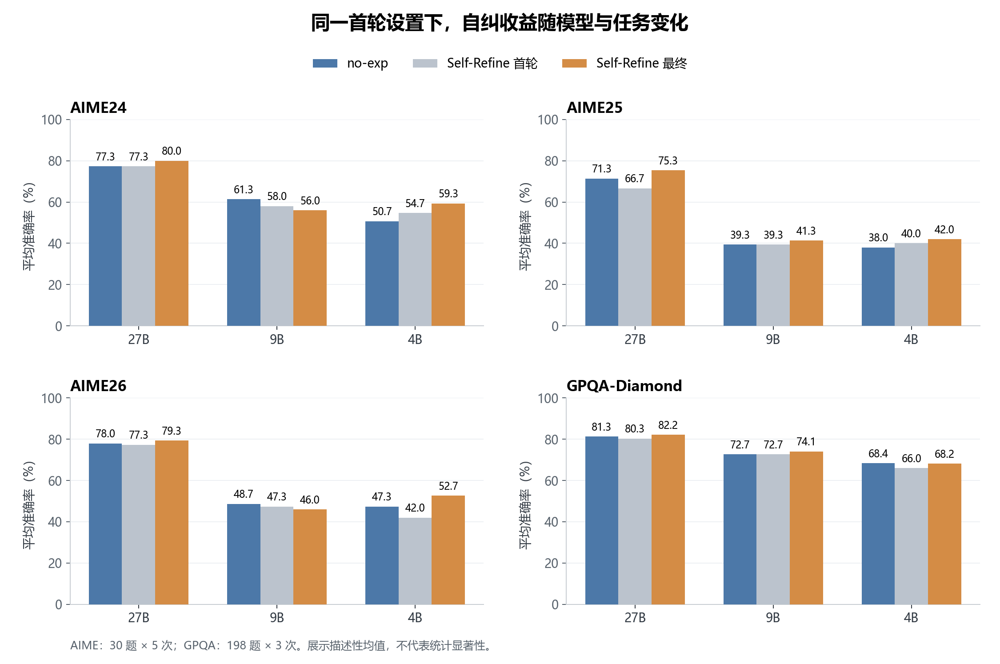
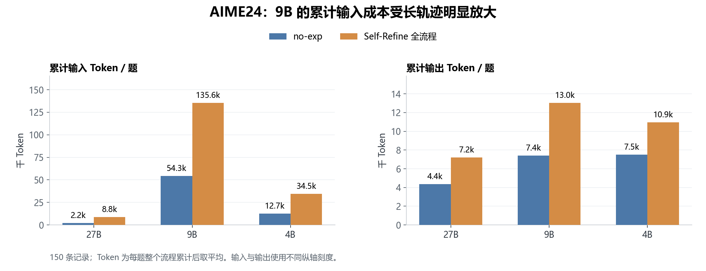

# Step：AIME / GPQA 复现结果分析

> Qwen3.5-27B / 9B / 4B，关闭 thinking。AIME 每年 30 题 × 5 次；GPQA-Diamond 198 题 × 3 次。表中准确率均为多次运行的平均值，差值单位为百分点。

## 1. 整体结果

| 模型  | 数据集    | no-exp | Self-Refine 首轮 | 首轮 − no-exp | Self-Refine 最终 | 最终 − 首轮 |
| --- | ------ | -----: | -------------: | ----------: | -------------: | ------: |
| 27B | AIME24 | 77.33% |         77.33% |        0.00 |         80.00% |   +2.67 |
| 27B | AIME25 | 71.33% |         66.67% |       −4.67 |         75.33% |   +8.67 |
| 27B | AIME26 | 78.00% |         77.33% |       −0.67 |         79.33% |   +2.00 |
| 27B | GPQA   | 81.31% |         80.30% |       −1.01 |         82.15% |   +1.85 |
| 9B  | AIME24 | 61.33% |         58.00% |       −3.33 |         56.00% |   −2.00 |
| 9B  | AIME25 | 39.33% |         39.33% |        0.00 |         41.33% |   +2.00 |
| 9B  | AIME26 | 48.67% |         47.33% |       −1.33 |         46.00% |   −1.33 |
| 9B  | GPQA   | 72.73% |         72.73% |        0.00 |         74.07% |   +1.35 |
| 4B  | AIME24 | 50.67% |         54.67% |       +4.00 |         59.33% |   +4.67 |
| 4B  | AIME25 | 38.00% |         40.00% |       +2.00 |         42.00% |   +2.00 |
| 4B  | AIME26 | 47.33% |         42.00% |       −5.33 |         52.67% |  +10.67 |
| 4B  | GPQA   | 68.35% |         65.99% |       −2.36 |         68.18% |   +2.19 |

- **27B：** 最终平均准确率在四个任务上均高于 no-exp；自纠相对自身首轮均有净收益。
- **9B：** AIME24、AIME26 退化；AIME25、GPQA 提升。合并三个年份的 AIME 运行记录后，no-exp 为 224/450（49.78%），Self-Refine 为 215/450（47.78%）。
- **4B：** 三个 AIME 均提升。GPQA 虽略低于 no-exp，但自纠本身将正确数从 392 提高到 405；与 no-exp 的差距主要来自首轮偏低。

## 2. 27B Token 少、9B Token 多：长尾循环放大历史输入

下表为 **AIME24 no-exp** 的结果。Token 消耗先按每条轨迹累计，再对全部运行记录取平均。

| 模型  | 平均调用次数 | 调用次数中位数 | 最大调用次数 | 平均输入 Token | 平均输出 Token |
| --- | -----: | ------: | -----: | ---------: | ---------: |
| 27B |   2.23 |       2 |      3 |      2,220 |      4,364 |
| 9B  |   7.45 |       2 |     73 |     54,264 |      7,412 |
| 4B  |   3.14 |       2 |     49 |     12,725 |      7,512 |

**9B 的问题集中在少数长轨迹。** 超过 10 次调用的仅 21/150 条（14%），却消耗了 93.68% 的输入 Token。每次请求都会重新传入完整历史，因此重复续写会不断增加累计输入。4B 也存在此问题：8 条超过 10 次调用的轨迹消耗了 78.15% 的输入 Token；27B AIME24 无此类长轨迹。

**原始案例：9B / no-exp / AIME24 / run_05 / ID 69。** 第 2 次返回已算出正确答案 116，但未输出规定的 `\boxed{116}`；随后反复重复同一结论，最终累计调用 73 次、耗尽 16,384 个输出 Token，累计输入 646,927 个 Token，仍被记为无答案。高消耗同时包含重复生成和结束格式失败，不能全部解释为有效推理。

“调用次数”对应程序记录的 step；一次返回内部可能包含多步推导，甚至多个 `<step>` 标签。27B AIME24 最多 3 次调用就结束，其中仍有 20 条答错、14 条无答案；AIME25、AIME26 最多为 4 次。它不代表每题只需三个实际推理步骤就能答对。

## 3. 9B 的 Self-Refine 在部分任务上为何退化？

| 数据集    | no-exp 正确数 | 首轮正确数 | 自纠救回 |         初答正确但最终丢失 | 最终正确数 |
| ------ | ---------: | ----: | ---: | ----------------: | ----: |
| AIME24 |         92 |    87 |    0 | 3：反馈无效 1、修正预算耗尽 2 |    84 |
| AIME25 |         59 |    59 |    7 |   4：改错 1、修正预算耗尽 3 |    62 |
| AIME26 |         73 |    71 |    2 |        4：修正预算耗尽 4 |    69 |
| GPQA   |        432 |   432 |   11 |            3：改错 3 |   440 |

合并三个年份的 AIME 结果后，退化可分为两部分：**首轮合计比 no-exp 少答对 7 条；后续自纠救回 9 条、丢失 11 条，再净损 2 条。** 丢失的 11 条中，9 条因修正阶段耗尽预算而未得到最终答案，1 条因反馈无效而丢失初答，另有 1 条被改成了明确错误的答案。

当前流程在无法从反馈中提取有效的 `Verdict` 时，不保留初答；判为 `INCORRECT` 后，修正失败也不会回退到初答。9B 的重复续写和结束失败因此会把已正确的答案变成无答案。修正阶段的每次请求还会重新带入初答、反馈和已有修正历史，进一步增加输入成本。GPQA 中救回数大于改错数，因此仍有净收益。

自评估是否正确
是否未改对

## 4. 错误分布与反馈判定

“标准答案形式”指 AIME 的 0–999 整数或 GPQA 的 A/B/C/D；未提取到答案、越界数、分式/根式、占位符及空 boxed 归入“无标准答案”。

| 模型 | 数据集 | 方法 | 答案正确 | 标准格式但答错 | 无标准答案 | 合计 |
| --- | --- | --- | ---: | ---: | ---: | ---: |
| 27B | AIME24–26 | no-exp | 340 | 68 | 42 | 450 |
| 27B | AIME24–26 | Self-Refine | 352 | 67 | 31 | 450 |
| 27B | GPQA | no-exp | 483 | 91 | 20 | 594 |
| 27B | GPQA | Self-Refine | 488 | 94 | 12 | 594 |
| 9B | AIME24–26 | no-exp | 224 | 116 | 110 | 450 |
| 9B | AIME24–26 | Self-Refine | 215 | 81 | 154 | 450 |
| 9B | GPQA | no-exp | 432 | 148 | 14 | 594 |
| 9B | GPQA | Self-Refine | 440 | 146 | 8 | 594 |
| 4B | AIME24–26 | no-exp | 204 | 150 | 96 | 450 |
| 4B | AIME24–26 | Self-Refine | 231 | 136 | 83 | 450 |
| 4B | GPQA | no-exp | 406 | 150 | 38 | 594 |
| 4B | GPQA | Self-Refine | 405 | 160 | 29 | 594 |

**9B 的 AIME 退化主要伴随未完成或非标准输出增加：** 标准格式的错误答案从 116 条降至 81 条，但无标准答案从 110 条增至 154 条。这 154 条中，123 条是生成阶段耗尽预算，16 条反馈无效，13 条输出了非标准 boxed 内容，2 条因空输出或空步骤终止。其中也包括初答未完成、反馈却判为正确而直接保留的情况。

下表检查 Self-Refine 的 **3,132 条初答**与反馈结论。括号为该行被判 `INCORRECT` 的比例。反馈针对整份初答，日志没有独立的“首错步”标注，因此不能据此统计首错落在第几步。

| 被审查的初答结果      | 判为 INCORRECT | 判为 CORRECT | 无有效 Verdict |   合计 |
| ------------- | -----------: | ---------: | ----------: | ---: |
| 初答答案正确        |     98（4.8%） |       1954 |           3 | 2055 |
| 初答为标准格式，但答案错误 |   216（28.9%） |        528 |           4 |  748 |
| 初答无标准答案       |   126（38.3%） |        115 |          88 |  329 |
| 合计            |   440（14.0%） |       2597 |          95 | 3132 |

## 5. Self-Refine 怎样修正？真实案例

模型先生成完整初答，再针对题目和初答生成审查反馈；反馈不接收标准答案。`CORRECT` 会保留初答；`INCORRECT` 会启动修正。修正阶段把“题目、完整初答、反馈、已有修正历史”作为输入，逐步重新生成一份完整解答，以新的 boxed 答案作为最终结果。反馈无效或修正未完成时，当前实现不会回退到初答。

| 情况 | 日志位置 | 初答与反馈发现 | 后续结果 |
| --- | --- | --- | --- |
| 换方法修正几何分解 | 27B / AIME25 / run_01 / ID 2 | 初答用错误的面积加减关系算出 432；反馈指出多边形区域分解不成立，改用向量叉积核算 | 修正按顶点顺序累加有向面积，得到 **588（正确）** |
| 补回遗漏情况 | 9B / AIME26 / run_01 / ID 2 | 初答把 7 位回文数的数位和写成偶数长度的形式，漏算该类 20 个数，得到 42；反馈定位到这一遗漏 | 补算 7 位情况，合计 **62（正确）** |
| 修正边界漏计 | 4B / AIME26 / run_01 / ID 4 | 初答在区间 [2,101] 只计了 25 个质数，漏掉 101，得到 71；反馈要求补计边界质数 | 改为排除 26 个质数和 4 个质数平方，得到 **70（正确）** |
| 指出问题后仍重算错误 | 9B / AIME25 / run_02 / ID 15 | 初答余数为 735；反馈指出其立方剩余计数推导存在问题，但修正阶段又发生计数错误 | 新答案为 **245（错误）**；独立按立方余数分布计数得 N=885735，余数应为 735 |
| 反馈未完成，丢失正确初答 | 9B / AIME24 / run_01 / ID 73 | 初答为 197（正确）；反馈反复讨论几何关系，输出至 16,384 Token 被截断，没有有效 Verdict | 未进入修正，最终记为无答案 |
| 未发现错误，直接保留 | 9B / GPQA / run_01 / ID 16 | 初答选 D，数据集答案为 C；反馈认为初答推理成立，给出 CORRECT | 保留 D，最终仍答错 |

